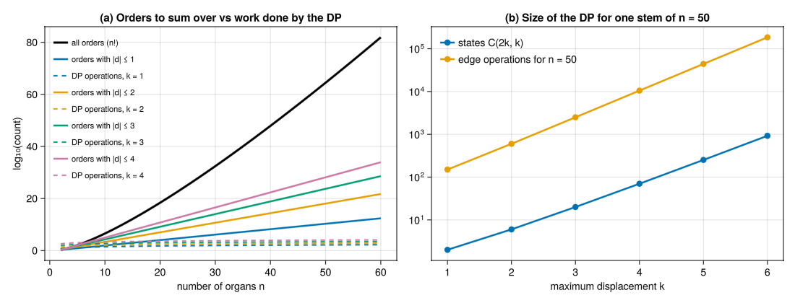
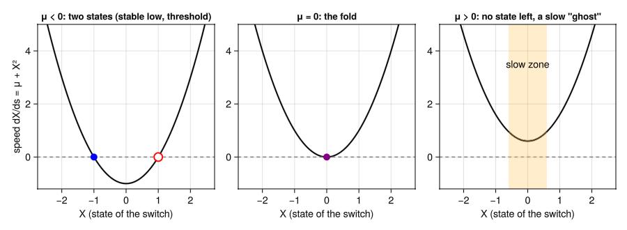
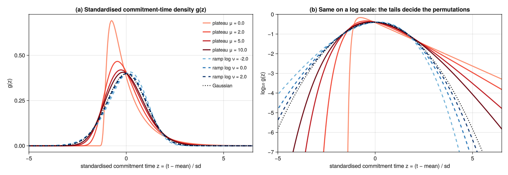
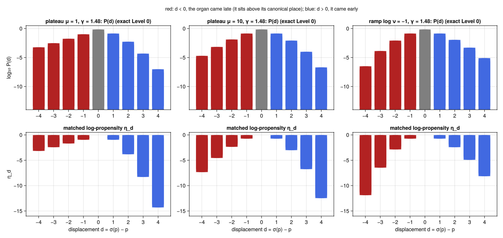
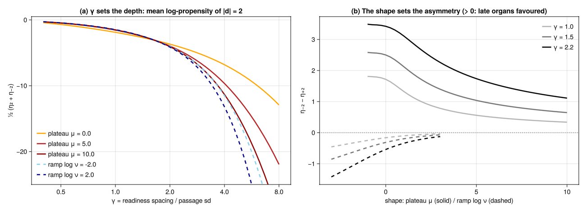
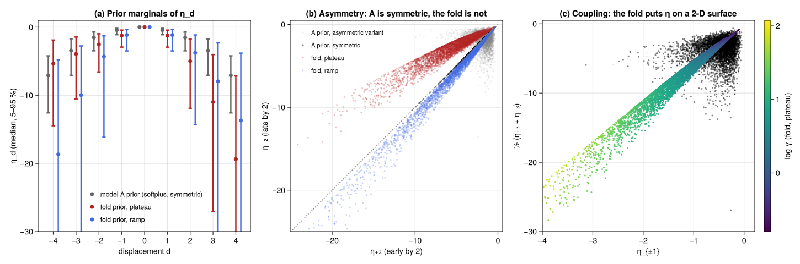
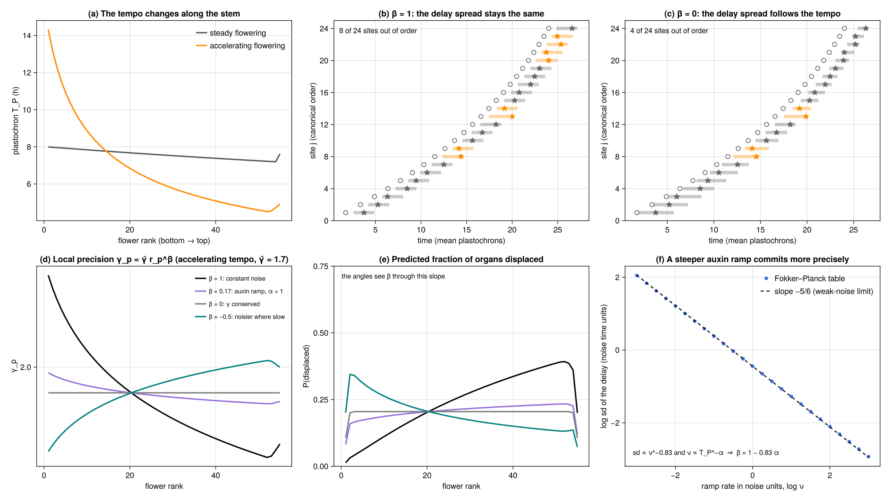

# The order of organs along a stem: method

This document describes the models of `PhyllotaxisFold.jl`, from the biological assumptions to the equations and the
code. It is written for readers with different backgrounds. Every section starts with the biology and ends with the
code, so you can stop at the level you need:

| marker | what it contains |
|---|---|
| **Biology** | the assumption in words, and what follows from it for the plant |
| **Statement** | the precise mathematical object or result |
| **Derivation** | why the statement is true, step by step |
| **Code** | the functions that implement it |

Each modelling statement carries a status: **[A]** a mathematical consequence of the stated assumptions; **[B]** an
assumption, i.e. a modelling choice that could be wrong; **[C]** a numerical result (on simulated data in this
document).

**Contents.** 1 The question and the data · 2 Angles given an order · 3 Summing over all orders · 4 Model A: free
propensities · 5 Model B: a commitment switch near its fold · 6 A tempo that changes along the stem · 7 Inference ·
8 Assumptions and limits · Notation · References.

---

## 1. The question and the data

**Biology.** Phyllotaxis, the arrangement of organs around a stem, is self-organised at the shoot apical meristem: each
new organ (primordium) is initiated where the auxin field, shaped by the older primordia, allows it (Reinhardt et al.
2003; Shi & Vernoux 2019). In *Arabidopsis* the inflorescence stem keeps the record: flowers, then fruits, follow a
spiral whose divergence angle is close to the golden angle (137.5°). The order is often disturbed: two organs initiated
close in time can end up inverted along the stem, a *permutation* (Besnard et al. 2014; Refahi et al. 2016). Positions
on the spiral are robust; the timing is not. Permutations are therefore a readout of the **timing noise of organ
initiation**. This package asks what that noise tells us about the mechanism that commits a group of cells to become an
organ.

**Data.** For each stem, bottom to top (positions $p = 1, \dots, n$):

| measurement | symbol | used for |
|---|---|---|
| absolute azimuth of each organ (radians) | $y_p$ | the likelihood (all models) |
| internode lengths (mm), optional | $\ell_p$ | the coordinate of the stem twist (§2) |
| daily counts of open flowers, optional | $c(\text{day})$ | the plastochron along the stem (§6) |

The models use absolute azimuths rather than divergence angles $y_{p+1} - y_p$, so that a single misplaced organ
changes one observation instead of two.

**Three models.** They share the angle model and the algorithm, and differ only in the law of the order:

| model | constructor | law of the order | timing parameters |
|---|---|---|---|
| A | `PhyllotaxisModelAD` | a free cost $\eta_d$ for each displacement $d$ (§4) | $\eta_1, \dots, \eta_k$ |
| B | `FoldModel` | costs derived from a commitment switch near its fold, with sites made ready at a regular pace (§5) | shape, $\gamma$ |
| B with tempo | `FoldModel(...; tempo = r)` | as B, with a precision that follows the pace along the stem (§6) | shape, $\gamma$, $\beta$ |

---

## 2. Angles given an order

**Biology.** If organs appeared in perfect spiral order, the organ at stem position $p$ would sit at the angle of the
$p$-th site of the spiral. A permutation does not move the sites; it changes which site's organ ends up at position $p$.
The model therefore separates *where* the sites are (a regular spiral) from *in which order* their organs appear.

**Statement [B].** Site $j = 1, 2, \dots$ (its rank along the spiral, the *canonical* order) sits at the angle
$\phi + o\,(j - 1)\,\psi$, where $\psi$ is the divergence (golden, $\approx 137.5^\circ$, with probability $\alpha$, or
Lucas, $\approx 99.5^\circ$), $o = \pm 1$ the orientation of the spiral and $\phi$ the angle of the first site
(uniform). The order is a permutation $\sigma$: the organ at position $p$ comes from site $\sigma(p)$, and its
*displacement* is $d_p = \sigma(p) - p$. A negative displacement means that the organ sits above its canonical place:
its site committed late. Given $\sigma$, the angles are independent von Mises variables (the circular analogue of a
Gaussian),

$$
y_p \sim \mathrm{vM}\big(\phi+o\,(\sigma(p)-1)\,\psi+\omega_s x_p,\ \kappa_s\big),\qquad
\mathrm{vM}(y\mid m,\kappa)=\frac{e^{\kappa\cos(y-m)}}{2\pi I_0(\kappa)} .
$$

- **Angular precision.** $\kappa_s$ is specific to each stem, $\log\kappa_s \sim \mathcal N(\log\mu_\kappa, \sigma_\kappa^2)$:
  a poorly measured stem gets a small $\kappa$ instead of being explained by many permutations.
- **Stem twist.** A stem can twist as it elongates. If its surface is twisted by a small angle $\alpha_s$ on a radius
  $r_s$, an internode of length $\ell$ rotates everything above it by $\ell\tan\alpha_s / r_s$ (Landrein et al. 2013).
  The organ at position $p$ is then rotated by $\omega_s x_p$, with $x_p$ the stem length below it
  (`torsion_coordinate(ℓ)`; by default $x_p = p - 1$) and one rate $\omega_s$ per stem. The rates are a random effect,
  $\omega_s \sim \mathcal N(m_\omega, s_\omega^2)$, integrated out (§7). A twist rotates the organs with the same
  handedness for both spiral orientations, which separates it from a change of divergence.
- **Outlier angles (option).** With `outlier = true` (both models), each angle is drawn from the von Mises of its site
  with probability $1 - \pi_o$ and uniformly on the circle otherwise:
  $y_p \sim (1-\pi_o)\,\mathrm{vM}(\cdot) + \pi_o/(2\pi)$, with $\pi_o$ fitted (prior Beta(1, 49), mean 2 %). A badly
  measured angle (or an organ that is not where the site model puts it) is then explained as an outlier instead of a
  long displacement. The mixture enters the edge weights of §3 only, so the sum over orders is unchanged.

**The likelihood of one stem** sums over everything that is not observed:

$$
p(y)=\sum_{o,\psi}p(o)\,p(\psi)\int\!\frac{d\phi}{2\pi}\int\!p(\kappa)\,d\kappa\ \sum_{\sigma}P(\sigma)\prod_{p=1}^{n}\mathrm{vM}\big(y_p\mid\phi+o(\sigma(p)-1)\psi+\omega x_p,\kappa\big).
$$

What distinguishes the models is $P(\sigma)$, the law of the order.

**Code.** `AngleLikelihood.stem_loglik!`. The sum over $(o, \psi)$ is exact; $\phi$ uses `ngrid_ϕ` equally spaced
nodes and $\log\kappa$ `ngrid_κ` Gauss–Hermite nodes (32 × 16 by default). The rectangle rule is very accurate for
$\phi$ because the integrand is periodic and smooth; the error falls like the Bessel ratio $I_{N}(\kappa n)/I_0(\kappa n)$
with $N$ nodes. The sum over $\sigma$ is §3.

---

## 3. Summing over all orders

This is the key technical idea: it makes the exact likelihood computable in milliseconds, which in turn allows exact
gradients, Newton's method and confidence intervals.

### 3.1 The problem and the band

**Biology.** We do not know the order of a stem, so every order compatible with the angles must be weighed. A stem of 50
organs has $50! \approx 3 \times 10^{64}$ orders. But an organ is never found far from its canonical place, so we
impose **[B]** $|\sigma(p) - p| \le k$ ($k = 4$; the posterior mass at $|d| = k$ checks that this is enough).

**Statement.** In every model the law of the order and the angles factorise over positions, so the sum over orders is
the *permanent* of a banded matrix $W$ (a determinant without the signs):

$$
\sum_\sigma P(\sigma)\prod_p p(y_p\mid\sigma(p))\ \propto\ \sum_{\sigma}\prod_{p=1}^{n}W_{p,\sigma(p)}=\operatorname{perm}(W),
\qquad W_{p,j}=0\ \text{if}\ |j-p|>k .
$$

A general permanent is #P-hard (Valiant 1979), and the band alone does not help enough: a 50-organ stem still has about
$10^{28}$ banded orders. What helps is the structure the band creates.

### 3.2 A sliding window is all the memory needed

**Biology.** Read the stem from the bottom and give each position a site. When you reach position $i$, the choices
already made matter for the rest of the stem only through *which sites they have used*. Because no organ moves by more
than $k$, every site far below $i$ is necessarily used, and every site far above is necessarily free: only a window of
$2k$ sites around $i$ can be undecided.

**Statement [A] (window lemma).** For $\sigma$ in the band, with the $k$ virtual sites $1 - k, \dots, 0$ counted as
used, the sites used by positions $1, \dots, i - 1$ are: all sites $\le i - k - 1$, none $\ge i + k$, and exactly $k$ of
the $2k$ sites $\{i - k, \dots, i + k - 1\}$.

**Derivation.** A site $j \le i - k - 1$ is taken by a position $\le j + k \le i - 1$; a position $p \le i - 1$ takes a
site $\le p + k \le i + k - 1$. Counting: $i - 1 + k$ sites are used (virtual ones included), $i - 1$ of them lie below
the window, so $k$ lie inside it. ∎

So the past enters the future only through a *state*: which $k$ of the $2k$ window sites are used, a $2k$-bit mask
($\binom{8}{4} = 70$ states for $k = 4$, whatever the stem length). Position $i$ may take any free site of the window or
the site entering at its top; if the lowest window site is still free, it *must* take it (no later position can reach
it). Each order is exactly one path through a graph whose columns are the positions and whose nodes are the states
(figure 1); its weight is the product of the weights $W_{p,\sigma(p)}$ along the path.

*Figure 1. An order is a path. (a) An order drawn as an assignment: rows are stem positions, columns are canonical sites;
only the shaded band $|j - p| \le 2$ is allowed. The order 2 1 3 5 6 4 7 8 has a swap (positions 1–2) and a three-organ
cycle (4–6). The orange frame is the window of row 5: sites below it are used, sites above are free. (b) The state before
each row (which window sites are used) and the choice made. Before row 6 the lowest window site is free, so row 6 must
take it. (c) The graph unrolled along the stem: one column of the six states per position ($k = 2$), one edge per allowed
choice. Every banded order of 8 organs is one path from start to end; the orange path is the order of (a).*

### 3.3 Forward, backward and Viterbi

**Statement [A] (forward pass).** Let $F_i(s)$ be the total weight of all partial orders of rows $1, \dots, i - 1$
that end in state $s$. Grouping the paths by their last edge,

$$
F_1=\mathbb 1[\text{start}],\qquad F_{i+1}(s')=\sum_{s\xrightarrow{d}s'}F_i(s)\,W_{i,i+d},\qquad \operatorname{perm}(W)=F_{n+1}(\text{end}).
$$

Two partial orders that reach the same state have the same possible futures, so they are merged into one number: this
merge turns a factorial sum into a linear one. A 50-organ stem costs about $10^4$ operations instead of $10^{28}$
(figure 2). The weights are rescaled row by row, as in hidden Markov models, with an automatic fall-back to log-space
when a rescaled entry could underflow.

*Figure 2. (a) Number of orders a brute-force sum would visit (solid lines, log scale) against the number of operations
of the forward pass (dashed), as a function of the number of organs: all $n!$ orders (black) and banded orders for
$k = 1$–$4$ (colours). (b) For one stem of 50 organs, the number of states and of operations against the band width.*

**Statement [A] (marginals).** Running the same recursion from the top gives $B_i(s)$, the weight of all completions
from state $s$. The probability that position $p$ holds the organ of site $p + d$ is

$$
\rho_{p,d}=\frac{1}{\operatorname{perm}(W)}\sum_{s\xrightarrow{d}s'\ \text{in row}\ p}F_p(s)\,W_{p,p+d}\,B_{p+1}(s'),
$$

the weight of the paths through the edges labelled $d$ divided by the total. With the angles in $W$, $\rho_{p,d}$ is the
posterior probability that the organ at $p$ is displaced by $d$ (figure 3). The same pass with (max, +) instead of
(+, ×) gives the single most likely order (Viterbi), and choosing the edges with probabilities
$W_{i,i+d}B_{i+1}(s')/B_i(s)$ draws an order exactly from $P_W$.

*Figure 3. What the forward–backward pass returns, on a simulated stem of 30 organs. Each column is a position, each row a
displacement; the colour is the probability that the position holds the organ displaced by $d$. Orange circles: the
true displacements. (a) Before seeing the angles. (b) Given the angles: most columns concentrate on one value. Black
crosses: the Viterbi order. Where the angles are ambiguous the probability is shared, and the single best order should
not be trusted.*

### 3.5 Decoding the order of a real stem [A]

The angles of a stem do not fix the nuisance state (ϕ, o, ψ, κ, the twist rate $\omega_s$ and, with uncertain ranks,
the offset), and a different state can give a different order: a different twist in particular, since the twist
likelihood of a stem is often multimodal. Two decodings are provided, both from the likelihood of the fits.

- **Posterior (`order_posterior`).** The posterior of the order is a mixture over the nuisance states,
  $P(\sigma\mid y)=\sum_{\text{state}}P(\text{state}\mid y)\,P_W(\sigma)$, where $P(\text{state}\mid y)$ is the
  forward weight of each grid node (and twist quadrature node, weighted by the fitted population law) and $P_W$ is the
  banded permanent with that state's weights. Its marginals $\rho_{p,d}$ are the weighted mixture of the per-state
  marginals; exact samples of $\sigma$ draw a state, then an order. This is the decoding to count events with.
- **Joint MAP (`decode_orders`).** The most probable pair (order, state): Viterbi for each state of non-negligible
  weight, the twist rate maximised as well (best quadrature node, then golden section within its mode), its prior the
  fitted $\mathcal N(m_\omega, s_\omega^2)$. It returns one order per stem, with its twist, $\phi$, $o$, $\psi$ and
  $\kappa$, for figures and for organ-by-organ inspection; where $\rho$ is spread, the single order should not be
  trusted.

Without a twist fit (plain parameters $u$), both use each stem's current rate.

### 3.4 Derivatives

**Statement [A].** $\operatorname{perm}(W)$ is linear in each entry, so

$$
\frac{\partial\log\operatorname{perm}(W)}{\partial\log W_{p,j}}=P_W\big(\sigma(p)=j\big)=\rho_{p,\,j-p}.
$$

If $\log W_{p,p+d} = \eta_d + c_p$, then $\partial\log\operatorname{perm}/\partial\eta_d = \mathbb E[N_d]$ and the
second derivatives are $\operatorname{Cov}(N_d, N_e)$, with $N_d$ the number of organs displaced by $d$: the log-permanent
is convex in $\eta$. The gradient of a stem's log-likelihood in the costs is therefore

$$
\frac{\partial\ell}{\partial\eta_d}=\mathbb E_{\text{given the angles}}[N_d]-\mathbb E_{\text{prior}}[N_d],
$$

the expected number of organs displaced by $d$ given the angles minus the same number a priori. The derivatives in
$\kappa$ and $\alpha$ come from the same pass (expected cosines, posterior weight of the golden spiral). The Hessian is
one pass of forward-mode dual numbers through this analytic gradient.

**Code.** `Permanents`: `PermutationGraph(k)` (built once), `PermanentWorkspace`, `forward!`, `backward!` (marginals),
`sample_permutation!`, `map_permutation` (Viterbi). The tests check the permanent and the marginals against brute-force
enumeration.

---

## 4. Model A: free propensities

**Biology.** In the stochastic model of Refahi et al. (2016), each candidate site fires at a rate set by the inhibitory
field, and which site fires next depends on the history. Model A keeps what the order data can identify: a *log-propensity*
$\eta_d$ for an organ to come from the site displaced by $d$ from its canonical place, the same all along the stem.

**Statement [B].**

$$
P(\sigma\mid\eta)=\frac{1}{Z(\eta)}\exp\Big(\sum_{p=1}^{n}\eta_{\sigma(p)-p}\Big),\qquad Z(\eta)=\operatorname{perm}\big[e^{\eta_{j-p}}\big]_{p,j},
$$

and with the angles $W_{p,j} = e^{\eta_{j-p}}\,e^{\kappa\cos(y_p - \phi - o(j-1)\psi - \omega x_p)}$.

**Statement [A] (what $\eta$ means).**

- A constant shift of $\eta$, and a linear tilt $\eta_d \to \eta_d + a\,d$, leave every probability unchanged (since
  $\sum_p d_p = 0$). The code fixes $\eta_0 = 0$ and uses the symmetric variant $\eta_{-d} = \eta_d$ by default.
- $\eta_d$ is a cost, not a frequency: organs compete for sites, so the realised frequency of a displacement is computed
  from the marginals (`estimate_displacement_frequencies`).

**Prior [B].** A larger displacement should never be cheaper than a smaller one:
$\eta_d = -(\Delta_1 + \dots + \Delta_d)$ with independent log-normal gaps $\Delta_j > 0$ (default means 0.5, 1.25, 2,
3.75). For the fit the gaps are mapped to the real line by a softplus (`LogNormalSoftPlus`).

**Limits.** $\eta$ is descriptive: it says how costly a displacement is, not why, and the rare large displacements are
set mostly by the prior. Model B replaces the $k$ free costs by two numbers with a mechanistic meaning.

**Code.** `PhyllotaxisModelAD(angles, PhyllotaxisPrior(); symmetric = true, outlier = false)`, then the API shared with
model B: `fit_map`, `fit_map_torsion`, `constrained_parameters` (η is the full vector of $2k + 1$ costs),
`unconstrained_parameters`, `prior_mean_parameters`, `stem_loglik`, `angle_loglikelihood`, `decode_orders`,
`order_posterior`, `simulate_stems(η; ...)` (orders drawn from the permanent). `TransformedLogDensityProblem(model)`
remains for LogDensityProblems; `decode_sequence!` is the legacy decoder (raw angles, no twist).

---

## 5. Model B: a commitment switch near its fold

Model B derives the costs $\eta$ from a mechanism in four steps: a switch near its fold (5.1), the law of its delay
(5.2), a meristem that makes sites ready at a regular pace (5.3), and the closest model-A law to the resulting order law
(5.4).

### 5.1 The switch [B] and its reduction [A]

**Biology.** In each cell of the peripheral zone, a regulatory network downstream of auxin signalling receives an input
$u(t)$ that rises as auxin accumulates at the site. *Commitment* is the switch of this network to the organ-founder state.
We assume (H1) that the network is bistable over a range of inputs (uncommitted and committed states), (H2) that as $u$
rises the uncommitted state disappears in a saddle-node bifurcation (a *fold*) at $u = u_{\rm on}$, and (H3) that the
committed state persists. No molecular mechanism is assumed: a fold is the generic way a smooth input removes one state
of a bistable system.

**Statement [A].** Near the fold, any such network collapses onto one slow variable $x$,

$$
dx=k_m\big(\Delta(t)+a_f\,x^2\big)\,dt+\sqrt{k_m S_0}\;dW_t,\qquad \Delta=\frac{u-u_{\rm on}}{u_s},
$$

with $\Delta$ the *margin* above the fold, $k_m$ a rate, $a_f$ the curvature of the fold and $S_0$ the molecular noise.
In natural noise units ($X = x/x_S$, $s = t/t_S$, $\mu = \Delta/\Delta_S$ with $x_S = (S_0/a_f)^{1/3}$,
$t_S = (a_f^2 S_0)^{-1/3}/k_m$, $\Delta_S = (a_f S_0^2)^{1/3}$) the equation has a single parameter left:

$$
dX=\big(\mu(s)+X^2\big)\,ds+dW_s .
$$

**Biology.** Below the fold there is a stable state and a threshold; at the fold they merge; above it no state is left,
but the flow stays slow near $X = 0$, the "ghost" of the lost states (figure 4). A cell lingers there for a time
$\approx \pi/(k_m\sqrt{a_f\Delta})$. This is how fast molecular reactions (minutes) can produce slow and variable
commitment (hours).

*Figure 4. The speed of the switch variable, $dX/ds = \mu + X^2$, for three margins. Left, below the fold: a stable
uncommitted state (blue) and a threshold (red circle). Middle: the two merge (the fold). Right, above the fold: no state
is left, but the speed stays small near $X = 0$; the time spent there sets the commitment delay, and noise acting there
sets its variability.*

### 5.2 The law of the commitment delay [A]

The commitment delay is the first passage of $X$ from $-\infty$ to $+\infty$. Its law depends only on the schedule
$\mu(s)$. Two schedules are tabulated **[B]**:

- **plateau**: $\mu(s) = \mu$, the input has reached its level before commitment;
- **linear ramp**: $\mu(s) = \mu_0 + \nu s$, the input is still rising when the cell commits.

Only the standardised delay $z = (T - \mathbb E\,T)/\mathrm{sd}(T)$ matters for the order (§5.3). Its density $g$ has
one *shape* parameter ($\mu$, or $\log\nu$). A plateau gives a **late tail** (a few cells wait long at the ghost); a slow
ramp gives an **early tail** (a few cells escape by noise before the fold is reached); both approach a Gaussian at large
$\mu$ or $\nu$ (figure 5).

*Figure 5. The shape of the commitment delay: standardised densities (mean 0, sd 1) for plateaus (solid, red), ramps
(dashed, blue) and the Gaussian (dotted). (a) Linear scale. (b) Log scale, which shows the tails: plateaus have heavy late
tails, slow ramps heavy early tails. An organ is displaced when its delay is far from the mean, so the tails decide how
often and in which direction organs are displaced.*

**Code.** `PassageTime`: the Fokker–Planck equation of $X$ is solved by finite volumes (Scharfetter–Gummel fluxes);
`passage_table`, `ramp_passage_table`, `FoldPassageTime` (a Distributions.jl distribution), `passage_sampler`. The tables
in `tables/` are rebuilt by `build_tables` and `build_ramp_tables`.

### 5.3 From delays to an order: a paced meristem

**Biology [B].** Site $j$ becomes *ready* (its input starts rising toward the fold) at $j\,T_P$, where $T_P$ is the
plastochron set by the meristem. It commits after an independent delay drawn from the law of §5.2:

$$
\tau_j=j\,T_P+\varepsilon_j,\qquad \sigma=\operatorname{sortperm}(\tau_1,\dots,\tau_n).
$$

The order of organs on the stem is the order of commitment (figure 6). Assumptions: noise acts on timing, not on
positions; sites commit independently; and (relaxed in §6) the schedule is the same for all sites.

**Statement [A] (two numbers matter).** The law of $\sigma$ depends on the delay law only through its shape and

$$
\gamma=\frac{T_P}{\operatorname{sd}(\varepsilon)} ,
$$

the plastochron in units of the spread of the delay. **Derivation:** sorting is unchanged by any increasing affine map
of the times; dividing by $\mathrm{sd}(\varepsilon)$ after subtracting the mean delay turns $\tau_j$ into $j\gamma + z_j$. ∎

A small $\gamma$ gives many permutations, a large $\gamma$ few. The shape decides their direction: with a late tail, a
very late organ (pattern 231) is more likely than a very early one (312).

*Figure 6. How a timing event becomes a permutation. (a) Twelve sites: site $j$ becomes ready at time $j$ (circles, in
plastochrons) and commits after a random delay (stars). Sites 6 and 7 (orange) commit in inverted order. (b) The
internodes around the inverted pair: about two plastochrons, nearly zero, just under one. (c) The divergence angles:
the inversion replaces three divergences $\psi$ by $2\psi$, $-\psi$, $2\psi$, which is what the angle models detect.*

### 5.4 The costs implied by the fold

The exact order law of §5.3 has no closed form and does not factorise over positions. Model B uses the member of model
A closest to it.

**Statement [A] (projection).** Model A is an exponential family with sufficient statistics $N_d$. For any law $Q$ on
orders, the $\eta^*$ that minimises $\mathrm{KL}(Q \,\|\, P_\eta)$ is the one that matches the expected counts,
$\mathbb E_{\eta^*}[N_d] = \mathbb E_Q[N_d]$, and it is unique up to the gauge. **Derivation:** the KL divergence equals
$\log Z(\eta) - \sum_d \eta_d\,\mathbb E_Q[N_d]$ plus a constant; it is convex (§3.4) and its gradient is
$\mathbb E_\eta[N_d] - \mathbb E_Q[N_d]$. ∎

**Statement [A] (the displacement law of one organ).** For a site with standardised delay $z$, a later site $j$ steps
commits before it with probability $F(z - j\gamma)$ and an earlier one after it with probability $1 - F(z + j\gamma)$
($F$ the distribution function of $g$). These events are independent given $z$, so the displacement of an organ in the
bulk of a stem, $p_d = \int g(z)\,P(D = -d \mid z)\,dz$, is a difference of two Poisson-binomial counts, computed
exactly. Restricted to the band and tilted to mean zero, it fixes $\eta(\text{shape}, \gamma)$ (figure 7).

*Figure 7. From a delay law to costs, at the same $\gamma$. Top: the exact probability that an organ is displaced by $d$
(red, late; blue, early). Bottom: the costs $\eta_d$ that reproduce it. Left, late-tailed plateau: late displacements are
cheap. Middle, nearly Gaussian: symmetric. Right, early-tailed ramp: the mirror image.*

**Model B** is therefore model A with $\eta$ restricted to a two-dimensional surface, $\eta = \eta(\text{shape}, \gamma)$
(figure 8): $\gamma$ sets the depth of all the costs together, the shape their asymmetry. Two numbers fix all the
costs, so the rare large displacements are predicted from the frequent small ones, and the parameters can be read
mechanistically (e.g. a noisier switch lowers $\gamma$ at the same mean delay).

*Figure 8. The two directions of the fold surface. (a) The mean cost of a displacement of 2 against $\gamma$, for five
shapes: a more precise clock makes displacements much rarer. (b) The asymmetry $\eta_{-2} - \eta_{+2}$ against the
shape: positive for every plateau (late organs cheaper), negative for every ramp.*

*Figure 9. What the fold says about $\eta$ before seeing data: prior draws of (shape, $\gamma$) pushed through
$\eta(\text{shape}, \gamma)$ (red, plateau; blue, ramp), against the prior of model A (grey). (a) Marginal priors of each
$\eta_d$. (b) Plateaus lie above the diagonal (late organs cheaper), ramps below. (c) Once $\eta_{\pm1}$ is known, the
far costs follow (the fold draws lie on a thin curve).*

**Priors [B].** $\mu \sim \mathcal N(2, 2^2)$ (plateau) or $\log\nu \sim \mathcal N(0, 1.5^2)$ (ramp),
$\log\gamma \sim \mathcal N(\log 2, 0.5^2)$, and the angle priors of model A. The angles identify $\gamma$ well and the
shape poorly: it depends on rare long displacements and on their direction.

**Code.** `displacement_marginal`, `match_propensity`, `propensity_table` and `propensity!` (bicubic interpolation of
$\eta$ and of its derivatives in shape and $\log\gamma$); `FoldModel(angles, ptab; outlier = false)`, `fit_map`,
`fit_map_torsion`, `decode_orders`, `order_posterior`, `simulate_stems`: the same API as model A.

### 5.5 B-mix: an input that varies between sites

**Why [C].** Fitted to real stems, model A's costs fall steeply for the first step and then flatten (on WT with the
twist, $\eta_{1..4} \approx -1.2, -2.5, -3.1, -3.9$). On the fold surface, the first cost fixes $\gamma$, and at that
$\gamma$ no single passage law makes long displacements that cheap: the costs fall like $d^2$ (Gaussian-like plateaus) or
like $d$ (exponential), never slower. The data look like a *mixture*: most organs precisely timed, a few much later.

**Biology [B].** Sites do not receive the same input: the amplitude and duration of the auxin maximum differ from site to
site, so the margin above the fold, $\mu_j$, differs too (extrinsic variability), while the switch itself (its noise
and gain) is shared. Near the fold the delay grows without bound as the margin shrinks (above the fold
$T \propto \mu^{-1/2}$; below, an escape over a barrier, $T \propto e^{(8/3)|\mu|^{3/2}}$), so a spread of margins becomes
a heavy late tail of delays.

**Statement [B].** $\mu_j = \bar\mu + s_\mu\zeta_j$, $\zeta_j \sim \mathcal N(0,1)$ i.i.d., restricted to
$[\mu_c, \mu_{\max}] = [-1, 16]$. Given $\mu_j$, the delay follows the plateau law at $\mu_j$ (absolute noise time, not
standardised per margin). The delays stay i.i.d. across sites, with the mixture law
$g_{\text{mix}}(s) = \int g_\mu(s)\,\mathcal N(\mu;\bar\mu,s_\mu^2)\,d\mu / Z$, so everything downstream (exact
displacement marginals, KL projection onto $\eta$, the angle model, the twist, tempo, outliers) is unchanged: B-mix is
model B with a two-parameter family of laws (one parameter more than B, one fewer than A with $k = 4$).

- **The cut-off $\mu_c$.** A margin of $-1$ already means a mean wait of about 50 noise units, about 20 plastochrons at
  the fitted tempo: such an organ falls far outside the band, and appears as a misplaced angle (the outlier fits put
  that fraction below 1 %). Mass below $\mu_c$ is renormalised away.
- **The scale of $\gamma$.** The mixture law is standardised by its median and $\mathrm{IQR}/1.349$, not its sd: with a
  heavy tail the sd mostly measures the rare long delays. $\gamma = T_P / (\mathrm{IQR}/1.349)$ keeps measuring the
  precision of the bulk, and $s_\mu$ alone carries the long range. At $s_\mu = 0$ the law is model B's at $\mu = \bar\mu$
  (only the unit of $\gamma$ differs, by the ratio IQR/1.349 : sd of that law).

**Reachability [C].** Before any fit, the closest B-mix costs to model A's symmetric fitted costs. In the gauge
$\eta_{-1} = \eta_1$, the symmetric part $(\eta_d + \eta_{-d})/2$ is reachable: $\chi^2$ (A's full Laplace covariance, 4
costs) 9.6 on hda9 WT, 9.1 on *hda9-1*, 1.7 on tfiis WT, 6.0 on *tfiis-2*, 1.1 on *ssrp1-2*, against 533, 238, 60, 46,
50 for model B. But a delay tail is one-sided: the same mixtures make late long displacements far more frequent than
early ones (at $|d| = 4$, about 10 to 1), an asymmetry that symmetric A does not have. (A first version of this check
compared the symmetric parts only and read it as a full match.)

**Fits [C].** Twist integrated, 32 ϕ × 16 κ nodes, same priors as A and B (`mutant_analysis/bmix_fits.jl`).

| group | $\ell_A - \ell_B$ | $\ell_{\text{B-mix}} - \ell_B$ | $\ell_A - \ell_{\text{B-mix}}$ | $\bar\mu$ | $s_\mu$ | $\gamma$ |
|---|---|---|---|---|---|---|
| hda9 WT | 30.7 | +12.6 | 18.1 | 4.27 | 1.47 | 2.30 |
| *hda9-1* | 43.7 | +8.3 | 35.4 | 4.05 | 1.47 | 1.37 |
| tfiis WT | 9.9 | +0.9 | 9.0 | 3.14 | 1.15 | 1.80 |
| *tfiis-2* | 3.2 | −0.2 | 3.5 | 3.70 | 0.59 | 1.63 |
| *ssrp1-2* | 11.1 | +0.1 | 10.9 | 3.63 | 0.61 | 1.20 |

B-mix fits the late side of the displacement law as well as A (the late long displacements are a heavy delay tail),
but cannot make early long displacements, which the data have about as often as late ones: that is the remaining gap to
A. In-band mass at every MAP ≥ 0.99. Validation: the exact-vs-projected cost is 0.65 ± 1.5 nats per in-band stem
(heavy tails make the order law less local than for B, 0.1–0.3), and about 2 % of organs fall beyond the band $k = 4$ at
the hda9 WT optimum (as for model A, they are forced into the band). One recovery replicate at the hda9 WT design
recovers $\bar\mu$ and $s_\mu$ within their intervals but overestimates $\gamma$ (4.1 for 3.1); replicates are pending.

**Projection [C].** Heavy-tailed targets make the plain iterative scaling of `match_propensity` oscillate (a first
build of the table left errors up to 11.6 in log-marginal, and 22 % of the nodes off by more than 0.05 in $\eta$, some
in the region the WT fits use). `match_propensity` now halves its damping when the error stalls, then polishes by
Gauss–Newton (finite-difference Jacobian, the two gauge directions dropped) to the least-squares optimum. At finite $n$
the trimmed bulk marginals of a permanent are not exactly zero-mean, so a zero-mean target is reached only up to a
floor: over the 29 155 nodes, the largest error is $1.2\times10^{-4}$ (log-marginal), and $\eta$ moves by at most
$7\times10^{-4}$ from $n = 60$ to $n = 100$.

**Code.** `build_mixture_tables` (fine plateau table on $[\mu_c, \mu_{\max}]$, step 0.05, and η on
$\bar\mu \in [-0.5, 8]$, $s_\mu \in [0, 4]$, 49 values of $\log\gamma$; cached in `tables/tables_mix_k4.jls` without the
passage table), `mixture_passage_column`, `propensity!(η, ∂η, mtab, μ̄, sμ, logγ)` (tricubic, with its Jacobian).
`FoldModel(angles, mtab)` is B-mix: parameters (μ̄, log γ, log μκ, σκ, α [, β], s_μ [, π_o]), prior
$s_\mu \sim$ half-Normal(1.5). `simulate_stems(tab, μ̄, γ; sμ)` simulates it (with the fine passage table).

---

## 6. A tempo that changes along the stem

**Biology.** Section 5.3 assumes the meristem keeps the same pace from the first flower to the last. It need not: the
plastochron typically shortens or lengthens during flowering, sometimes by a factor of two or more. What happens to the
order of organs then depends on how the timing noise follows the tempo. Two extreme answers:

- *The noise ignores the tempo.* $\mathrm{sd}(\varepsilon)$ stays the same, so $\gamma = T_P/\mathrm{sd}(\varepsilon)$
  falls where the plastochron is short, and organs swap much more often there.
- *The noise scales with the tempo.* $\mathrm{sd}(\varepsilon)$ shrinks with $T_P$, $\gamma$ is conserved, and the swap
  rate is the same all along the stem. Two mechanisms do this: (i) the commitments themselves pace the meristem (a new
  site becomes ready when older primordia commit, so the plastochron follows the delay); (ii) the auxin field paces the
  meristem but also sets how fast auxin builds up at a site, and a switch on a steeper ramp commits more precisely (see
  below). Organogenesis requires a temporal integration of auxin signalling (Galvan-Ampudia, Cerutti et al. 2020), so such
  a coupling is plausible.

The tempo option puts both answers, and everything between and beyond them, in one family with one exponent.

**Statement [B] (locally stationary pacing).** Let $T_{P,j}$ be the plastochron at site $j$ and
$r_j = T_{P,j}/\bar T_P$ its value relative to the mean (1 on average). Site $j$ becomes ready at
$\sum_{i \le j} T_{P,i}$ and commits after an independent delay of fixed shape whose spread may follow $r_j$:

$$
\gamma_j=\frac{T_{P,j}}{\operatorname{sd}(\varepsilon_j)}=\gamma\,r_j^{\,\beta},\qquad\text{equivalently}\qquad\operatorname{sd}(\varepsilon_j)\propto T_{P,j}^{\,1-\beta}.
$$

| $\beta$ | timing noise | precision along the stem |
|---|---|---|
| 1 | constant | follows the plastochron |
| 0 | proportional to the plastochron | conserved (this is model B) |
| between 0 and 1 | grows more slowly than the plastochron | partly conserved |
| negative | grows faster than the plastochron | lowest where the plastochron is longest |

$\gamma$ is the precision at the mean tempo, directly comparable with that of model B.

**Derivation [A] (an auxin ramp coupled to the tempo).** Two numbers appear: 0.83, a property of the switch, and
$\alpha$, a property of the meristem.

1. *Coupling [B].* After readiness the margin rises at the rate $\dot\Delta$, and that rate follows the tempo,
   $\dot\Delta \propto T_P^{-\alpha}$. $\alpha = 1$: the whole auxin field runs faster or slower in time; $\alpha = 0$: no
   coupling. The switch is the same along the stem, so its noise units are fixed and the ramp rate in noise units is
   $\nu = \dot\Delta\,t_S/\Delta_S \propto T_P^{-\alpha}$.
2. *Spread against ramp rate (5/6).* In $dX = (\nu s + X^2)\,ds + dW$, put $s = a v$, $X = b Y$: the drift becomes
   $(\nu a^2/b)\,v + ab\,Y^2$ and the noise $\sqrt a/b$. Both drift coefficients equal 1 for $a = \nu^{-1/3}$,
   $b = \nu^{1/3}$, which leaves

   $$
   dY=(v+Y^2)\,dv+\nu^{-1/2}\,dW_v ,
   $$

   a universal passage with a noise that weakens as the ramp steepens. For weak noise the spread in $v$ is proportional
   to the noise, $\nu^{-1/2}$, so in $s$ it is $\nu^{-1/3}\nu^{-1/2} = \nu^{-5/6}$.
3. *The exact exponent (0.83).* The exact Fokker–Planck tables give a slope $d\log\mathrm{sd}/d\log\nu$ between −0.82
   and −0.85 over a 400-fold range of ramp rates, close to $-5/6$ even where the noise is not weak (figure 10f). We use
   0.83.
4. *Back to the tempo.* $\mathrm{sd}(\varepsilon) \propto \nu^{-0.83} \propto T_P^{0.83\alpha}$, so
   $\gamma = T_P/\mathrm{sd} \propto T_P^{1 - 0.83\alpha}$ and $\beta = 1 - 0.83\,\alpha$. ∎

Particular values: $\alpha = 1$ gives $\beta \approx 0.17$, almost conserved precision although the switch itself is
unchanged; exact conservation ($\beta = 0$) needs $\alpha = 1/0.83 \approx 1.2$; $\beta < 0$ needs $\alpha > 1.2$. The
shape of the delay also moves with the tempo in this mechanism; it is kept constant in the model **[B]** because the
angles hardly identify the shape. Consequence: the angles alone cannot tell commitment pacing ($\beta = 0$) from a
tempo-coupled auxin ramp ($\beta \approx 0$–$0.2$).

*Figure 10. What $\beta$ means (synthetic flowering curves). (a) The plastochron by flower rank for a steady and an
accelerating flowering, from `plastochron_by_rank`. (b, c) One simulated stem whose plastochron shortens upward, with the
same random delays: readiness (circles), 95 % range of the delay (bars) and commitment (stars); orange, sites out of
order. With $\beta = 1$ the delay spread stays the same while the sites get closer, and permutations pile up at the top.
With $\beta = 0$ the spread shrinks with the spacing, and permutations are spread evenly. (d) The local precision along
the stem for several $\beta$. (e) The predicted fraction of organs displaced along the stem: the angles see $\beta$
through this slope. (f) The spread of the ramp delay against the ramp rate (Fokker–Planck tables, dots) and the
weak-noise slope −5/6 (dashed).*

**Statement [B, an approximation] (the order law).** If $r_j$ varies little over $k$ consecutive sites, the order law
near position $p$ is close to the law of §5.3 at the local precision $\gamma_p$. Projecting it row by row gives model A
with costs that change along the stem:

$$
P(\sigma)=\frac{1}{Z}\prod_{p=1}^{n}\exp\Big(\eta_{\sigma(p)-p}\big(\text{shape},\ \gamma\,r_p^{\,\beta}\big)\Big).
$$

The dynamic programme of §3 never used the fact that the rows were identical, so it handles this at the same cost.

**Statement [A] (gradient).** With $H_{p,d}$ the cost of displacement $d$ at row $p$,
$\partial\ell/\partial H_{p,d} = \rho^{\text{angles}}_{p,d} - \rho^{\text{prior}}_{p,d}$ (§3.4 row by row), and by the
chain rule through $\log\gamma_p = \log\gamma + \beta\log r_p$,

$$
\frac{\partial\ell}{\partial\log\gamma}=\sum_p g_p,\qquad \frac{\partial\ell}{\partial\beta}=\sum_p g_p\log r_p,\qquad
g_p=\sum_d\frac{\partial\ell}{\partial H_{p,d}}\,\frac{\partial\eta_d}{\partial\log\gamma}\Big|_{\gamma_p}.
$$

$\beta$ is learnt from the correlation, along the stem, between the excess of displacements and the tempo.

**Where $r$ comes from [B].** From the daily counts of open flowers. Each plant $i$ opens flowers at a piecewise-linear
rate (flowers per day, $t$ in days from the start of observation):

$$
\lambda_i(t)=\begin{cases}b+a\,t & t\le\tau_i\quad\text{(the rate rises: the plastochron shortens)}\\
\rho_i-d\,(t-\tau_i) & \tau_i<t\le A_i\quad\text{(the rate falls: the plastochron lengthens)}\\
0 & t>A_i\quad\text{(the meristem has arrested)}\end{cases}
\qquad \rho_i=b+a\,\tau_i,\quad A_i=\tau_i+\rho_i/d .
$$

The meristem therefore stops at a finite time $A_i$. The change point $\tau_i$ (the "failure time") differs between
plants, $\log\tau_i \sim \mathcal N(\mu_\tau, \sigma_\tau^2)$, and is integrated out for each plant (a dense grid in
$\log\tau_i$). This matters: plants of a group arrest at different dates, and a single smooth curve fitted to all of
them would mix plants that still flower with plants that have stopped, which makes the last plastochrons look longer
than any meristem's. The new flowers of a day are Poisson with mean $\int\lambda_i$ over that day (computed exactly; a
day without record is merged with the next), and the five parameters $(a, b, d, \mu_\tau, \sigma_\tau)$ are fitted by
maximum likelihood (Newton trust region, Hessian by automatic differentiation). All recorded days are used, including
the days without new flowers at the end: they date the arrest.

Flower $k$ opens when the expected count reaches $k - \tfrac12$, and its plastochron is $T_P(k) = 1/\lambda(t_k)$.
Because $\lambda$ is linear in time on each phase, $\lambda^2$ is linear in the expected count
($\lambda^2 = b^2 + 2a\,F$ while rising), so $T_P(k)$ has a closed form. Two choices: the plastochron of a typical plant
(the median change point), the same for all stems of a group; or each plant's own, from the posterior of its change
point given its own counts, which gives each stem its own tempo profile when the stem's plant was counted. Near a
plant's arrest its rate goes to zero, so the plastochron of its last flowers is poorly determined whatever the model.
Assumption: flowers open at the pace they were initiated (a constant maturation delay).

**Validation [C] of the flowering model.** On 30 simulated plants recorded until 3 days without new flowers, the
population parameters are recovered (within 1.2 standard errors), the per-plant change points correlate at 0.93 with
the truth (root-mean-square error 0.8 day), and each plant's plastochron is recovered within a median of 7 % over its
first 80 % of flowers.

**Registering the organs to the flower ranks [B].** The angles and the counts are linked by the flower rank of each
measured organ. When the first organs of a stem are missing from the angle data (e.g. lost or not reconstructed at the
base), the organ at stem position $p$ has rank $p + o_s$, with $o_s$ the number of missing basal organs (the *offset*).
If the offsets are known, they are given directly. If they are uncertain, each stem's likelihood is summed over a set
of candidate offsets with prior weights $w_o$,

$$
p(y_s)=\sum_{o}w_o\,p\big(y_s\mid r^{(o)}_s\big),
$$

a discrete random effect handled like the twist (the gradient is the posterior-weighted mean of the per-offset
gradients; the cost is multiplied by the number of candidates). The angles say little about the offset of a single
stem: the order depends on the offset only through the precision, so with $\beta = 0$ all offsets are equally likely,
and even with $\beta = 1$ they are hardly distinguished. Summing over them is therefore not a way to estimate the
registration; it propagates its uncertainty into $\beta$ and $\gamma$ instead of fixing it at a possibly wrong value.

**Prior [B].** $\beta \sim \mathcal N(0.5, 1)$, neutral between the two readings.

**Validation [C].** With a constant tempo the model returns the value, gradient and decoded orders of model B exactly,
and the gradient in $\beta$ vanishes. With a tempo profile the analytic gradient and Hessian agree with finite
differences. On 60 simulated stems of 50 organs whose plastochron shortens threefold, $\beta$ is recovered within three
standard errors for $\beta = 0$ and $\beta = 1$ (test suite). Summing over unknown offsets gives the same answer as knowing
them: on 50 simulated stems with offsets drawn in 0–2 ($\beta = 1$), $\hat\beta$ = 1.17 ± 0.10 with the true offsets,
1.16 ± 0.11 summed over 0–2, and 1.08 or 1.24 when all offsets are wrongly fixed at 0 or 2.

**Code.** `fit_flowering(counts)`, `plastochron_by_rank` (a typical plant), `plant_plastochron` (one plant from its own
counts), `tau_posterior`, `relative_plastochron` (module `Plastochron`);
`FoldModel(angles, ptab; tempo = r)` (known ranks) or `FoldModel(angles, ptab; plastochron = TP, offsets = 0:2)`
(uncertain offsets; `offset_posterior` gives each stem's posterior), `has_tempo`, `fold_eta` (the per-row costs), and
the same `fit_map`,
`fit_map_torsion`, `decode_orders`; `simulate_stems(...; tempo = r, β)` simulates the generative model above.

---

## 7. Inference

- **Parameters on the real line.** Bounded parameters (shape, $\log\gamma$) go through a scaled logistic onto the
  table range, positive ones through log, probabilities through logit, the costs of model A through the softplus map;
  the log-Jacobian is part of the log density.
- **Maximum a posteriori by Newton's method with a trust region.** Value, gradient and Hessian are computed in one
  callback, and the Hessian only when the optimiser asks for it. The gradient is analytic (§3.4); the Hessian is one
  pass of dual numbers through it. A non-finite evaluation is a rejected step.
- **Stem twist.** The rates $\omega_s \sim \mathcal N(m_\omega, s_\omega^2)$ are integrated out by adaptive Gauss–Hermite
  quadrature on the modes of each stem's likelihood, and $(m_\omega, s_\omega)$ are fitted with the other parameters
  (`fit_map_torsion`).
- **Uncertainty.** Laplace approximation: $-H^{-1}$ at the maximum is the covariance of the unconstrained parameters.
- **Model comparison.** The integrated log-likelihood at the maximum (`loglik` of `fit_map_torsion`, priors excluded).
  Model B is nested in model B with tempo ($\beta = 0$), and both are restrictions of model A.
- **Cost.** One stem of about 45 organs takes ~50 ms (2048 nuisance nodes); a fit of 50–90 stems with the twist
  integrated takes 10–15 minutes on 18 threads. The cost is proportional to `ngrid_ϕ` × `ngrid_κ`.
- **Numerical accuracy.** The band $k = 4$ is checked by the posterior mass at $|d| = k$; 32 $\phi$ nodes give converged
  estimates (use 64 for fine log-likelihood comparisons); 16 $\kappa$ nodes are accurate while $\sigma_\kappa \lesssim 0.5$.

---

## 8. Assumptions and limits

| assumption | status | what would break it |
|---|---|---|
| organ positions follow a regular spiral; noise acts on timing | [B] | missed organs are not modelled; outlier angles only with `outlier = true` (otherwise they appear as long displacements) |
| displacements bounded by $k = 4$ | [B] | posterior mass at $\lvert d\rvert = k$ (refit with a larger $k$) |
| the switch has a fold; cells commit near it | [B] | the predicted covariation of mean and spread of the delay across perturbations |
| sites commit independently, delays of one shape | [B] | cascades of permutations, a drifting timeline (internodes) |
| model B = the closest model-A law to the order law | [A] | small cost against the exact order law on simulated stems |
| the precision follows the tempo as $r^\beta$, shape constant | [B] | the shape may move with the tempo; the locally stationary approximation needs $r$ to vary slowly over $k$ organs |
| flowers open at the pace they were initiated | [B] | a maturation delay that changes during flowering |
| piecewise-linear opening rate with a per-plant change point and a finite arrest | [B] | a curved rise or decline; the plastochron of the last flowers before arrest is poorly determined |
| one twist rate per stem, Normal across stems | [B] | a tapering stem makes the rate drift along the stem |
| von Mises angular noise (+ uniform outliers, option) | [B] | a broad but not uniform component (e.g. angles off by a fraction of the divergence) |

The angles alone confound angular noise and permutations (a lower $\kappa$ or more permutations), identify the shape of
the delay poorly, and cannot separate a noisier readiness from a noisier commitment (only their sum enters the order).
Timing data (internodes, imaging of primordia) are needed for those questions.

---

## Notation

| symbol | meaning |
|---|---|
| $p$, $n$, $j$ | stem position (bottom-up), number of organs, canonical site |
| $\sigma$, $d_p = \sigma(p) - p$, $N_d$ | order, displacement ($d < 0$: late organ), number of organs displaced by $d$ |
| $y_p$, $x_p$ | absolute azimuth, stem length below position $p$ |
| $\phi$, $o$, $\psi$, $\alpha$ | spiral offset, orientation, divergence (golden or Lucas), probability of golden |
| $\kappa$, $\mu_\kappa$, $\sigma_\kappa$ | angular concentration of a stem, its log-normal population law |
| $\omega_s$, $m_\omega$, $s_\omega$ | twist rate of stem $s$, its population mean and sd |
| $\eta_d$, $H_{p,d}$ | cost (log-propensity) of displacement $d$; of displacement $d$ at row $p$ |
| $W$, $\rho_{p,d}$ | weight matrix, marginal probability $P(\sigma(p) = p + d)$ |
| $x$, $\Delta$, $k_m$, $a_f$, $S_0$ | switch variable, margin, rate, curvature of the fold, noise |
| $X$, $s$, $\mu$, $\nu$ | the same in noise units; plateau margin; ramp rate |
| $g$, $z$ | standardised delay density and variable |
| $T_P$, $\gamma$ | plastochron, precision $T_P/\mathrm{sd}(\text{delay})$ |
| $r_p$, $\beta$, $\alpha$ (§6) | relative plastochron, tempo exponent, coupling of the auxin ramp to the tempo |

## References

- Besnard F. et al. (2014) Cytokinin signalling inhibitory fields provide robustness to phyllotaxis. *Nature* 505,
  417–421.
- Galvan-Ampudia C. S., Cerutti G. et al. (2020) Temporal integration of auxin information for the regulation of
  patterning. *eLife* 9, e55832.
- Landrein B. et al. (2013) Impaired cellulose synthase guidance leads to stem torsion and twists phyllotactic patterns
  in *Arabidopsis*. *Curr. Biol.* 23, 895–900.
- Refahi Y. et al. (2016) A stochastic multicellular model identifies biological watermarks from disorders in
  self-organized patterns of phyllotaxis. *eLife* 5, e14093.
- Reinhardt D. et al. (2003) Regulation of phyllotaxis by polar auxin transport. *Nature* 426, 255–260.
- Shi B. & Vernoux T. (2019) Patterning at the shoot apical meristem and phyllotaxis. *Curr. Top. Dev. Biol.* 131,
  81–107.
- Valiant L. G. (1979) The complexity of computing the permanent. *Theor. Comput. Sci.* 8, 189–201.
