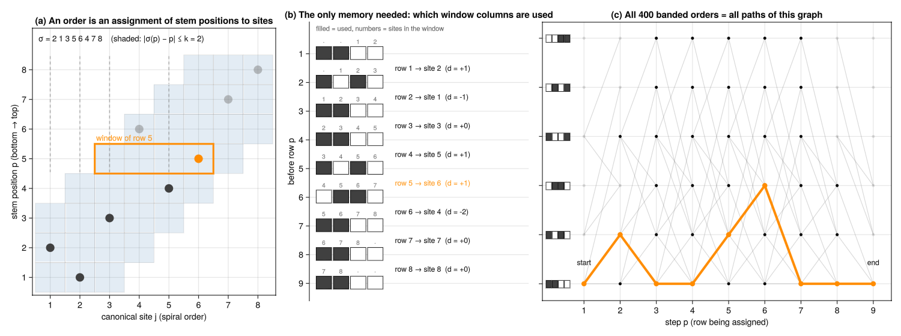
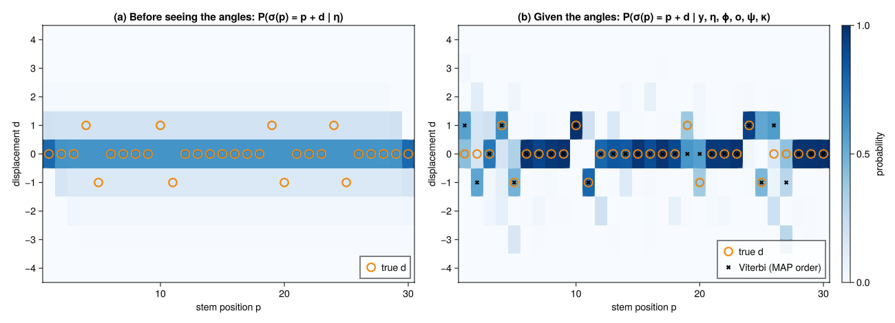
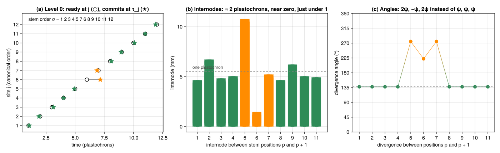

# The order of organs along a stem: method

This document describes the models of `PhyllotaxisFold.jl`, from the biological assumptions to the equations and the
code. It is written for readers with different backgrounds. Every section starts with the biology and ends with the
code, so you can stop at the level you need:

| marker | what it contains |
|---|---|
| **Biology** | the assumption in words, and what follows from it for the plant |
| **Statement** | the precise mathematical object or result |
| **Derivation** | why the statement is true, step by step |
| **Code** | the functions that implement it |

Each modelling statement carries a status: **[A]** a mathematical consequence of the stated assumptions; **[B]** an
assumption, i.e. a modelling choice that could be wrong; **[C]** a numerical result (on simulated data in this
document).

**Contents.** 1 The question and the data · 2 Angles given an order · 3 Summing over all orders · 4 The propensity
model · 5 Commitment timing through the propensity model · 6 Validation on simulated stems · 7 Inference · 8 Assumptions
and limits · Notation · References.

---

## 1. The question and the data

**Biology.** Phyllotaxis, the arrangement of organs around a stem, is self-organised at the shoot apical meristem: each
new organ (primordium) is initiated where the auxin field, shaped by the older primordia, allows it (Reinhardt et al.
2003; Shi & Vernoux 2019). In *Arabidopsis* the inflorescence stem keeps the record: flowers, then fruits, follow a
spiral whose divergence angle is close to the golden angle (137.5°). The order is often disturbed: two organs initiated
close in time can end up inverted along the stem, a *permutation* (Besnard et al. 2014; Refahi et al. 2016). Positions
on the spiral are robust; the timing is not. Permutations are therefore a readout of the **timing noise of organ
initiation**. This package asks what that noise tells us about the mechanism that commits a group of cells to become an
organ.

**Data.** For each stem, bottom to top (positions $p = 1, \dots, n$):

| measurement | symbol | used for |
|---|---|---|
| absolute azimuth of each organ (radians) | $y_p$ | the likelihood (all models) |
| internode lengths (mm), optional | $\ell_p$ | the coordinate of the stem twist (§2) |
| daily counts of open flowers, optional | $c(\text{day})$ | the plastochron in hours (`Plastochron`) |

The models use absolute azimuths rather than divergence angles $y_{p+1} - y_p$, so that a single misplaced organ
changes one observation instead of two.

**Two steps.** They share the angle model (§2) and the sum over orders (§3):

| step | functions | law of the order | parameters |
|---|---|---|---|
| propensity model (A) | `PhyllotaxisModelAD`, `fit_map_torsion`, `order_posterior` | a free cost $\eta_d$ for each displacement $d$ (§4) | $\eta_1, \dots, \eta_k$ |
| fold-commit timing | `DelayLaw`, `fit_delay_law`, `delay_law_inference` | sites ready at a regular pace commit after a random delay (§5) | core sd $s$, tails $\pi_L, m_L, \pi_E, m_E$ |

The fold-commitment model of earlier versions (costs derived from the passage law of the switch, "model B") is in the
tag `with-model-B`.

---

## 2. Angles given an order

**Biology.** If organs appeared in perfect spiral order, the organ at stem position $p$ would sit at the angle of the
$p$-th site of the spiral. A permutation does not move the sites; it changes which site's organ ends up at position $p$.
The model therefore separates *where* the sites are (a regular spiral) from *in which order* their organs appear.

**Statement [B].** Site $j = 1, 2, \dots$ (its rank along the spiral, the *canonical* order) sits at the angle
$\phi + o\,(j - 1)\,\psi$, where $\psi$ is the divergence (golden, $\approx 137.5^\circ$, with probability $\alpha$, or
Lucas, $\approx 99.5^\circ$), $o = \pm 1$ the orientation of the spiral and $\phi$ the angle of the first site
(uniform). The order is a permutation $\sigma$: the organ at position $p$ comes from site $\sigma(p)$, and its
*displacement* is $d_p = \sigma(p) - p$. A negative displacement means that the organ sits above its canonical place:
its site committed late. Given $\sigma$, the angles are independent von Mises variables (the circular analogue of a
Gaussian),

$$
y_p \sim \mathrm{vM}\big(\phi+o\,(\sigma(p)-1)\,\psi+\omega_s x_p,\ \kappa_s\big),\qquad
\mathrm{vM}(y\mid m,\kappa)=\frac{e^{\kappa\cos(y-m)}}{2\pi I_0(\kappa)} .
$$

- **Angular precision.** $\kappa_s$ is specific to each stem, $\log\kappa_s \sim \mathcal N(\log\mu_\kappa, \sigma_\kappa^2)$:
  a poorly measured stem gets a small $\kappa$ instead of being explained by many permutations.
- **Stem twist.** A stem can twist as it elongates. If its surface is twisted by a small angle $\alpha_s$ on a radius
  $r_s$, an internode of length $\ell$ rotates everything above it by $\ell\tan\alpha_s / r_s$ (Landrein et al. 2013).
  The organ at position $p$ is then rotated by $\omega_s x_p$, with $x_p$ the stem length below it
  (`torsion_coordinate(ℓ)`; by default $x_p = p - 1$) and one rate $\omega_s$ per stem. The rates are a random effect,
  $\omega_s \sim \mathcal N(m_\omega, s_\omega^2)$, integrated out (§7). A twist rotates the organs with the same
  handedness for both spiral orientations, which separates it from a change of divergence.
- **Outlier angles (option).** With `outlier = true` (both models), each angle is drawn from the von Mises of its site
  with probability $1 - \pi_o$ and uniformly on the circle otherwise:
  $y_p \sim (1-\pi_o)\,\mathrm{vM}(\cdot) + \pi_o/(2\pi)$, with $\pi_o$ fitted (prior Beta(1, 49), mean 2 %). A badly
  measured angle (or an organ that is not where the site model puts it) is then explained as an outlier instead of a
  long displacement. The mixture enters the edge weights of §3 only, so the sum over orders is unchanged.

**The likelihood of one stem** sums over everything that is not observed:

$$
p(y)=\sum_{o,\psi}p(o)\,p(\psi)\int\!\frac{d\phi}{2\pi}\int\!p(\kappa)\,d\kappa\ \sum_{\sigma}P(\sigma)\prod_{p=1}^{n}\mathrm{vM}\big(y_p\mid\phi+o(\sigma(p)-1)\psi+\omega x_p,\kappa\big).
$$

What distinguishes the models is $P(\sigma)$, the law of the order.

**Code.** `AngleLikelihood.stem_loglik!`. The sum over $(o, \psi)$ is exact; $\phi$ uses `ngrid_ϕ` equally spaced
nodes and $\log\kappa$ `ngrid_κ` Gauss–Hermite nodes (32 × 16 by default). The rectangle rule is very accurate for
$\phi$ because the integrand is periodic and smooth; the error falls like the Bessel ratio $I_{N}(\kappa n)/I_0(\kappa n)$
with $N$ nodes. The sum over $\sigma$ is §3.

---

## 3. Summing over all orders

This is the key technical idea: it makes the exact likelihood computable in milliseconds, which in turn allows exact
gradients, Newton's method and confidence intervals.

### 3.1 The problem and the band

**Biology.** We do not know the order of a stem, so every order compatible with the angles must be weighed. A stem of 50
organs has $50! \approx 3 \times 10^{64}$ orders. But an organ is never found far from its canonical place, so we
impose **[B]** $|\sigma(p) - p| \le k$ ($k = 4$; the posterior mass at $|d| = k$ checks that this is enough).

**Statement.** In every model the law of the order and the angles factorise over positions, so the sum over orders is
the *permanent* of a banded matrix $W$ (a determinant without the signs):

$$
\sum_\sigma P(\sigma)\prod_p p(y_p\mid\sigma(p))\ \propto\ \sum_{\sigma}\prod_{p=1}^{n}W_{p,\sigma(p)}=\operatorname{perm}(W),
\qquad W_{p,j}=0\ \text{if}\ |j-p|>k .
$$

A general permanent is #P-hard (Valiant 1979), and the band alone does not help enough: a 50-organ stem still has about
$10^{28}$ banded orders. What helps is the structure the band creates.

### 3.2 A sliding window is all the memory needed

**Biology.** Read the stem from the bottom and give each position a site. When you reach position $i$, the choices
already made matter for the rest of the stem only through *which sites they have used*. Because no organ moves by more
than $k$, every site far below $i$ is necessarily used, and every site far above is necessarily free: only a window of
$2k$ sites around $i$ can be undecided.

**Statement [A] (window lemma).** For $\sigma$ in the band, with the $k$ virtual sites $1 - k, \dots, 0$ counted as
used, the sites used by positions $1, \dots, i - 1$ are: all sites $\le i - k - 1$, none $\ge i + k$, and exactly $k$ of
the $2k$ sites $\{i - k, \dots, i + k - 1\}$.

**Derivation.** A site $j \le i - k - 1$ is taken by a position $\le j + k \le i - 1$; a position $p \le i - 1$ takes a
site $\le p + k \le i + k - 1$. Counting: $i - 1 + k$ sites are used (virtual ones included), $i - 1$ of them lie below
the window, so $k$ lie inside it. ∎

So the past enters the future only through a *state*: which $k$ of the $2k$ window sites are used, a $2k$-bit mask
($\binom{8}{4} = 70$ states for $k = 4$, whatever the stem length). Position $i$ may take any free site of the window or
the site entering at its top; if the lowest window site is still free, it *must* take it (no later position can reach
it). Each order is exactly one path through a graph whose columns are the positions and whose nodes are the states
(figure 1); its weight is the product of the weights $W_{p,\sigma(p)}$ along the path.

*Figure 1. An order is a path. (a) An order drawn as an assignment: rows are stem positions, columns are canonical sites;
only the shaded band $|j - p| \le 2$ is allowed. The order 2 1 3 5 6 4 7 8 has a swap (positions 1–2) and a three-organ
cycle (4–6). The orange frame is the window of row 5: sites below it are used, sites above are free. (b) The state before
each row (which window sites are used) and the choice made. Before row 6 the lowest window site is free, so row 6 must
take it. (c) The graph unrolled along the stem: one column of the six states per position ($k = 2$), one edge per allowed
choice. Every banded order of 8 organs is one path from start to end; the orange path is the order of (a).*

### 3.3 Forward, backward and Viterbi

**Statement [A] (forward pass).** Let $F_i(s)$ be the total weight of all partial orders of rows $1, \dots, i - 1$
that end in state $s$. Grouping the paths by their last edge,

$$
F_1=\mathbb 1[\text{start}],\qquad F_{i+1}(s')=\sum_{s\xrightarrow{d}s'}F_i(s)\,W_{i,i+d},\qquad \operatorname{perm}(W)=F_{n+1}(\text{end}).
$$

Two partial orders that reach the same state have the same possible futures, so they are merged into one number: this
merge turns a factorial sum into a linear one. A 50-organ stem costs about $10^4$ operations instead of $10^{28}$
(figure 2). The weights are rescaled row by row, as in hidden Markov models, with an automatic fall-back to log-space
when a rescaled entry could underflow.

*Figure 2. (a) Number of orders a brute-force sum would visit (solid lines, log scale) against the number of operations
of the forward pass (dashed), as a function of the number of organs: all $n!$ orders (black) and banded orders for
$k = 1$–$4$ (colours). (b) For one stem of 50 organs, the number of states and of operations against the band width.*

**Statement [A] (marginals).** Running the same recursion from the top gives $B_i(s)$, the weight of all completions
from state $s$. The probability that position $p$ holds the organ of site $p + d$ is

$$
\rho_{p,d}=\frac{1}{\operatorname{perm}(W)}\sum_{s\xrightarrow{d}s'\ \text{in row}\ p}F_p(s)\,W_{p,p+d}\,B_{p+1}(s'),
$$

the weight of the paths through the edges labelled $d$ divided by the total. With the angles in $W$, $\rho_{p,d}$ is the
posterior probability that the organ at $p$ is displaced by $d$ (figure 3). The same pass with (max, +) instead of
(+, ×) gives the single most likely order (Viterbi), and choosing the edges with probabilities
$W_{i,i+d}B_{i+1}(s')/B_i(s)$ draws an order exactly from $P_W$.

*Figure 3. What the forward–backward pass returns, on a simulated stem of 30 organs. Each column is a position, each row a
displacement; the colour is the probability that the position holds the organ displaced by $d$. Orange circles: the
true displacements. (a) Before seeing the angles. (b) Given the angles: most columns concentrate on one value. Black
crosses: the Viterbi order. Where the angles are ambiguous the probability is shared, and the single best order should
not be trusted.*

### 3.5 Decoding the order of a real stem [A]

The angles of a stem do not fix the nuisance state (ϕ, o, ψ, κ, the twist rate $\omega_s$ and, with uncertain ranks,
the offset), and a different state can give a different order: a different twist in particular, since the twist
likelihood of a stem is often multimodal. Two decodings are provided, both from the likelihood of the fits.

- **Posterior (`order_posterior`).** The posterior of the order is a mixture over the nuisance states,
  $P(\sigma\mid y)=\sum_{\text{state}}P(\text{state}\mid y)\,P_W(\sigma)$, where $P(\text{state}\mid y)$ is the
  forward weight of each grid node (and twist quadrature node, weighted by the fitted population law) and $P_W$ is the
  banded permanent with that state's weights. Its marginals $\rho_{p,d}$ are the weighted mixture of the per-state
  marginals; exact samples of $\sigma$ draw a state, then an order. This is the decoding to count events with.
- **Joint MAP (`decode_orders`).** The most probable pair (order, state): Viterbi for each state of non-negligible
  weight, the twist rate maximised as well (best quadrature node, then golden section within its mode), its prior the
  fitted $\mathcal N(m_\omega, s_\omega^2)$. It returns one order per stem, with its twist, $\phi$, $o$, $\psi$ and
  $\kappa$, for figures and for organ-by-organ inspection; where $\rho$ is spread, the single order should not be
  trusted.

Without a twist fit (plain parameters $u$), both use each stem's current rate.

### 3.4 Derivatives

**Statement [A].** $\operatorname{perm}(W)$ is linear in each entry, so

$$
\frac{\partial\log\operatorname{perm}(W)}{\partial\log W_{p,j}}=P_W\big(\sigma(p)=j\big)=\rho_{p,\,j-p}.
$$

If $\log W_{p,p+d} = \eta_d + c_p$, then $\partial\log\operatorname{perm}/\partial\eta_d = \mathbb E[N_d]$ and the
second derivatives are $\operatorname{Cov}(N_d, N_e)$, with $N_d$ the number of organs displaced by $d$: the log-permanent
is convex in $\eta$. The gradient of a stem's log-likelihood in the costs is therefore

$$
\frac{\partial\ell}{\partial\eta_d}=\mathbb E_{\text{given the angles}}[N_d]-\mathbb E_{\text{prior}}[N_d],
$$

the expected number of organs displaced by $d$ given the angles minus the same number a priori. The derivatives in
$\kappa$ and $\alpha$ come from the same pass (expected cosines, posterior weight of the golden spiral). The Hessian is
one pass of forward-mode dual numbers through this analytic gradient.

**Code.** `Permanents`: `PermutationGraph(k)` (built once), `PermanentWorkspace`, `forward!`, `backward!` (marginals),
`sample_permutation!`, `map_permutation` (Viterbi). The tests check the permanent and the marginals against brute-force
enumeration.

---

## 4. The propensity model (A): free costs

**Biology.** In the stochastic model of Refahi et al. (2016), each candidate site fires at a rate set by the inhibitory
field, and which site fires next depends on the history. Model A keeps what the order data can identify: a *log-propensity*
$\eta_d$ for an organ to come from the site displaced by $d$ from its canonical place, the same all along the stem.

**Statement [B].**

$$
P(\sigma\mid\eta)=\frac{1}{Z(\eta)}\exp\Big(\sum_{p=1}^{n}\eta_{\sigma(p)-p}\Big),\qquad Z(\eta)=\operatorname{perm}\big[e^{\eta_{j-p}}\big]_{p,j},
$$

and with the angles $W_{p,j} = e^{\eta_{j-p}}\,e^{\kappa\cos(y_p - \phi - o(j-1)\psi - \omega x_p)}$.

**Statement [A] (what $\eta$ means).**

- A constant shift of $\eta$, and a linear tilt $\eta_d \to \eta_d + a\,d$, leave every probability unchanged (since
  $\sum_p d_p = 0$). The code fixes $\eta_0 = 0$ and uses the symmetric variant $\eta_{-d} = \eta_d$ by default.
- $\eta_d$ is a cost, not a frequency: organs compete for sites, so the realised frequency of a displacement is computed
  from the marginals (`estimate_displacement_frequencies`).

**Prior [B].** A larger displacement should never be cheaper than a smaller one:
$\eta_d = -(\Delta_1 + \dots + \Delta_d)$ with independent log-normal gaps $\Delta_j > 0$ (default means 0.5, 1.25, 2,
3.75). For the fit the gaps are mapped to the real line by a softplus (`LogNormalSoftPlus`).

**Limits.** $\eta$ is descriptive: it says how costly a displacement is, not why, and the rare large displacements are
set mostly by the prior. Section 5 reads the orders through a timing mechanism instead.

**Code.** `PhyllotaxisModelAD(angles, PhyllotaxisPrior(); symmetric = true, outlier = false)`, then `fit_map`, `fit_map_torsion`, `constrained_parameters` (η is the full vector of $2k + 1$ costs),
`unconstrained_parameters`, `prior_mean_parameters`, `stem_loglik`, `angle_loglikelihood`, `decode_orders`,
`order_posterior`, `simulate_stems(η; ...)` (orders drawn from the permanent). `TransformedLogDensityProblem(model)`
remains for LogDensityProblems; `decode_sequence!` is the legacy decoder (raw angles, no twist).

---

## 5. Commitment timing through the propensity model

The propensity model describes the orders; it does not say why they are what they are. This section tests a mechanism,
fold commitment, by fitting the law of the commitment delay through the orders that the propensity model decodes.

### 5.1 The switch [B]

**Biology.** In each cell of the peripheral zone, a regulatory network downstream of auxin signalling receives an input
$u(t)$ that rises as auxin accumulates at the site. *Commitment* is the switch of this network to the organ-founder state.
We assume that the network is bistable over a range of inputs (H1), that the uncommitted state disappears in a
saddle-node bifurcation, a *fold*, as $u$ rises (H2), and that the committed state persists (H3). Near the fold the
whole network collapses onto one slow variable, $dX = (\mu + X^2)\,ds + dW_s$ (figure 4): above the fold no state is
left, but the flow stays slow near $X = 0$, so fast molecular reactions produce a slow and variable commitment delay.

*Figure 4. The speed of the switch variable, $dX/ds = \mu + X^2$, for three margins. Left, below the fold: a stable
uncommitted state (blue) and a threshold (red circle). Middle: the two merge (the fold). Right, above the fold: no state
is left, but the speed stays small near $X = 0$; the time spent there sets the commitment delay.*

The law of that delay is not imposed here. The first-passage law of the switch has one smooth tail (late for an input
that has reached its level, early for a slowly rising one), and no such law reproduces the organ orders, even with a
margin that varies between sites (the fold-commitment model, version `with-model-B`). The delay law is therefore given a
flexible form (§5.3), and the fold remains the reading of its parts.

### 5.2 From delays to an order: a paced meristem [B]

**Biology.** Site $i$ becomes *ready* at time $i$, in plastochrons. It commits after an independent delay $e_i$:

$$
\tau_i=i+e_i,\qquad \sigma=\operatorname{sortperm}(\tau_1,\dots,\tau_n).
$$

The order of organs on the stem is the order of commitment (figure 5). Assumptions: noise acts on timing, not on
positions; sites commit independently ("Level 0"); the schedule is the same all along the stem. Only differences of
delays matter, so the law of $e$ is defined up to a shift; its core is centred at 0.

*Figure 5. How a timing event becomes a permutation. (a) Twelve sites: site $j$ becomes ready at time $j$ (circles, in
plastochrons) and commits after a random delay (stars). Sites 6 and 7 (orange) commit in inverted order. (b) The
internodes around the inverted pair: about two plastochrons, nearly zero, just under one. (c) The divergence angles:
the inversion replaces three divergences $\psi$ by $2\psi$, $-\psi$, $2\psi$, which is what the angle model detects.*

### 5.3 The delay law [B]

$$
f=(1-\pi_L-\pi_E)\,\mathcal N(0,s^2)+\pi_L\,\big(\mathcal N(0,s^2)\ast\mathrm{Exp}(m_L)\big)+\pi_E\,\big(\mathcal N(0,s^2)\ast(-\mathrm{Exp}(m_E))\big):
$$

a Gaussian **core** of sd $s$ (the precision of a typical commitment), a fraction $\pi_L$ of sites committed late by an
extra exponential delay of mean $m_L$, a fraction $\pi_E$ committed early. Nested variants: `:core` ($s$), `:late`
($s, \pi_L, m_L$), `:both` (all five).

**Statement [C] (what the orders identify).** A frequent short tail and a rarer long one give nearly the same orders, so
$\pi$ and $m$ are poorly identified one by one. The quantities to report are the core sd $s$ and the **tail masses**
$P(e > 1)$ and $P(e < -1)$: the fractions of sites committed more than one plastochron late or early (§6).

**Code.** `DelayLaw(s; πL, mL, πE, mE)`, `rand(rng, f)`, `delay_logdensity(f)`, `tail_masses(f; a = 1)`.

### 5.4 The exact order likelihood [A]

**Statement.** $P_f(\sigma)=\int_{\tau_1<\dots<\tau_n}\prod_p f(\tau_p-\sigma(p))\,d\tau$, computed by a forward recursion
over the stem positions on a time grid (step 0.05 plastochron): the message at position $p$ is the density of
$\tau_p$ jointly with the event that the times so far are ordered.

**Numerics.** Two times in the same grid cell are ordered with probability ½ (midpoint rule). Counting them as ordered
biases $\log P(\sigma)$ upwards at first order in the step (+0.28 for an order of 6 sites with three displacements); the
midpoint rule leaves an error ≤ 0.01. Tests: the two-site closed form, probabilities of all orders of 4 sites summing to
1, and the frequencies of the orders drawn by `rand`.

**Code.** `loglik_order_exact(σ, f)` or `loglik_order_exact(σ, logg, grid, γ)`.

### 5.5 Re-weighting the propensity model's posterior orders [A]

**Statement.** The propensity model (A) and the timing law $f$ share the angle likelihood $p(y \mid \sigma)$ (§2) and
differ only in the law of the order. For one stem,

$$
\frac{p(y\mid f)}{p(y\mid A)}=\sum_\sigma p(\sigma\mid y,A)\,\frac{P_f(\sigma)}{P_A(\sigma)}
=\mathbb E_{\sigma\sim p(\sigma\mid y,A)}\Big[\frac{P_f(\sigma)}{P_A(\sigma)}\Big].
$$

**Derivation.** $p(y \mid f) = \sum_\sigma p(y \mid \sigma) P_f(\sigma)$ and, by Bayes' rule under A,
$p(y \mid \sigma) = p(\sigma \mid y, A)\, p(y \mid A) / P_A(\sigma)$. ∎

The expectation is estimated with the exact posterior samples of `order_posterior` (§3.5): per stem, the log of the
weighted mean of $P_f(\sigma)/P_A(\sigma)$ over its sampled orders. Summed over stems, it is
$\Delta\ell = \log p(y \mid f) - \log p(y \mid A)$: positive when the timing law explains the orders better than the
free costs. A candidate law costs seconds to score, because neither the angles nor the permutation sums are recomputed.

**Limits.** The angle nuisances (κ, offsets, twist) are those of the propensity model's fit. Orders outside its band
($|d| > k$) are never sampled, so a law that puts mass on them is slightly penalised. The weights stay well spread when A's
posterior covers the orders $f$ favours (effective sample size, §6).

**Code.** `order_samples(order_posterior(m, fit; nsamples), η)`, `stem_terms(samples, f)`, `relative_loglik(samples, f)`;
`stem_terms(samples, logP)` scores any order law given as σ ↦ log P(σ).

### 5.6 Fit, uncertainty and comparisons

- **Fit.** `fit_delay_law(samples, variant)`: Nelder–Mead on unconstrained parameters (log $s$; for `:both`,
  logit($\pi_L + \pi_E$), logit of the late share, log $m_L$, log $m_E$).
- **Robust standard errors.** The stem is the unit. `delay_law_inference` computes the sandwich covariance
  $H^{-1}(\sum_s g_s g_s^\top)H^{-1}$ from the per-stem scores $g_s$ and the Hessian $H$ of the summed terms (central
  differences), which allows for heterogeneity between stems, then the delta method for $s$ and the tail masses.
- **Two groups** (a mutant and its co-segregant wild type): compare the tail masses with their standard errors
  (independent groups), or the summed $\Delta\ell$ of separate laws and of one shared law (likelihood ratio). The A terms
  cancel in such differences, because each stem's term is relative to its own group's fit of A.

---

## 6. Validation on simulated stems

(validation figures: to be added)

---

## 7. Inference

- **Parameters on the real line.** Positive parameters go through log, probabilities through logit, the costs of the
  propensity model through the softplus map; the log-Jacobian is part of the log density.
- **Maximum a posteriori by Newton's method with a trust region.** Value, gradient and Hessian are computed in one
  callback, and the Hessian only when the optimiser asks for it. The gradient is analytic (§3.4); the Hessian is one
  pass of dual numbers through it. A non-finite evaluation is a rejected step.
- **Stem twist.** The rates $\omega_s \sim \mathcal N(m_\omega, s_\omega^2)$ are integrated out by adaptive Gauss–Hermite
  quadrature on the modes of each stem's likelihood, and $(m_\omega, s_\omega)$ are fitted with the other parameters
  (`fit_map_torsion`).
- **Uncertainty.** Laplace approximation: $-H^{-1}$ at the maximum is the covariance of the unconstrained parameters.
- **Model comparison.** The integrated log-likelihood at the maximum (`loglik` of `fit_map_torsion`, priors excluded);
  timing laws against the propensity model and against each other by $\Delta\ell$ (§5.5).
- **Cost.** One stem of about 45 organs takes ~50 ms (2048 nuisance nodes); a fit of 50–90 stems with the twist
  integrated takes 10–15 minutes on 18 threads. The cost is proportional to `ngrid_ϕ` × `ngrid_κ`.
- **Numerical accuracy.** The band $k = 4$ is checked by the posterior mass at $|d| = k$; 32 $\phi$ nodes give converged
  estimates (use 64 for fine log-likelihood comparisons); 16 $\kappa$ nodes are accurate while $\sigma_\kappa \lesssim 0.5$.

---

## 8. Assumptions and limits

| assumption | status | what would break it |
|---|---|---|
| organ positions follow a regular spiral; noise acts on timing | [B] | missed organs are not modelled; outlier angles only with `outlier = true` (otherwise they appear as long displacements) |
| displacements bounded by $k = 4$ | [B] | posterior mass at $\lvert d\rvert = k$ (refit with a larger $k$) |
| sites ready at a regular pace commit independently, with i.i.d. delays (Level 0) | [B] | cascades of permutations, a drifting timeline (internodes); heterogeneity between stems |
| the same delay law all along the stem | [B] | the off-time rate may change along the stem (e.g. at the base) |
| the delay law is a Gaussian core with exponential tails | [B] | discrete slot errors (tails at exactly ±1 plastochron) fit as short tails |
| the timing law is scored at the propensity model's angle nuisances and band | [B] | the effective sample size of the weights; refit with a larger $k$ |
| flowers open at the pace they were initiated | [B] | a maturation delay that changes during flowering |
| piecewise-linear opening rate with a per-plant change point and a finite arrest | [B] | a curved rise or decline; the plastochron of the last flowers before arrest is poorly determined |
| one twist rate per stem, Normal across stems | [B] | a tapering stem makes the rate drift along the stem |
| von Mises angular noise (+ uniform outliers, option) | [B] | a broad but not uniform component (e.g. angles off by a fraction of the divergence) |

The angles alone confound angular noise and permutations (a lower $\kappa$ or more permutations), identify the shape of
the delay poorly, and cannot separate a noisier readiness from a noisier commitment (only their sum enters the order).
Timing data (internodes, imaging of primordia) are needed for those questions.

---

## Notation

| symbol | meaning |
|---|---|
| $p$, $n$, $j$ | stem position (bottom-up), number of organs, canonical site |
| $\sigma$, $d_p = \sigma(p) - p$, $N_d$ | order, displacement ($d < 0$: late organ), number of organs displaced by $d$ |
| $y_p$, $x_p$ | absolute azimuth, stem length below position $p$ |
| $\phi$, $o$, $\psi$, $\alpha$ | spiral offset, orientation, divergence (golden or Lucas), probability of golden |
| $\kappa$, $\mu_\kappa$, $\sigma_\kappa$ | angular concentration of a stem, its log-normal population law |
| $\omega_s$, $m_\omega$, $s_\omega$ | twist rate of stem $s$, its population mean and sd |
| $\eta_d$, $H_{p,d}$ | cost (log-propensity) of displacement $d$; of displacement $d$ at row $p$ |
| $W$, $\rho_{p,d}$ | weight matrix, marginal probability $P(\sigma(p) = p + d)$ |
| $X$, $\mu$ | switch variable and margin above the fold, in noise units (§5.1) |
| $\tau_i$, $e_i$, $f$ | commitment time and delay of site $i$ (plastochrons), delay law |
| $s$, $\pi_L$, $m_L$, $\pi_E$, $m_E$ | core sd; fraction and mean extra delay of late sites; of early sites |
| $\Delta\ell$ | $\log p(y \mid f) - \log p(y \mid A)$, summed over stems |

## References

- Besnard F. et al. (2014) Cytokinin signalling inhibitory fields provide robustness to phyllotaxis. *Nature* 505,
  417–421.
- Galvan-Ampudia C. S., Cerutti G. et al. (2020) Temporal integration of auxin information for the regulation of
  patterning. *eLife* 9, e55832.
- Landrein B. et al. (2013) Impaired cellulose synthase guidance leads to stem torsion and twists phyllotactic patterns
  in *Arabidopsis*. *Curr. Biol.* 23, 895–900.
- Refahi Y. et al. (2016) A stochastic multicellular model identifies biological watermarks from disorders in
  self-organized patterns of phyllotaxis. *eLife* 5, e14093.
- Reinhardt D. et al. (2003) Regulation of phyllotaxis by polar auxin transport. *Nature* 426, 255–260.
- Shi B. & Vernoux T. (2019) Patterning at the shoot apical meristem and phyllotaxis. *Curr. Top. Dev. Biol.* 131,
  81–107.
- Valiant L. G. (1979) The complexity of computing the permanent. *Theor. Comput. Sci.* 8, 189–201.
