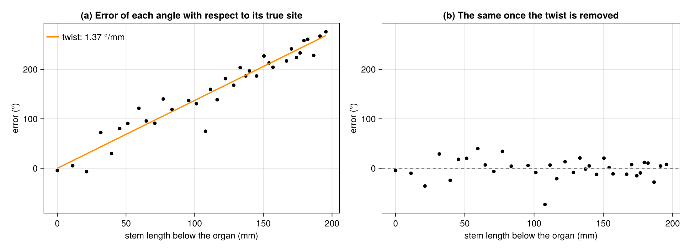

# 2. Angles given an order

Suppose for a moment that we know the order ``\sigma`` of a stem: the organ at height ``p`` comes from site
``\sigma(p)``. How should its angle ``y_p`` be distributed? This page builds the answer one term at a time, from the
three difficulties of [§1.3](problem.md).

## 2.1 The spiral

**assumption** — the sites sit on a regular spiral. Site ``j`` is at the angle

```math
\phi + o\,(j - 1)\,\psi ,
```

where ``\phi`` is the angle of the first site, ``o = \pm 1`` the orientation of the spiral and ``\psi`` the
divergence. The divergence is the golden angle (``\approx 137.5^\circ``) with probability ``\alpha``, and the Lucas
angle (``\approx 99.5^\circ``) otherwise. ``\phi`` is uniform on the circle, and each orientation has probability ½.
These three quantities are specific to each stem, unknown, and integrated out.

A permutation moves *organs* between sites. It does not move the sites. The organ at height ``p`` is therefore expected
at ``\phi + o\,(\sigma(p) - 1)\,\psi``. This separation, *where the sites are* versus *in which order their organs
appear*, is the core of every model of the package.

## 2.2 The noise

**assumption** — the angle of an organ is its site's angle plus an independent error with a von Mises law, the circular
analogue of the Gaussian:

```math
\mathrm{vM}(y \mid m, \kappa) = \frac{e^{\kappa \cos(y - m)}}{2\pi I_0(\kappa)} .
```

The concentration ``\kappa`` plays the role of an inverse variance: for large ``\kappa`` the error has an sd of about
``1/\sqrt{\kappa}`` radians. ``I_0`` is the modified Bessel function of order 0.

**assumption** — each stem has its own concentration, ``\log\kappa_s \sim \mathcal N(\log\mu_\kappa, \sigma_\kappa^2)``.

Why one ``\kappa`` per stem? A poorly measured stem must be allowed to be noisy. With a single ``\kappa`` for all stems,
the model could only explain its scattered angles by many permutations, and these spurious permutations would bias
everything downstream.

## 2.3 The twist

Many stems twist as they elongate (Landrein et al. 2013). If the surface of a stem of radius ``r_s`` is inclined by a
small angle ``\alpha_s``, an internode of length ``\ell`` rotates everything above it by ``\ell \tan\alpha_s / r_s``.
The rotations add up along the stem. The organ at height ``p`` is then rotated by

```math
\omega_s\, x_p, \qquad x_p = \ell_1 + \dots + \ell_{p-1} ,
```

where ``x_p`` is the length of stem below the organ and ``\omega_s`` a rate (degrees per mm) specific to each stem.
When the internodes are not measured, ``x_p = p - 1`` and the rate is per organ.

**assumption** — the rates are a random effect, ``\omega_s \sim \mathcal N(m_\omega, s_\omega^2)``, integrated out of
each stem's likelihood.

Why integrate, rather than fix each twist at its best value? Because the twist of a stem is not known, and fixing it
would make the orders look more certain than they are. A different twist combined with a few permutations can explain
the same angles, so the likelihood of a stem is often multimodal in ``\omega_s``. It is also very sharp (about
0.1°/mm wide). The integral

```math
L_s = \int L_s(\omega)\, \mathcal N(\omega \mid m_\omega, s_\omega^2)\, d\omega ,
```

where ``L_s(\omega)`` is the likelihood of stem ``s`` at twist rate ``\omega`` (all its other unknowns summed out,
[§2.5](angles.md)), is therefore computed by a quadrature built on each stem's own likelihood, not on the population
law.

!!! details "The adaptive quadrature: derivation and accuracy"
    **Nodes.** Scan the rate, find the local maxima of ``\log L_s`` within 8 log-units of the best (at most four),
    refine each by golden section, and measure its curvature. Each mode ``r`` becomes a Gaussian component (centre
    ``c_r``, sd ``h_r`` from the curvature, widened by 25 %), with a weight ``\pi_r`` proportional to its Laplace mass.
    Their mixture ``q_s`` is a proposal that covers every peak. Five Gauss–Hermite nodes ``z_j`` (weights
    ``\gamma_j``) are placed on each component: ``\omega_{rj} = c_r + h_r z_j``.

    **Weights.** Write the integral against the proposal and apply the Gauss–Hermite rule to each component:
    ```math
    \int L_s\, p = \int \frac{L_s\, p}{q_s}\, q_s = \sum_r \pi_r\, \mathbb E_{\mathcal N(c_r, h_r^2)}\Big[\frac{L_s\, p}{q_s}\Big]
    \approx \sum_{r,j} \frac{\pi_r \gamma_j}{q_s(\omega_{rj})}\, L_s(\omega_{rj})\, p(\omega_{rj}) .
    ```
    The node weights ``\pi_r \gamma_j / q_s(\omega_{rj})`` do not depend on the population law ``p``. So the same
    nodes integrate any ``(m_\omega, s_\omega)``, and the integrated likelihood is a smooth function of them, which the
    fit needs ([§4.5](propensity.md)). This is multiple importance sampling with the balance heuristic. It is exact
    when ``L_s\, p / q_s`` is a polynomial of low degree on each component, that is, when each peak of ``L_s`` is close
    to Gaussian and ``p`` varies slowly across it.

    **Accuracy.** On the 40 stems of the running example, at their fitted parameters, each stem's integral was
    compared with a brute-force sum over a fine grid of rates (step 0.005 °/mm), for the fitted population law and three
    others (sd doubled, sd halved, mean shifted by 0.5 °/mm). 38 stems have one mode, one has two and one has four.

    | rule | median error per stem | worst stem |
    |---|---|---|
    | adaptive, 5 nodes per mode (default) | 0.02 | 0.23–0.29 |
    | adaptive, 9 nodes per mode | | 0.08 |
    | adaptive, 15 nodes per mode | | 0.01 |
    | Gauss–Hermite on the population law, 32 nodes | 0.2–2.5 | 0.6–11 |
    | Gauss–Hermite on the population law, 128 nodes | 0.1–0.8 | 0.4–3.4 |

    Errors are in log-likelihood units (the 9- and 15-node rows on the six worst stems). The adaptive rule is equally
    accurate for the four population laws, as the derivation says. Its residual error comes from peaks that are not
    quite Gaussian, and more nodes per mode remove it. A rule placed on the population law misses the sharp peaks
    even with 128 nodes. For fine comparisons of integrated log-likelihoods, use 9 nodes per mode
    (`fit_map_torsion!(m; nodes_kw = (; nnodes = 9))`), at about twice the cost.

Could a twist be mistaken for a slightly different divergence? Both rotate the organs more and more going up the
stem. A divergence ``\psi + \delta`` instead of ``\psi`` moves the organ of site ``j`` by ``o\,(j - 1)\,\delta``:
*with the sign of the orientation*. A twist rotates the organ at height ``p`` by ``\omega_s x_p``, whatever the
orientation of the spiral. So the two are told apart by comparing clockwise and counter-clockwise stems. A shifted
divergence pushes them in opposite directions, a twist in the same direction. A twist also follows the length of the
stem (long internodes rotate more), and a divergence follows the organ count.



*Figure 2. The example stem. (a) The error of each angle with respect to the site of its true organ, against the
length of stem below it: the errors drift linearly, at the stem's twist rate. (b) The same errors once the twist is
removed: what remains is the von Mises noise.*

## 2.4 Outlier angles (option)

**assumption** (with `outlier = true`) — with a small probability ``\pi_o``, an angle is not related to its site at
all, and is uniform on the circle:

```math
y_p \sim (1 - \pi_o)\,\mathrm{vM}\big(\cdot \mid \phi + o\,(\sigma(p) - 1)\,\psi + \omega_s x_p,\ \kappa_s\big) + \frac{\pi_o}{2\pi} .
```

``\pi_o`` is fitted (prior Beta(1, 49), mean 2 %). A grossly mis-measured angle is then explained as an outlier
rather than as a long displacement of its organ.

## 2.5 The likelihood of one stem

Given the order, the angles are independent. The probability of the angles of a stem is the sum, over everything that
is not observed, of the probability of the angles:

```math
p(y) = \sum_{o,\,\psi} p(o)\,p(\psi) \int_0^{2\pi} \frac{d\phi}{2\pi} \int p(\kappa)\,d\kappa
\;\sum_{\sigma} P(\sigma) \prod_{p=1}^{n} \mathrm{vM}\big(y_p \mid \phi + o\,(\sigma(p) - 1)\,\psi + \omega_s x_p,\ \kappa\big).
```

Everything in this formula is fixed by this page except ``P(\sigma)``, the law of the order. The models of the
package differ *only* in ``P(\sigma)``: the propensity model ([§4](propensity.md)) and the timing laws
([§5](timing.md)). That is what makes the comparison of [§1.5](problem.md) possible.

Two sums remain hard. The sum over ``\sigma`` is the subject of [§3](orders.md). The integrals over the nuisance
quantities are low-dimensional and handled by quadrature.

!!! details "Numerical integration over the spiral and the precision"
    The sum over ``(o, \psi)`` is exact (four terms). The integral over ``\phi`` uses ``N`` equally spaced nodes
    (`ngrid_ϕ`, 32 by default). The integrand is smooth and periodic in ``\phi``, so this rectangle rule converges
    geometrically: its error behaves like the Bessel ratio ``I_N(\kappa n)/I_0(\kappa n)``. The integral over
    ``\log\kappa`` uses `ngrid_κ` Gauss–Hermite nodes (16 by default) of the log-normal law. The twist rate is
    integrated by the adaptive quadrature of [§2.3](angles.md). All the terms are computed in log space,
    and ``\log I_0`` with a dedicated routine (`logbesseli`) that also accepts dual numbers for the derivatives.

    Accuracy: 32 ``\phi`` nodes give converged estimates; use 64 for fine comparisons of log-likelihoods. 16
    ``\kappa`` nodes are accurate while ``\sigma_\kappa \lesssim 0.5``. The cost is proportional to
    `ngrid_ϕ` × `ngrid_κ`.

**Code.** `AngleLikelihood.stem_loglik!` (one stem, all grids, and its gradient), `stem_loglik`, `angle_loglikelihood`;
the twist: `torsion_coordinate(ℓ)`, `corrected_angles`; simulation: `simulate_stems` (both laws of the order).
