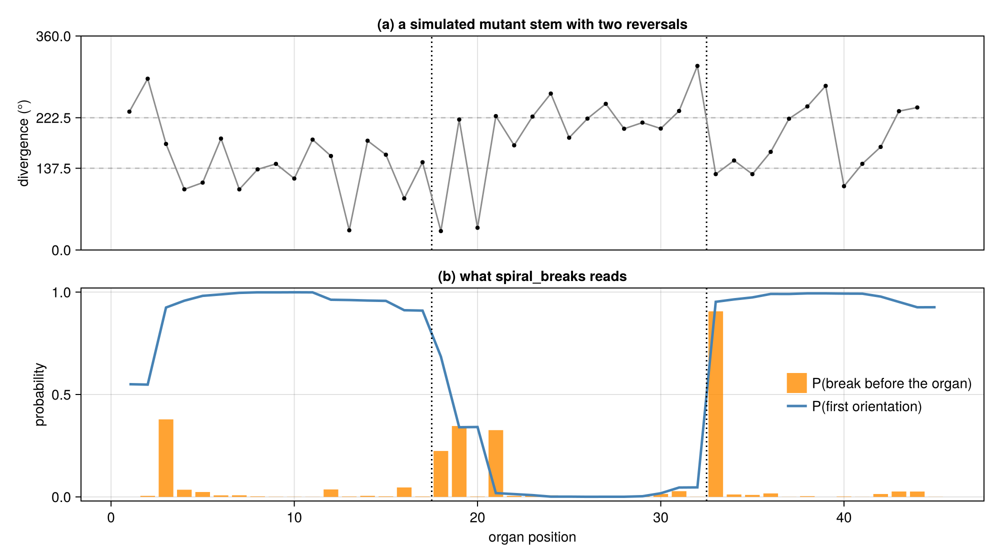
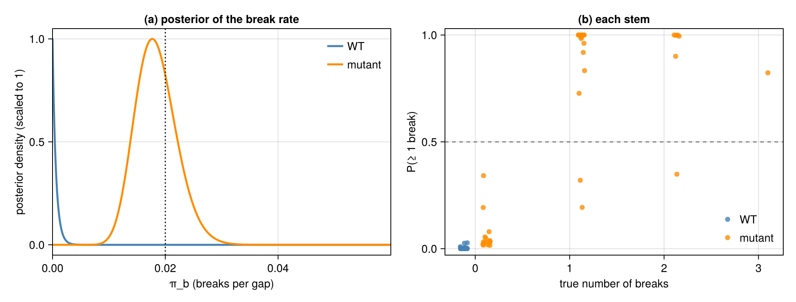

# Breaks of the spiral

The angle model gives each stem one spiral, from its base to its top ([§2](angles.md)). Some stems break it: the
spiral reverses its orientation (such inversions are described in published data), switches to another canonical
angle, or is measured with a precision that changes. A fit that ignores a break reads the angles after it as
permutations.

`spiral_breaks(fit)` asks, for each stem, whether its spiral breaks, how many times and where. It is a check after the
fit: nothing is refitted.

## The model of a break

A break splits a stem into parts.

**assumption** — the order law restarts at each break: no permutation crosses it. Each part is a stem of its own,
with the population parameters of the fit. The parts share the stem's twist rate, integrated over the fit's nodes
([§2.6](angles.md#2.6-Integrating-out-the-unknowns-of-each-stem)). Each part has its own phase, uniform on the 
circle like the offset of a stem. In addition, what breaks (`kind`) changes at each break:

- `:orientation` (the default): the spiral turns the other way;
- `:angle`: the canonical angle switches to another one of the prior's list ([Canonical angles](canonical_angles.md));
- `:precision`: the angles have a new precision, drawn from the fitted law of κ;
- `:phase`: nothing else, the pattern only jumps (see [Missed organs](#Missed-organs));
- a tuple of these, which change together.

**Why a new phase?** A perturbation strong enough to change the spiral also displaces it. And a reversed spiral cannot
simply continue from the last site: a spiral that reverses after site ``\tau - 1`` would put site ``\tau`` on
site ``\tau - 2``, site ``\tau + 1`` on site ``\tau - 3``, and so on, retracing the old sites. A uniform phase also keeps
the parts independent, which makes the computation exact.

## The prior on breaks

**assumption** — each gap between two organs is a break with probability ``\pi_b``, independently. A stem of ``n``
organs has Binomial(``n - 1``, ``\pi_b``) breaks, at uniform places.

The odds of ``j + 1`` breaks against ``j`` are

```math
\mathrm{BF} \times \frac{n - 1 - j}{j + 1} \times \frac{\pi_b}{1 - \pi_b} ,
```

with BF the Bayes factor of the angles. With ``\pi_b = 0.01`` and 45 organs, the prior expects 0.44 breaks per stem,
and a first break wins once the angles favour it by a factor of about 2.3. Longer stems have more chances to break.

**The rate is shared by the stems.** By default ``\pi_b \sim \mathrm{Beta}(1, 99)`` (mean 1 %), one rate for all the
stems of the fit, integrated out: each stem's results average over its posterior. This posterior is a result in
itself, the propensity of a genotype to break its spiral. A fixed rate can be given instead (`break_rate = 0.01`).

!!! details "Why the computation is exact, and what it costs"
    Given its nuisances, a part ``[a, b]`` has a banded permanent as likelihood, like a whole stem ([§3](orders.md)).
    One forward pass from organ ``a`` gives all the parts ``[a, b]`` at once: after organ ``b``, the state in which no
    site beyond ``b`` is used yet is exactly the part ending at ``b``. A part's phase uses the stem's offset grid,
    shifted. The sum over all segmentations, with their values and the binomial prior, is then an exact change-point
    recursion. A stem of ``n`` organs costs about ``n/2`` stem likelihoods per kind. On a short stem, `spiral_breaks`
    matches a brute-force sum over every segmentation to ``10^{-13}``.

## Reading the result

For each stem:

| field | what it is |
|---|---|
| `p_breaks` | the posterior probability of 0, 1, 2, … breaks |
| `logBF` | the log Bayes factor of at least one break against none |
| `p_cut` | the posterior probability of a break just before each organ |
| `p_part` | for each organ, the posterior probability of each value of its part (orientation or angle) |
| `logZ` | the log-likelihood summed over every placement of ``j`` breaks, for each ``j`` |

The result also holds the posterior of the break rate, one rate for all the stems (`break_rate`: its mean, median and
95 % interval).

With `kind = :each`, `spiral_breaks` runs each kind of break in turn and returns one result per kind. Comparing their
log Bayes factors tells which kind of break the angles support best.

## Missed organs

An organ missed in the measurements shifts the sites of all the organs above it by one divergence ψ. The spiral is
unchanged, only displaced: this is a `:phase` break at the missing organ. `spiral_breaks(fit; kind = :phase)` therefore
flags the stems and the places where an organ may be missing. Other displacements of the pattern look the same, so a
flagged stem is worth checking.

## Example: a mutant whose spiral reverses

**Simulation.** Two groups of 40 stems of 45 organs, like those of [§6.1](validation.md#6.1-The-simulated-stems). In
the wild type, each stem keeps one spiral. In the mutant, each gap is a reversal with probability 2 % (about 0.9 per
stem), and each new part has its own phase. The orders are drawn along the whole stem, so some permutations cross a
reversal: the simulation also tests the restart of the order law. Each group is fitted as usual, then scanned:

```julia
using PhyllotaxisFold

r_wt = fit_map(PhyllotaxisModelAD(angles_wt; torsion = TorsionPrior(), torsion_x = x_wt))
r_mutant = fit_map(PhyllotaxisModelAD(angles_mutant; torsion = TorsionPrior(), torsion_x = x_mutant))

b_wt = spiral_breaks(r_wt)          # the defaults: orientation breaks, a Beta prior (1, 99) on the rate
b_mutant = spiral_breaks(r_mutant)

b_mutant.break_rate                  # posterior of the rate: mean, median, 95 % interval
p_any = [1 - s.p_breaks[1] for s in b_mutant.stems]   # the probability of at least one break of each stem
```



*Figure 1. A simulated mutant stem with two reversals (dotted lines). (a) Its divergences, in the orientation of its
first part: about 137.5°, then about 222.5° (−137.5°) between the reversals. (b) The posterior probability of a break
before each organ (bars), and the posterior probability that each organ lies in a part with the stem's first
orientation (line: near 1 before the first reversal and after the second, near 0 between them).*



*Figure 2. (a) The posterior of the break rate of each group, scaled to its maximum (dotted line: the mutant's true
rate, 2 %). (b) Each stem's posterior probability of at least one break, against its true number of breaks.*

**result** — the rate is recovered, and the wild type is clean:

| | wild type | mutant |
|---|---|---|
| true reversals (stems with one or more) | 0 | 33 (25 stems) |
| stems with P(≥ 1 break) > 0.5 | 0 of 40 | 22 of the 25, none of the other 15 |
| reversals placed within one organ | | 22 of 33 |
| break rate: posterior mean (95 % interval) | 0.06 % (0–0.23 %) | 1.84 % (1.19–2.61 %); true 2 % |

Of the 11 reversals not placed, 8 lie within 8 organs of an end of the stem or within 2 organs of another reversal,
where a part has few organs.

**result** — ignoring, the reversals bias the usual fit of the mutant gives:

| | wild type | mutant |
|---|---|---|
| organs decoded as displaced (true) | 21.8 % (21.5 %) | 28.2 % (21.7 %) |
| fitted κ (true about 6.4) | 6.7 | 5.2 |

The angles after a reversal are read as extra permutations and noisier measurements: a mutant that reverses its spiral
looks like one that permutes its organs more. The break rates tell the two apart.

## Limits

- **Slow changes are not breaks.** A slowly drifting divergence is absorbed by the twist
  ([§2.3](angles.md#2.3-The-twist)). Breaks are jumps.
- **Short parts carry little.** Breaks near either end of a stem, or a few organs apart, are hard to place.
- **The order restarts at each break.** The permutations across a break are lost, which makes the test slightly
  conservative.
- **The fit is not redone.** The population parameters come from a fit that ignored the breaks. When many stems
  break, refit their parts as separate stems.
- **A twist that changes along the stem** is not a kind of break.
