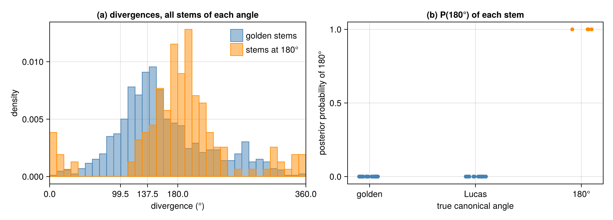

# Canonical angles

By default, the divergence of each stem is the golden angle (``\approx 137.5^\circ``) or, rarely, the Lucas angle
(``\approx 99.5^\circ``) ([§2.1](angles.md#2.1-The-spiral)). Some data need another list or a single divergence 
known in advance. The prior takes a list of any length.

## The prior: stick-breaking probabilities

**assumption** — the divergence of each stem is one of the M + 1 `angles`, listed from the most to the least expected.
Their probabilities come from M probabilities ``\alpha_j \sim \mathrm{Beta}(a_j, b_j)`` (`aα`, `bα`):

```math
p_1 = \alpha_1, \qquad p_j = \alpha_j \prod_{i<j} (1 - \alpha_i), \qquad p_{M+1} = \prod_{i \le M} (1 - \alpha_i) .
```

``\alpha_j`` is the probability of angle ``j`` among the stems not at the angles before it: each step breaks off one
piece of what is left. Each prior is then stated one angle at a time:

| `angles` | `aα`, `bα` | what it says |
|---|---|---|
| (golden, Lucas) | (95,), (5,) | the default: golden in about 95 % of the stems, else Lucas |
| (golden, Lucas, π) | (95, 999), (5, 1) | as the default; 180° in about 1 in 1000 of the other stems |
| (golden,) | (), () | every stem golden, no α |

An unexpected angle gets a small prior: a Beta that holds the previous α near 1. A wild-type fit is then unchanged,
while a stem that clearly follows the angle is still recognised (example below). All the ``\alpha_j`` are fitted.

```julia
using PhyllotaxisFold

prior = PhyllotaxisPrior(; angles = (Golden_angle, Lucas_angle, π), aα = (95, 999), bα = (5, 1))
golden_only = PhyllotaxisPrior(; angles = Golden_angle, aα = (), bα = ())
```

With M + 1 angles, `θ.α` is a tuple and `θ.angle_probs` gives the probability of each angle; `spiral_posterior`
returns `p_angle`, the posterior probability of each angle for each stem; `simulate_stems` takes the same `angles`.
The cost grows linearly with the number of angles.

## Noble angles

The divergences of the phyllotaxis diagram converge to noble numbers, ``(a + b\,\tau^{-1})/(c + d\,\tau^{-1})`` with
``\lvert ad - bc \rvert = 1`` and ``\tau`` the golden mean [douady1996phyllotaxis](@cite). `noble_angle(a, b, c, d)`
returns ``2\pi`` times such a number, folded into ``(0, \pi]`` (``\psi`` and ``2\pi - \psi`` give the same spirals,
turning the other way).

| `noble_angle` | divergence |
|---|---|
| `(1, 1, 2, 3)` | 151.1° |
| `(1, 0, 2, 1)` | 137.5°, the golden angle |
| `(1, 0, 3, 1)` | 99.5°, the Lucas angle |
| `(1, 0, 4, 1)` | 78.0° |
| `(1, 0, 5, 1)` | 64.1° |

```julia
prior = PhyllotaxisPrior(; angles = (Golden_angle, Lucas_angle, noble_angle(1, 0, 4, 1)), aα = (95, 99), bα = (5, 1))
```

## Example: a few stems at 180°

**Simulation.** Forty stems of 40 organs, each golden with probability 0.6, else Lucas or 180° (distichous) with equal
probability (`α = (0.6, 0.5)`). The draw gave 4 stems at 180°, far more than the prior expects.

```julia
using PhyllotaxisFold, Random

angles = (Golden_angle, Lucas_angle, π)
sim = simulate_stems([-1.2, -2.5, -3.1, -4.0]; plants = 40, organs = 40, logμκ = 1.85, α = (0.6, 0.5), angles,
    rng = Xoshiro(3))

prior = PhyllotaxisPrior(; angles, aα = (95, 999), bα = (5, 1))
r = fit_map(PhyllotaxisModelAD(sim.angles, prior))
post = spiral_posterior(r)
p180 = [p.p_angle[3] for p in post]          # the posterior probability of 180° of each stem
```

**result** — the 4 stems at 180° are recognised despite a prior of 1 in 20,000: their posterior probability of 180° is
1.000, that of every other stem below ``10^{-22}``. Forty organs carry far more evidence than the prior. The fitted
probability of 180° stays small (0.08 %, `r.θ.angle_probs`): a Beta(999, 1) weighs as much as a thousand stems.



*Figure 1. Forty simulated stems, 4 of them at 180°. (a) The divergences of the golden stems and of the stems at 180°.
(b) The posterior probability of 180° of each stem, against its true angle.*

## What the angles can see at 180°

At 180°, site ``j + 2`` sits where site ``j`` sits, so an organ displaced by two sites lands on its own site: only odd
displacements show. In a stem at 180°, ``\eta_2`` and ``\eta_4`` are informed by the other stems only, and the decoded
order can be wrong by even displacements without any change of the likelihood. Other symmetric patterns (decussate
pairs) have the same blind spots.

