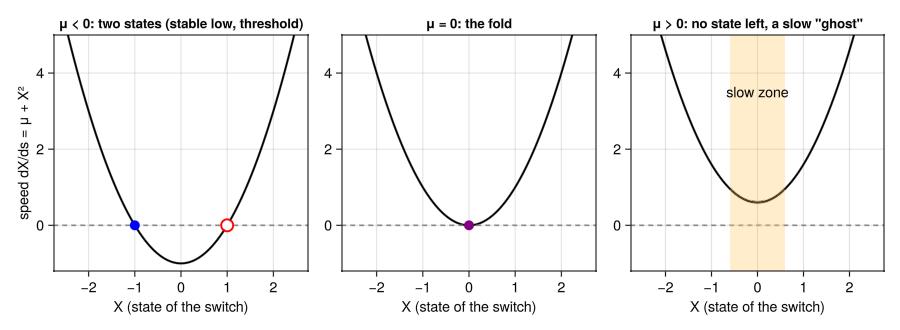

# Deriving a law: the fold switch

The package needs only the assumptions of [§1.4](problem.md#1.4-The-question-behind-the-order): sites are ready at a
regular pace, and each commits after a random delay drawn from one law ``f``. What makes the delay random, and what
shape ``f`` has, is left open: the default law ([§5.6](timing.md#5.6-The-delay-law)) is a flexible description, and
[Defining and fitting a law](custom_laws.md) shows how to fit any other.

This page works through one example of how a mechanism becomes a delay law that the orders can test: a commitment
switch driven through a *fold*. It goes in four steps:

1. the mechanism, stated as assumptions ([The mechanism](fold_law.md#The-mechanism));
2. its reduction to a delay law, simplified enough to be written in a few lines
   ([A simplified delay law](fold_law.md#A-simplified-delay-law));
3. that law as a `DelayLaw` ([Definition](fold_law.md#Definition));
4. what it predicts, and how the orders test it ([Testing it](fold_law.md#Testing-it)).

The **assumption** and **result** labels on this page belong to the example, not to the package.

## The mechanism

**The switch.** In each cell of the peripheral zone of the meristem, a regulatory network downstream of auxin
signalling reads an *input*: the strength of auxin signalling in that cell. The input rises as auxin accumulates at
the site, and is lowered near young primordia, which inhibit new ones around them. *Commitment* is the switch of the
network to the organ-founder state, a switch that is not undone when the input falls back: a site has committed once
removing auxin no longer prevents the organ from forming. The visible signs of the organ come later, but that lag does
no harm: its common part shifts every site alike, which leaves the order unchanged ([§5.2](timing.md#5.2-The-law-of-the-order-of-a-paced-meristem)), and its jitter adds to ``f``.

**Why a fold.** The **assumption** is that the network has two stable states over a range of inputs, uncommitted and
committed, and that the rising input makes the uncommitted state disappear. Positive feedback readily builds such a
switch [ferrell2012bistability](@cite); nothing is assumed about the genes, their number or their kinetics. When a
smoothly rising input makes a stable state disappear, the generic way is a *fold*: the state merges with the threshold
that separates it from the committed state, and both vanish (figure 1). The other ways need a symmetry or a finely
tuned network [saez2022dynamical](@cite). The fold also explains why commitment lasts: the committed state is still
there when the input falls back [ferrell2012bistability](@cite).

!!! details "Why a fold is generic"
    Write the network as ``d\mathbf y/dt = \mathbf F(\mathbf y; u, \boldsymbol\theta)``, with ``\mathbf y`` its
    concentrations, ``u`` the input and ``\boldsymbol\theta`` its gains, cooperativities, turnover rates and growth
    dilution. A stable state disappears (rather than just losing stability) when it collides with an unstable one, at
    a zero eigenvalue of the Jacobian ``\partial_{\mathbf y}\mathbf F``. With a single parameter varying, the input,
    the generic collision is a saddle-node at ``u = u_{\rm on}``: it has codimension one and needs no symmetry. A cusp
    needs a second parameter tuned; a pitchfork needs a symmetry of ``\mathbf F``. If a second parameter varies too
    (between cells, or in a mutant), the folds form lines in the plane of the two parameters, while the other
    bifurcations sit at single points: a path through that plane crosses fold lines without any tuning
    [saez2022dynamical](@cite). The fold is assumed non-degenerate: raising the input moves the system through it
    rather than just touching it.

**One slow variable.** This is a **result**: near a fold, the whole network behaves as a single slow variable, whose
dynamics take the same form for every network,

```math
dX = (\mu + X^2)\, ds + dW_s .
```

``X`` is the position along the slow direction, ``dW_s`` the molecular noise felt along it, and ``\mu`` the
*margin*: how far the input is above the fold, all in units set by the noise (box). Below the fold (``\mu < 0``), the
speed ``\mu + X^2`` vanishes at the uncommitted state and at the threshold; at the fold they merge, and above it they
are gone (figure 1). Commitment is the moment ``X`` passes the *point of no return*, beyond which the cell reaches the
committed state even if the input falls back.

!!! details "Derivation"
    At the fold, ``\partial_{\mathbf y}\mathbf F`` has a single zero eigenvalue. The other directions relax on their
    own time scales, and the dynamics collapse onto a one-dimensional centre manifold. With ``x`` the coordinate
    along it (projected on the left null vector, centred at the fold) and ``\Delta = (u - u_{\rm on})/u_s`` the
    margin, a Taylor expansion gives
    ``dx/dt = k_m(\Delta + a_f x^2 + b_1 x\Delta + b_3 x^3 + \dots)``, where ``k_m`` is the rate of the slow mode and
    ``a_f > 0`` the curvature of the fold. The two leading terms are the same for every network that satisfies the
    assumption; the coefficients ``b`` are network-specific and, to leading order, only add a constant to the
    commitment time. Noise in every component, and fluctuations of the input, project onto ``x`` with an intensity
    ``S_0``: ``dx = k_m(\Delta + a_f x^2)\,dt + \sqrt{k_m S_0}\,dW_t``. With the noise units
    ``x_S = (S_0/a_f)^{1/3}``, ``t_S = (a_f^2 S_0)^{-1/3}/k_m`` and ``\Delta_S = (a_f S_0^2)^{1/3}``, the variables
    ``X = x/x_S``, ``s = t/t_S`` and ``\mu = \Delta/\Delta_S`` obey ``dX = (\mu + X^2)\,ds + dW_s``. This is an
    asymptotic statement, exact as ``\Delta`` and ``x`` go to 0.



*Figure 1. The speed of the switch variable, ``dX/ds = \mu + X^2``, for three margins. Left, before the fold: a stable
uncommitted state (blue) and a threshold (red circle). Middle: the two merge, at the fold. Right, after the fold: no
state is left, but the speed stays small near ``X = 0``. The time spent there sets the commitment delay.*

**Slow from fast.** Another **result**: after the fold the speed stays small near ``X = 0``, where the uncommitted
state used to be. The cell lingers there before it escapes, for a time proportional to ``1/\sqrt\mu``: this is how a
network of fast reactions produces a slow commitment. The same slowness just *before* a fold, *critical slowing
down*, is used to anticipate tipping points [wissel1984universal, scheffer2009early](@cite), and has been measured in a
cyanobacterial population pushed towards a fold [veraart2012recovery](@cite).

!!! details "Derivation"
    Without noise and at a constant margin ``\Delta > 0``, the time from the uncommitted state ``x_0 < 0`` to the
    point of no return ``x_c > 0`` is
    ``T = \frac{1}{k_m}\int_{x_0}^{x_c} \frac{dx}{\Delta + a_f x^2} \simeq \frac{1}{k_m}\Big[\frac{\pi}{\sqrt{a_f\Delta}} - C\Big]``,
    with ``C \simeq (1/|x_0| + 1/x_c)/a_f`` plus network-specific corrections. In noise units, the first term is
    ``\pi/\sqrt\mu``. The time is spent near ``x = 0``, the "ghost" of the vanished state, where the flow almost
    stops.

**Noise makes the delay random.** A third **result**: near the ghost the speed is small, so a small push from the
noise moves the moment of escape a lot. The closer to the fold, the longer the passage, and its spread grows faster
than its mean: in noise units, the relative spread of the delay depends on ``\mu`` alone and increases as ``\mu``
shrinks. The randomness of the delay is a property of the switch itself, not an imperfection added to it.

!!! details "Derivation"
    For a margin well above the noise scale (``\mu \gg 1``), follow the deterministic path: a push ``\delta x`` at a
    point where the speed is ``v`` shifts the passage by ``\delta x / v``. Adding up the noise along the path,
    ``\mathrm{Var}(T) \simeq \int k_m S_0\, v(x)^{-3}\, dx`` with ``v = k_m(\Delta + a_f x^2)``, so
    ``\mathrm{sd}(T) \simeq \frac{\sqrt{S_0}}{k_m}\sqrt{\tfrac{3\pi}{8}}\, a_f^{-1/4}\Delta^{-5/4}``. The mean grows
    as ``\Delta^{-1/2}`` and the sd as ``\Delta^{-5/4}``; in noise units, the coefficient of variation is
    ``\mathrm{sd}/\text{mean} \simeq \sqrt{3/(8\pi)}\,\mu^{-3/4}``. Fluctuations of the input that are fast compared
    with the passage (bursts of transcription upstream, for instance) simply add to the noise ``S_0``.

**Why near the fold.** The fold makes the delay slow and variable only if cells commit at a small margin. This is an
**assumption**, but a natural one: auxin accumulates much more slowly than the network responds, and a switch driven
this slowly commits shortly after the uncommitted state has disappeared, while the margin is still small (**result**,
box below). Such slow passages through a bifurcation shape cell fates in morphogen gradients
[wedgwood2022morphogen](@cite). The meristem points the same way: inhibition by young primordia keeps the input of
nearby sites from rising far above threshold, and meristem cells integrate auxin over time before changing fate, with
stronger responses to longer treatments [galvan2020temporal](@cite). A switch near its fold behaves this way: the
longer the input stays above threshold, the more likely the cell crosses the slow region and commits.

!!! details "Derivation"
    Without noise, let the margin rise through the fold, ``\Delta(t) = \dot\Delta\, t``, in
    ``dx/dt = k_m(\Delta + a_f x^2)``. Rescaling time by ``T_0 = (k_m^2 a_f \dot\Delta)^{-1/3}`` gives
    ``dX/d\tau = \tau + X^2``, whose solution from the uncommitted state escapes at a fixed ``\tau`` (a zero of the
    Airy function). The cell therefore commits a time of order ``T_0`` after the fold, at a margin of order
    ``(\dot\Delta/k_m)^{2/3}``, which is small whenever the input rises slowly compared with the switch: the classical
    delay of a slow passage through a fold. Noise spreads the passage around this time; strong noise can even trigger
    the escape a little before the fold, but it never makes the margin larger [berglund2002effect](@cite).

**Delays in the network.** Some steps take time by themselves (transcript elongation, a lagging feedback). A delay
upstream of the switch shifts every commitment equally and leaves the order unchanged. A delay inside the feedback
slows the switch: the commitment delay gets longer and, relative to its mean, a little less variable. Either way, the
delay stays slow and random.

!!! details "Derivation"
    A pure lag of the input, ``u(t) \to u(t - \tau_d)``, shifts commitment by ``\tau_d``. A distributed delay acts,
    to first order, as a lag equal to its mean; it also smooths the rise of the input, which changes the shape of the
    delay law only when ``\tau_d`` is not short compared with the passage. A delay ``\tau_d`` inside the positive
    feedback does not move the fold but slows the switch, ``k_m \to k_m/(1 + c)`` with ``c = k_{\rm fb}\tau_d`` and
    ``k_{\rm fb}`` the slope of the feedback at the fold. To first order, the mean delay is multiplied by ``1 + c``
    and its sd by ``\sqrt{1 + c}``, so the coefficient of variation decreases. These are first-order results
    (``k_{\rm fb}\tau_d \ll 1``); long delays can change the switch itself.

## A simplified delay law

The exact law of the passage time through the ghost has no closed form, and the normal form above is itself only the
local picture of the switch: ``X`` runs off to infinity in a finite time, and the state of the cell before the fold, with
its own fluctuations, is not part of it. A law that the orders can test needs a simpler description. The one below keeps
the two features of the passage that matter for the order: its spread, and its skew towards late sites.

**assumption** — the margin ``\mu`` is constant during the passage, and well above the noise scale (``\mu \gg 1``); the
passage starts far before the ghost and ends far after it.

**result** — the passage time then follows, to a good approximation, an **inverse Gaussian** law (the first-passage
time of a Brownian motion with drift), with a coefficient of variation set by the margin alone:

```math
\mathrm{CV} = \sqrt{\tfrac{3}{8\pi}}\;\mu^{-3/4}, \qquad \text{skewness} = 3\,\mathrm{CV}.
```

!!! details "Derivation"
    Write ``X = \sqrt\mu \tan\theta``. Without noise, the angle ``\theta`` turns at the constant rate ``\sqrt\mu``, from
    ``-\pi/2`` (far before the ghost) to ``\pi/2`` (``X`` at infinity): the passage takes ``\pi/\sqrt\mu``, the time
    spent near the ghost. Noise moves ``\theta`` by ``d\theta = \cos^2\theta\, dX/\sqrt\mu``, a variance
    ``\cos^4\theta/\mu`` per unit time, largest at the ghost (``\theta = 0``). Replacing it by its average over the
    passage, ``\langle\cos^4\theta\rangle = 3/8``, turns ``\theta`` into a Brownian motion with drift ``\sqrt\mu`` and
    variance ``3/(8\mu)`` per unit time, whose first passage over the distance ``\pi`` is inverse Gaussian, of mean
    ``\pi/\sqrt\mu`` and variance ``\tfrac{3\pi}{8}\mu^{-5/2}``. Both agree with the small-noise results above. The
    approximation ignores the variation of the noise along the passage (it matters when ``\mu`` is not large), the
    spread of the state of the cell when the input starts to rise, and the rise of the margin during the passage
    ([Why near the fold](fold_law.md#The-mechanism)); each would change the shape of the law, not its kind.

**From time to plastochrons.** The passage time ``T`` above is in the time units of the switch, and the delay is
measured in plastochrons. Converting one into the other multiplies ``T`` by a factor that is unknown: it changes the
scale of the law, not its shape, which is set by its coefficient of variation, and so by the margin ``\mu`` alone. The
law in plastochrons therefore has two parameters: its sd ``s``, which takes in the unknown factor, and the margin
``\mu``. Together they also fix its mean, ``m = s/\mathrm{CV}``, but the orders cannot measure it: a delay common to
every site leaves the order unchanged ([§5.2](timing.md#5.2-The-law-of-the-order-of-a-paced-meristem)). The law is
therefore centred, ``e = T - m``. As ``\mu`` grows, the CV and the skew vanish and the law becomes a Gaussian of sd
``s``; as ``\mu`` falls, it becomes skewed, with a longer late tail.

The factor is the same for every site only if the plastochron is; a plastochron that changes along the stem changes
``s`` with it ([§5.2](timing.md#5.2-The-law-of-the-order-of-a-paced-meristem), a clock in plastochrons, not in hours).

## Definition

```@example fold
using PhyllotaxisFold, Random
using Distributions: InverseGaussian
import PhyllotaxisFold: delay_logpdf, free_parameters, with_free_parameters, reported_parameters, nshared_parameters

struct FoldDelay{T <: Real} <: DelayLaw
    s::T   # sd of the delay (plastochrons)
    μ::T   # margin above the fold (noise units)
end

# the inverse Gaussian of the passage: mean m and shape λ (CV² = m/λ)
function passage(f::FoldDelay)
    cv = sqrt(3 / (8π)) * f.μ^(-3 / 4)
    m = f.s / cv
    return m, m / cv^2
end

function delay_logpdf(f::FoldDelay, z)  # z = T - m, up to a constant
    m, λ = passage(f)
    t = z + m
    t > 0 || return oftype(t, -Inf)
    return -3 / 2 * log(t) - λ * (t - m)^2 / (2 * m^2 * t)
end

free_parameters(f::FoldDelay) = [log(f.s), log(f.μ)]
with_free_parameters(::FoldDelay, v) = FoldDelay(exp(v[1]), exp(v[2]))
reported_parameters(f::FoldDelay) = (; s = f.s, μ = f.μ)
nshared_parameters(::FoldDelay) = 1   # groups fitted jointly share the sd
Base.rand(rng::AbstractRNG, f::FoldDelay) = (p = passage(f); rand(rng, InverseGaussian(p...)) - p[1])
nothing # hide
```

**The grid.** The late tail decays at the rate ``1/(2 s\,\mathrm{CV})`` per plastochron, and the support starts at
``-m``, where the density is already negligible: for delays of a plastochron or less, the default grid (−30 to 30
plastochrons, [The delay grid](custom_laws.md#The-delay-grid)) holds the whole law.

**Usage.** As for any law, with the samples of step 1 of the [worked analysis](workflow.md):

```julia
fd = fit_delay_law(smp, FoldDelay(0.4, 5.0))        # fit, from s = 0.4 plastochron and μ = 5
inf = delay_law_inference(smp, fd)                  # s and μ, with robust standard errors
fit_delay_law(smp, GaussianExpTails(:late)).rel_ll  # the default law with a late tail only
overtaking(fd.law), overtaking_profile(smp)         # what the law predicts, and what the orders say
simulate_stems(FoldDelay(0.4, 2.0); plants = 50, organs = 40)  # stems from a fold, to test the method on them
```

## Testing it

The fold law makes predictions that the default law leaves free, and each can be checked against the orders:

- **One parameter for the shape.** The width of the core and the length of the late tail are tied by the margin: a
  narrower core goes with a longer tail. The default law fits them separately; the difference of their scores says
  whether the orders need that freedom.
- **A late tail and no early one.** A passage cannot end before it starts. Early organs, displaced towards the
  bottom of the stem, are only made by the left side of the core. This is the weakly identified late/early split of
  [§5.6](timing.md#5.6-The-delay-law), so it calls for care: compare with `GaussianExpTails(:late)` and `:both`, and
  simulate stems from both laws to see how well the orders separate them.
- **The margin is a reading of the shape.** ``\mu`` is read from the skew of the law, through the approximation above.
  A fitted ``\mu`` of order 1 or below lies outside the range where the approximation holds: it then says that the
  law is strongly skewed, not what the margin is.

**On the simulated stems of the worked analysis**, which were drawn from the default law, the comparison behaves as
expected (scores relative to the propensity model, as in [Defining and fitting a law](custom_laws.md)):

| law (free parameters) | wild type | mutant |
|---|---|---|
| fold, inverse Gaussian (2) | −17.6 | +42.5 |
| default, core and late tail (3) | −8.7 | +46.5 |
| default, core and both tails (5) | +15.6 | +56.3 |

The fitted margins (``\mu \approx 0.4`` and ``0.3``) fall outside the range of the approximation: the law reaches for
a strong skew to make the long overtakings, and the profile shows what it misses (in the wild type,
``q_3 = 0.005`` against ``0.010`` read from the orders). Since these stems carry early organs by construction, this
says nothing about plants: on real stems, the same score and profile decide.

**Beyond this law.** The simplifications above are the place to start for a better law: a margin that varies between
sites (the [Student t example](custom_laws.md#Example:-a-Student-t-law) does this for a Gaussian delay), a margin that
rises during the passage, or a random state of the cell before the fold. Each gives another density, fitted and compared
on the same scale.
