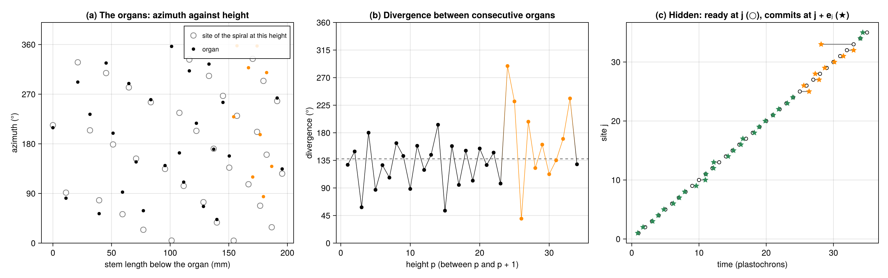

# PhyllotaxisFold.jl

*Reading the timing of organ initiation from the angles of the organs on a plant stem.*

The flowers of an *Arabidopsis* stem sit on a spiral: each one is rotated by about 137.5°, the golden angle, from the
one below. Every so often two neighbours are swapped, the later one sitting below the earlier one. These swaps record
*when* each organ was initiated at the tip of the plant, weeks before we look at the stem. From the angles alone, the
package reconstructs the order of initiation, then measures how precise its timing is and how often an organ comes
out of its turn.



*The example stem of the method pages (simulated). (a) Each organ at its height and azimuth; the grey circles are the
ideal spiral. (b) The angles between consecutive organs: mostly the golden angle, with a few characteristic jumps.
(c) What produced them, hidden from the observer: each site became ready at a regular pace (circles) and committed
after a small random delay (stars). Where two stars cross, the organs are swapped on the stem. This stem is one of
the 40 stems of 35 organs of the **running example**, whose delays have a Gaussian core of sd 0.42 plastochron, plus
6 % of the sites late (mean 1.5 plastochron) and 6 % early (mean 1.0) ([§5.6](timing.md)).*

## Quick start

```julia
using PhyllotaxisFold

# angles: one vector of azimuths per stem (radians, bottom to top); x: the stem length (mm) below each organ
m = PhyllotaxisModelAD(angles; torsion_x = x)
r = fit_map_torsion!(m; prior = TorsionPrior(m0 = 0.0, sm = 2.0, νω = 4.0, τω = 1.0))
smp = order_samples(order_posterior(m, r; nsamples = 200), r.fit.θ.η)

prof = overtaking_profile(smp)   # how often an organ is overtaken by the one d places up: the result to report
fit = fit_delay_law(smp, :both)  # a delay law that interprets it
```

[**A worked analysis**](workflow.md) runs the whole workflow on a simulated wild type and mutant, with the checks to
make and how to read the results.

## The method in five steps

1. [**The problem**](problem.md): what a swap is, and why the order cannot simply be read off the angles.
2. [**Angles given an order**](angles.md): a regular spiral, a little noise, a slow twist of the stem.
3. [**Summing over all orders**](orders.md): ``10^{56}`` orders summed exactly in a few thousand operations.
4. [**The propensity model**](propensity.md): the law of the order that reconstructs every stem, with its uncertainty.
5. [**Commitment timing**](timing.md): the delay law of initiation, scored exactly on those reconstructed orders.

Then [**validation on simulated stems**](validation.md), [**assumptions and limits**](limits.md),
[notation and references](notation.md), and the [API](api.md).

## How to read the method pages

They are written for a biologist comfortable with probabilities: each idea in words first, then as an equation. Two
labels mark the logic:

- **assumption**: a choice about the plant or the measurement, which could be wrong;
- **result**: a mathematical consequence of the assumptions.

Proofs and numerical details sit in folded boxes, which the main text never depends on:

!!! details "Derivation"
    The step-by-step argument behind a result.

Each page ends with the functions that implement it.
