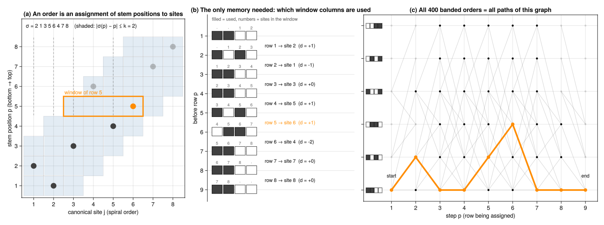
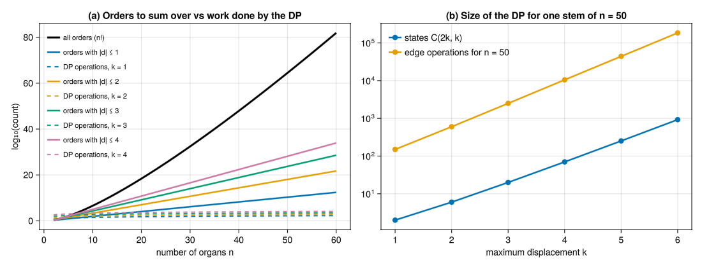
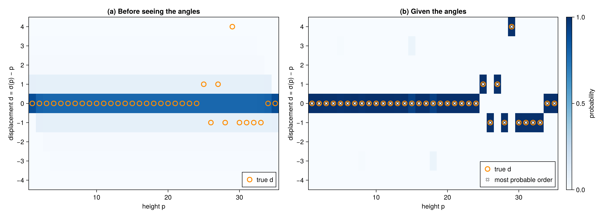

# 3. Summing over all orders

The likelihood of a stem contains a sum over all its orders ([§2.5](angles.md)). When the law of the order has a
product form, this sum is exact in a few thousand operations. The argument is elementary, and everything else rests on
it: exact likelihoods, exact gradients, Newton's method and exact samples of the order.

## 3.1 The sum as a permanent

Fix the nuisance quantities (``\phi, o, \psi, \kappa, \omega_s``). The angles are independent given the order, so the
angle term is a product over heights, ``\prod_p v_{p,\sigma(p)}``, with ``v_{p,j}`` the von Mises density of ``y_p``
at the angle of site ``j``. Suppose the law of the order has the same structure:

```math
P(\sigma) = \frac{1}{Z} \prod_{p=1}^{n} h_{p,\sigma(p)} ,
```

one positive factor for each organ, depending only on its height ``p`` and its site ``\sigma(p)``. Then the sum over
orders is

```math
\sum_\sigma P(\sigma) \prod_p v_{p,\sigma(p)} = \frac{1}{Z} \sum_\sigma \prod_{p=1}^{n} W_{p,\sigma(p)},
\qquad W_{p,j} = h_{p,j}\, v_{p,j} .
```

The sum on the right is the **permanent** of ``W``: the determinant without its signs (and ``Z`` is the permanent of
``h``). Bad news at first sight: a determinant costs ``n^3`` operations, but a general permanent is among the hardest
problems to compute (Valiant 1979).

## 3.2 The band

A general permanent lets every organ come from every site. A stem does not: an organ sits a few positions at most
from its canonical place.

**assumption** — no organ is displaced by more than ``k`` positions: ``|\sigma(p) - p| \le k``, with ``k = 4``.

Then ``W_{p,j} = 0`` for ``|j - p| > k``: ``W`` is a band matrix. The assumption is checked afterwards: noticeable
posterior probability at ``|d| = k`` means the band is too narrow.

The band alone is not enough (a stem of 45 organs still has ``1.8 \times 10^{25}`` banded orders), but it creates a
structure that is.

## 3.3 Reading the stem from the bottom

Assign the organs one height at a time, from the bottom. Once heights ``1, \dots, i - 1`` are assigned, what does the
rest of the stem need to know? Only which sites are still free, and the band decides most of that:

- a site ``j \le i - k - 1`` *must* be taken already. The only heights that can hold it are ``\le j + k \le i - 1``.
- a site ``j \ge i + k`` *cannot* be taken yet. The heights below ``i`` reach sites up to ``i - 1 + k`` at most.

Only the ``2k`` sites of the window ``\{i - k, \dots, i + k - 1\}`` can go either way: the whole past is summarised
by *which sites of the window are used*.

!!! note "result — the window lemma"
    For an order in the band, count the ``k`` virtual sites ``1 - k, \dots, 0`` as used. Before height ``i`` is
    assigned, the used sites are: all sites ``\le i - k - 1``, no site ``\ge i + k``, and exactly ``k`` of the ``2k``
    sites ``\{i - k, \dots, i + k - 1\}``.

!!! details "Derivation"
    The first two points are the two bullet points above. For the count: heights ``1, \dots, i - 1`` and the ``k``
    virtual sites make ``i - 1 + k`` used sites. Below the window lie the sites ``1 - k, \dots, i - k - 1``, which are
    all used and number ``i - 1``. The remaining ``k`` used sites are inside the window. ∎

The past is one of ``\binom{2k}{k}`` *states*: 70 for ``k = 4``, whatever the length of the stem. Height ``i`` takes
any free site of the window, or the site ``i + k`` entering it, with one forced move: if site ``i - k`` is still free,
height ``i`` must take it, since no later height can reach it. Every banded order is then exactly one path through a
graph whose columns are the heights and whose nodes are the states; the weight of a path is the product of the
``W_{p,\sigma(p)}`` along it (figure 1).



*Figure 1. An order is a path. (a) An order drawn as an assignment: rows are heights, columns are sites. Only the
shaded band ``|j - p| \le 2`` is allowed. The order 2 1 3 5 6 4 7 8 has a swap (heights 1–2) and a cycle of three
organs (4–6). The orange frame is the window of row 5: sites below it are used, sites above it are free. (b) The state
before each row, and the choice made. Before row 6 the lowest site of the window is free, so row 6 must take it.
(c) The graph unrolled along the stem, for ``k = 2``: one column of six states per height, one edge per allowed
choice. Every banded order of 8 organs is one path from start to end; the orange path is the order of (a).*

## 3.4 Merging the paths

Two partial orders reaching the same state have the same possible futures, so their weights can be added before going
on. This is the key step.

!!! note "result — the forward recursion"
    Let ``F_i(s)`` be the total weight of all the ways of assigning heights ``1, \dots, i - 1`` that end in state
    ``s``. Then
    ```math
    F_1 = \mathbb 1[s = \text{start}],\qquad
    F_{i+1}(s') = \sum_{s \xrightarrow{d} s'} F_i(s)\, W_{i,\,i+d},\qquad
    \operatorname{perm}(W) = F_{n+1}(\text{end}),
    ```
    where the sum runs over the edges into ``s'``, and an edge labelled ``d`` assigns height ``i`` to site ``i + d``.

The cost is the number of edges times the number of heights: about ``10^4`` operations for 45 organs, instead of
``10^{25}`` products (figure 2). The weights are rescaled at each height, as in hidden Markov models, and the code
falls back to log space whenever a rescaled number could underflow.



*Figure 2. (a) The number of orders a brute-force sum would visit (solid lines, log scale), and the number of
operations of the forward recursion (dashed), against the number of organs: all ``n!`` orders (black), and the banded
orders for ``k = 1`` to ``4`` (colours). (b) For one stem of 50 organs, the number of states and of operations, against
the width of the band.*

## 3.5 What else the graph gives

The same graph answers every question about the order of a stem.

- **The probability of each displacement.** Run the recursion from the top as well, giving ``B_i(s)``, the weight of
  all completions from state ``s``. The probability that height ``p`` holds the organ of site ``p + d`` is the weight of
  the paths through the edges labelled ``d`` at height ``p``, divided by the total:
  ```math
  \rho_{p,d} = \frac{1}{\operatorname{perm}(W)} \sum_{s \xrightarrow{d} s'\ \text{at height}\ p} F_p(s)\, W_{p,p+d}\, B_{p+1}(s') .
  ```
- **The most probable order.** The same recursion with a maximum in place of the sum (the Viterbi algorithm).
- **Exact samples of the order.** Walk from the start, and choose each edge with probability
  ``W_{i,i+d}\, B_{i+1}(s') / B_i(s)``. Each banded order is drawn with its exact probability ``\propto \prod_p
  W_{p,\sigma(p)}``.

When ``W`` contains the angles, these are posterior probabilities given the angles (figure 3).



*Figure 3. The order of the example stem. Each column is a height, each row a displacement ``d = \sigma(p) - p``; the
colour is the probability that the organ at height ``p`` comes from site ``p + d``. Orange circles: the true
displacements. (a) Before seeing the angles, under the fitted propensity model. (b) Given the angles: most columns
concentrate on one value. Black crosses: the most probable order. Where the angles are ambiguous the probability is
shared between several orders, and the single best order should not be trusted.*

## 3.6 Derivatives

The permanent is linear in each entry of ``W``, which gives its derivatives for free.

!!! note "result"
    ```math
    \frac{\partial \log \operatorname{perm}(W)}{\partial \log W_{p,j}} = P_W\big(\sigma(p) = j\big) = \rho_{p,\,j-p} .
    ```
    If ``\log W_{p,p+d} = \eta_d + c_p`` (the same cost ``\eta_d`` for a displacement ``d`` at every height), then
    ``\partial \log\operatorname{perm} / \partial\eta_d = \mathbb E[N_d]`` and the second derivatives are
    ``\operatorname{Cov}(N_d, N_e)``, where ``N_d`` is the number of organs displaced by ``d``. The log-permanent is
    therefore convex in ``\eta``.

!!! details "Derivation"
    Write ``\operatorname{perm}(W) = W_{p,j}\, M_{p,j} + R``, where ``M_{p,j}`` is the permanent of ``W`` without row
    ``p`` and column ``j``, and ``R`` collects the orders with ``\sigma(p) \ne j``. Then
    ``\partial\log\operatorname{perm}/\partial\log W_{p,j} = W_{p,j} M_{p,j} / \operatorname{perm}(W)``, the share of
    the orders with ``\sigma(p) = j``. Summing over the entries with ``j - p = d`` gives ``\mathbb E[N_d]``. The second
    derivative of a log-sum of exponentials of a linear function is the covariance of the exponents.

For the stem likelihood, the gradient in the costs reads

```math
\frac{\partial \ell}{\partial \eta_d} = \mathbb E[N_d \mid \text{angles}] - \mathbb E[N_d] :
```

the expected number of organs displaced by ``d`` given the angles, minus the same number before seeing them (with
the symmetric costs of [§4](propensity.md), ``\eta_{-d} = \eta_d``, the two sides add up). The
derivatives in ``\kappa`` and ``\alpha`` come from the same pass (expected cosines, posterior weight of the golden
spiral). The Hessian is one pass of forward-mode dual numbers through this analytic gradient.

## 3.7 The order of a real stem

The posterior of [§3.5](orders.md) holds for fixed nuisance quantities. A real stem has an unknown spiral, precision
and twist, and different values can favour different orders (the twist especially, whose likelihood is often
multimodal). The package gives two decodings of the fitted model.

- **The posterior of the order** (`order_posterior`). It is a mixture over the nuisance states,
  ``P(\sigma \mid y) = \sum_{\text{state}} P(\text{state} \mid y)\, P_W(\sigma)``. The weight of each state (grid node
  of ``\phi, o, \psi, \kappa`` and twist node) comes from the forward pass, and ``P_W`` is the banded law with that
  state's weights. Its marginals ``\rho_{p,d}`` mix the marginals of the states. Its exact samples draw a state, then
  an order. This is the decoding to count events with, and the input of [§5](timing.md).
- **The most probable order** (`decode_orders`). The most probable pair (order, state): the Viterbi order of every
  state of non-negligible weight, and the twist rate optimised as well. It returns one order per stem, with its twist,
  spiral and precision, for figures and for organ-by-organ inspection.

**Code.** `Permanents`: `PermutationGraph(k)` (built once), `PermanentWorkspace`, `forward!`, `backward!` (marginals),
`sample_permutation!`, `map_permutation` (Viterbi), `logprob_permutation`; `order_posterior`, `decode_orders`,
`spiral_posterior`. The tests check the permanent, the marginals and the sampling frequencies against brute-force
enumeration.
