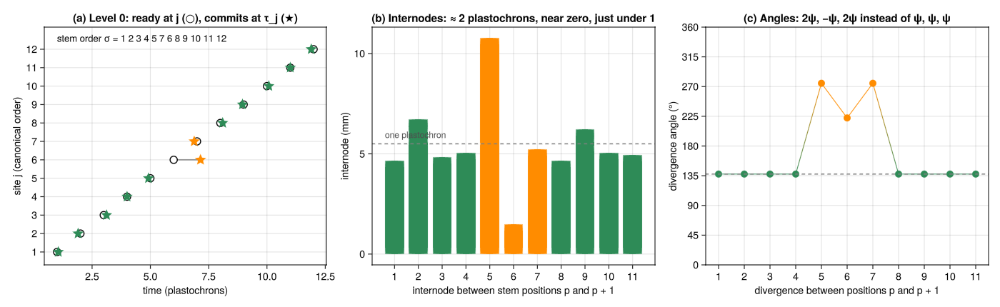

# 1. The problem

## 1.1 Organs on a spiral

At the tip of a growing shoot, the meristem makes new organs one after the other. Each new organ (a *primordium*)
appears where the auxin field allows it, away from the youngest organs, which inhibit their surroundings [reinhardt2003regulation, shi2019patterning](@cite). This rule is enough for a regular pattern. In *Arabidopsis* the flowers follow a
spiral, two successive flowers being separated by the **divergence angle** ``\psi \approx 137.5^\circ``, the golden
angle. Some plants follow a rarer spiral of ``\approx 99.5^\circ`` (the Lucas angle), and the spiral turns clockwise
or counter-clockwise depending on the plant.

The stem keeps a record of this process. Once initiated, the organs are carried upwards by the growth of the stem and
stay in place. Going up a mature stem reads the history of the meristem, one organ per *plastochron* (the time between
two initiations).

## 1.2 A swap and its signature

The record is often disturbed: two organs initiated close in time can end up inverted along the stem [besnard2014cytokinin, refahi2016stochastic](@cite). Their *positions* on the spiral are correct, but the organ of the later site sits below
that of the earlier one.

Number the sites of the spiral ``j = 1, 2, \dots`` in spiral order (the *canonical* order); site ``j`` sits at the
angle ``(j - 1)\psi``. If organ ``p`` (counted from the bottom) comes from site ``\sigma(p)``, the divergence between
heights ``p`` and ``p + 1`` is ``(\sigma(p + 1) - \sigma(p))\,\psi``. In a perfect stem ``\sigma(p) = p`` and every
divergence is ``\psi``. Swap the organs of sites 6 and 7, and heights 5 to 8 hold sites 5, 7, 6, 8: the three
divergences around the swap become

```math
(7 - 5)\psi = 2\psi,\qquad (6 - 7)\psi = -\psi,\qquad (8 - 6)\psi = 2\psi .
```

A swap leaves a signature spanning three divergences (figure 1c), and every permutation leaves its own.



*Figure 1. How a timing event becomes a permutation. (a) Site ``j`` becomes ready at time ``j`` (circles, in
plastochrons) and commits after a random delay (stars); sites 6 and 7 (orange) commit in inverted order. (b) The
internodes around the inverted pair, for a stem growing at a steady pace: about two plastochrons, nearly zero, just
under one. (c) The divergences: ``2\psi``, ``-\psi``, ``2\psi`` instead of ``\psi, \psi, \psi``.*

## 1.3 Why the order cannot simply be read off

With exact angles, the order could be read from the divergences. Real angles are blurred in three ways:

- **noise**: each azimuth is off by several degrees, more on some stems than on others;
- **an unknown spiral**: the angle of the first site, the orientation and the divergence (golden or Lucas) differ from
  stem to stem, and are not measured;
- **twist**: many stems twist as they elongate, slowly rotating the organs higher up.

So a divergence of ``170^\circ`` may be a noisy ``\psi``, or part of a swap seen through noise. One organ cannot
decide; the *whole* stem can. An order is plausible if it explains all the angles at once, with one spiral, one noise
level and one twist. A careful answer therefore weighs every possible order of the stem by how well it explains the
angles, and there are many: ``45! \approx 10^{56}`` for a stem of 45 organs.

## 1.4 The question behind the order

The order matters for what it says about the meristem. Here is the simplest mechanism that produces swaps:

- **assumption** — the sites become *ready* at a regular pace: site ``i`` at time ``i``, in plastochrons;
- **assumption** — each site then *commits* to become an organ after a random delay ``e_i``, independently of the
  others, with the same law ``f`` for every site;
- **assumption** — the organs appear on the stem in the order of commitment.

Site ``i`` commits at ``\tau_i = i + e_i``, and the order on the stem ranks these times (figure 1a):

```math
\sigma = \operatorname{sortperm}(\tau_1, \dots, \tau_n),\qquad \tau_i = i + e_i,\qquad e_i \overset{\text{iid}}{\sim} f .
```

Everything about the mechanism is in the **delay law** ``f``. A narrow ``f`` (sd well below one plastochron) gives
rare swaps between neighbours; a wide one, frequent and longer-range permutations. A tail, a few sites committing much
later than the others, gives a distinctive pattern: one organ displaced by two or three positions. The goal of the
package is to **estimate ``f`` from the angles**.

## 1.5 The plan

The angles depend on ``f`` only through the order, so the likelihood of a delay law is

```math
p(y \mid f) = \sum_{\sigma} P_f(\sigma)\, p(y \mid \sigma),
```

with ``P_f(\sigma)`` the probability of the order under the delay law, and ``p(y \mid \sigma)`` that of the angles
given the order (spiral, noise and twist integrated out). Three questions follow:

1. What is ``p(y \mid \sigma)``? A model of the angles given the order ([§2](angles.md)).
2. How can one sum over ``10^{56}`` orders? Easily, *provided* ``P(\sigma)`` is a product of one term per organ, each
   depending only on the organ's height and site ([§3](orders.md)).
3. Does ``P_f`` have that form? Not exactly: whether site ``i`` precedes site ``j`` depends on both of their delays,
   which ties every position to all the others. A product can approach ``P_f``, not reproduce it ([§5.3](timing.md#5.3-Not-a-product,-but-close-to-one)).

So ``p(y \mid f)`` cannot be computed by the easy sum. The way around is to fit an order law ``A`` that *does* have the
product form and is flexible enough to follow the data. ``A`` tells exactly which orders are plausible for each stem,
and gives samples of them; a good delay law should give these orders a high probability. This intuition is exact:
since ``A`` and ``f`` describe the angles in the same way and differ only in the law of the order
([§5.5](timing.md#5.5-Re-weighting-the-reconstructed-orders)),

```math
\frac{p(y \mid f)}{p(y \mid A)} = \mathbb{E}_{\sigma \sim p(\sigma \mid y, A)}\left[\frac{P_f(\sigma)}{P_A(\sigma)}\right].
```

This is the two-step plan of the package:

| step | model | what it gives | pages |
|---|---|---|---|
| 1 | the **propensity model** ``A``: a free cost for each displacement, in product form | the exact posterior of the order of each stem, with its spiral, noise and twist | [§2–4](propensity.md) |
| 2 | **commitment timing**: the delay law ``f`` | ``\log p(y \mid f) - \log p(y \mid A)``, hence a fit of ``f`` and tests between laws | [§5](timing.md) |

**Data.** For each stem, from the bottom to the top (heights ``p = 1, \dots, n``):

| measurement | symbol | used for |
|---|---|---|
| absolute azimuth of each organ (radians) | ``y_p`` | the likelihood |
| internode lengths (mm), optional | ``\ell_p`` | the coordinate of the twist ([§2.3](angles.md#2.3-The-twist)) |
| daily counts of open flowers, optional | ``c(\text{day})`` | the plastochron in hours (`Plastochron`) |

The models use absolute azimuths rather than divergences ``y_{p+1} - y_p``: a misplaced organ then changes one
observation instead of two, and the observations given the order are independent.
