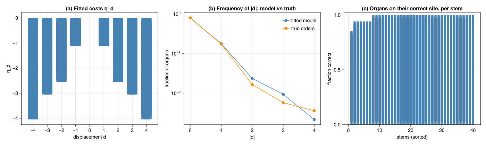

# 4. The propensity model

Step 1 of the plan ([§1.5](problem.md)) needs a law of the order with two properties. It must have the product form of
[§3.1](orders.md), so that the sum over orders is exact. And it must be flexible enough to follow the data, so that the
orders it reconstructs are those the angles support, not those a narrow model imposes.

## 4.1 The most general law that keeps the sum exact

The product form allows one factor ``h_{p,\sigma(p)}`` per organ. Add one requirement:

**assumption** — the law is the same all along the stem: the factor depends on the displacement ``d = \sigma(p) - p``,
not on the height.

Then ``h_{p,j}`` is a function of ``j - p`` only. Write it ``e^{\eta_d}``, and nothing else is left to choose:

```math
P(\sigma \mid \eta) = \frac{1}{Z(\eta)} \exp\Big( \sum_{p=1}^{n} \eta_{\sigma(p) - p} \Big),
\qquad Z(\eta) = \operatorname{perm}\big[ e^{\eta_{j-p}} \big]_{p,j}.
```

This is the **propensity model**, the law ``A`` of [§1.5](problem.md). There is one free *log-propensity* ``\eta_d``
per displacement ``d = -k, \dots, k``. With the angles, the weights of [§3](orders.md) are

```math
W_{p,j} = e^{\eta_{j-p}}\; e^{\kappa \cos(y_p - \phi - o\,(j-1)\,\psi - \omega_s x_p)} .
```

The propensity model is close in spirit to the stochastic model of Refahi et al. (2016), where each candidate site
fires at a rate set by the inhibitory field. It keeps what the orders of a stem can identify: how costly each
displacement is.

## 4.2 What ``\eta`` means

- **A cost, not a frequency.** The organs compete for the sites: if one organ takes the site of its neighbour, the
  neighbour must go elsewhere. So ``e^{\eta_d}`` is not the probability of a displacement ``d``. The realised
  frequencies follow from the costs through the permanent (`estimate_displacement_frequencies`).
- **Two directions that change nothing.** Adding a constant to every ``\eta_d`` changes nothing. More surprisingly,
  neither does tilting the costs, ``\eta_d \to \eta_d + a\,d``.

!!! details "Why a tilt changes nothing"
    Under a tilt, ``\sum_p \eta_{\sigma(p)-p}`` gains ``a \sum_p (\sigma(p) - p)``. For a permutation,
    ``\sum_p \sigma(p) = \sum_p p``: the displacements of an order always sum to zero. Every order gains the same
    amount (zero), and ``P(\sigma \mid \eta)`` is unchanged. ∎

The code therefore fixes ``\eta_0 = 0``, and uses **symmetric costs**, ``\eta_{-d} = \eta_d``. Free costs on the
two sides would not pay for themselves:

- the tilt moves the overall balance between positive and negative displacements without changing any probability, so
  that balance would be set by the prior alone;
- what remains of the asymmetry is carried by the rarer patterns of three organs or more (an organ that jumps two
  places one way while its neighbours each shift one place back);
- and the question an asymmetry would answer, *are the off-time organs early or late?*, is a question about timing.
  [§5](timing.md) asks it directly, with a law in which early and late have a physical meaning.

## 4.3 Prior

**assumption** — a larger displacement is never cheaper than a smaller one:
``\eta_d = -(\Delta_1 + \dots + \Delta_d)`` with independent log-normal gaps ``\Delta_j > 0`` (default means 0.5, 1.25,
2, 3.75).

The rare long displacements are set mostly by this prior, since a stem has few of them. For the fit, the gaps are
mapped to the real line by a softplus (`LogNormalSoftPlus`).

## 4.4 Fitting

The parameters (``\eta``, ``\log\mu_\kappa``, ``\sigma_\kappa``, ``\alpha``, the twist population ``m_\omega,
s_\omega`` and optionally ``\pi_o``) are fitted by maximum a posteriori.

- **Parameters on the real line.** Positive parameters go through a log, probabilities through a logit, and the costs
  ``\eta`` through the softplus map of their gaps ([§4.3](propensity.md)). The log-Jacobian of these maps is part of
  the log density.
- **Newton's method with a trust region.** The value, the gradient and the Hessian are computed in one call, and the
  Hessian only when the optimiser asks for it. The gradient is analytic ([§3.6](orders.md)). The Hessian is one pass
  of forward-mode dual numbers through the analytic gradient. A non-finite evaluation counts as a rejected step.
- **Uncertainty.** Laplace approximation: ``-H^{-1}`` at the maximum is the covariance of the unconstrained
  parameters.
- **Model comparison.** The integrated log-likelihood at the maximum (`loglik` of `fit_map_torsion!`, priors
  excluded). Timing laws are compared with the propensity model and with each other by ``\Delta\ell``
  ([§5.5](timing.md)).
- **Cost.** One stem of about 45 organs takes about 50 ms (2048 nuisance nodes). A fit of 50–90 stems with the twist
  integrated takes 10–15 minutes on 18 threads.

For the example stem and the other stems simulated with it, figure 1 shows the fitted costs and the orders they
reconstruct.



*Figure 1. The propensity model fitted to the 40 simulated stems of the example. (a) The fitted costs ``\eta_d``.
(b) The realised frequency of each displacement under the fitted costs, against the frequency in the true orders.
(c) The fraction of organs whose most probable site is correct, stem by stem.*

## 4.5 Fitting with the twist integrated out

The twist rate of each stem is integrated out of its likelihood by an adaptive quadrature, whose nodes are placed on
the peaks of that stem's own likelihood ([§2.3](angles.md)). The nodes depend on the parameters at which they are
placed, so the fit and the nodes are updated in turn. The nodes stay fixed during a Newton fit, so the objective is a
smooth function of all the parameters, including ``(m_\omega, \log s_\omega)``. `fit_map_torsion!` alternates the
two:

1. fit without twist;
2. place the nodes;
3. fit with each stem at its best mode;
4. place the nodes again;
5. fit the integrated objective.

It then optionally places the nodes once more and refits (`recenter`).

## 4.6 Why not stop here

The propensity model reconstructs the orders well, but its parameters only describe them. A cost ``\eta_2 = -2.5``
says that displacements by two positions are rare. It does not say why. It does not say whether they come from an
organ initiated late, or from one initiated early. It does not predict how the displacements of neighbouring organs go
together. Answering these questions needs a mechanism, and this is where [§5](timing.md) starts.

**Code.** `PhyllotaxisModelAD(angles, PhyllotaxisPrior(); outlier = false, torsion_x)`,
`fit_map` (no twist), `fit_map_torsion!` (twist integrated out; overwrites the stored twist rates of the model),
`constrained_parameters` (η is the full vector of ``2k + 1`` costs), `unconstrained_parameters`,
`prior_mean_parameters`, `full_eta`; post-processing: `estimate_displacement_frequencies`,
`estimate_permutation_frequencies`, `displacement_probability`; simulation: `simulate_stems(η; ...)`,
`sample_prior`. `TransformedLogDensityProblem(model)` gives the model to LogDensityProblems users.
