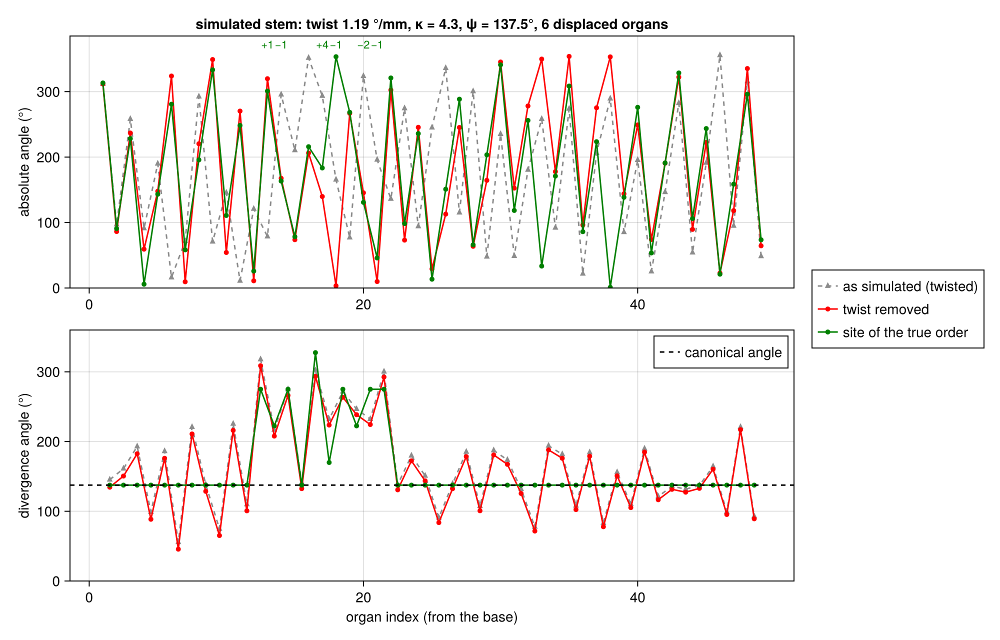
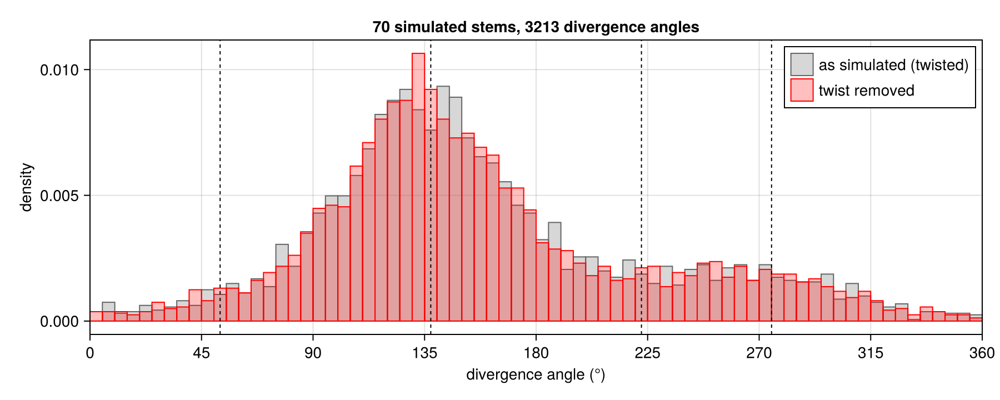

# Simulating stems

The model of the package is also a simulator of phyllotaxis. It makes stems as they are measured: absolute azimuths
with some imprecision, a twist of the stem, the occasional aberrant angle, and organs that do not always sit in the
order of their sites. Because the truth is known, simulated stems serve to:

- **test a measurement or analysis pipeline**, against stems whose order, twist and precision are known;
- **see what a statistic looks like** (a histogram of divergence angles, a count of swaps) under given conditions;
- **check a fitted model against its data**, by comparing the data with stems drawn from the fit
  ([below](#Checking-a-fit-against-its-data)).

## The stem model

Each stem has five ingredients, each set by a few keywords of `simulate_stems`:

| ingredient | what is drawn | keywords | in the example below |
|---|---|---|---|
| the order | which site each organ belongs to | the costs η (first argument) | ``\eta = (-1.2, -2.5, -3.1, -4.0)`` |
| the spiral | its angle, orientation and offset | `α` | golden in 96 % of the stems |
| the precision | the scatter of the angles around their sites | `logμκ`, `σκ` | ``\kappa \approx 6.4``, a circular sd of 23° |
| the twist | a rotation growing along the stem | `x`, `torsion_mean`, `torsion_sd` | 1.0 ± 0.5 °/mm |
| outliers | aberrant angles, uniform on the circle | `outlier` | one angle in 200 |

**The order.** The organ at height ``p`` belongs to site ``\sigma[p]``, displaced by ``d = \sigma[p] - p``. A
displacement by ``d`` (up or down) has propensity ``e^{\eta_d}`` relative to staying in place: with
``\eta_1 = -1.2``, a displacement by one is ``e^{-1.2} \approx 0.3`` times as likely as none. The order can instead come from
independent commitment delays (`simulate_stems(f::DelayLaw; ...)`, [§5](timing.md)), with the same other keywords.

**The spiral.** Site ``j`` sits at ``\phi + o\,(j - 1)\,\psi``: ``\psi`` is the golden angle (137.5°) with
probability `α`, else the Lucas angle (99.5°), the orientation ``o = \pm 1`` and the offset ``\phi`` are uniform.

**The precision.** Each angle is von Mises around its site. Its concentration ``\kappa`` varies from stem to stem:
``\log\kappa`` is normal, with mean `logμκ` and sd `σκ` (``e^{1.85} \approx 6.4`` for the median stem of the
example).

!!! details "From κ to degrees"
    A von Mises of concentration ``\kappa`` has a circular sd of about ``1/\sqrt{\kappa}`` radians:

    | ``\kappa`` | 2 | 4 | 6 | 10 | 25 | 100 |
    |---|---|---|---|---|---|---|
    | sd (°) | 41 | 29 | 23 | 18 | 11 | 6 |

**The twist.** The organ at height ``p`` is turned by ``\omega\,x_p``, with one rate ``\omega`` per stem, normal
with mean `torsion_mean` and sd `torsion_sd`, in degrees per unit of ``x``. The coordinate ``x`` is the stem length below
each organ in mm (`torsion_coordinate(internodes)`), or its position on the stem (the default, degrees per organ).

**Outliers.** Each angle is replaced, with probability `outlier`, by a uniform one: a measurement error, or an organ
that does not belong to the spiral.

## Example: stems like those of a wild type

**Simulation.** Seventy stems of 30 to 60 organs, whose internodes shorten from about 9 to 3 mm along the stem, with
the parameters of the table above (typical of wild-type *Arabidopsis thaliana* stems measured from the base):

```julia
using PhyllotaxisFold, Random
rng = Xoshiro(2026)

organs = rand(rng, 30:60, 70)                           # organs per stem
internodes(n) = [9.0 - 6.0 * (p - 1) / (n - 2) for p in 1:(n - 1)]
x = [torsion_coordinate(internodes(n)) for n in organs] # stem length (mm) below each organ

sim = simulate_stems(
    [-1.2, -2.5, -3.1, -4.0];                           # the costs η_1 … η_4
    plants = 70, organs, x,
    α = 0.96,                                           # the spiral: golden in 96 % of the stems
    logμκ = 1.85, σκ = 0.37,                            # the precision
    torsion_mean = 1.0, torsion_sd = 0.5,               # the twist, °/mm
    outlier = 0.005,                                    # outliers
    rng,
)
```

**What comes back.** One entry per stem in each field:

| field | content |
|---|---|
| `sim.angles` | the absolute azimuths (radians), from the base: the "measurements" |
| `sim.orders` | the true order: `sim.orders[s][p]` is the site of the organ at height `p` |
| `sim.torsion`, `sim.κ` | the twist rate (°/mm) and the precision of the stem |
| `sim.ψ`, `sim.o`, `sim.ϕ` | its spiral: angle, orientation, offset |
| `sim.outliers` | the heights of its aberrant angles |

**Divergence angles.** `divergence_angles` turns absolute angles into the angles between consecutive organs, in
degrees. Given the orientation of the stem's spiral, the canonical divergence reads 137.5° whichever way it turns:

```julia
s = 1                                                  # the first stem
divergence_angles(sim.angles[s]; o = sim.o[s])         # as measured
untwisted = sim.angles[s] .- deg2rad(sim.torsion[s]) .* x[s]
divergence_angles(untwisted; o = sim.o[s])             # with the stem's twist removed
```

Figure 1 shows one stem, figure 2 the divergence angles of all seventy.



*Figure 1. One simulated stem. Top: the absolute angles as simulated (grey), with the twist removed (red), and the site
of each organ in its true order (green); the red points scatter around the green ones by the angular imprecision. The
labels mark the displaced organs with their displacement ``d = \sigma[p] - p`` (+1: the organ belongs to the site
above its position, −1: to the site below).
Bottom: the divergence angles of the same three series. The green line leaves the canonical angle where organs are
displaced; the grey and red one scatters around it everywhere.*



*Figure 2. The divergence angles of the seventy stems, as simulated and with each stem's twist removed. The dashed
lines mark the canonical angle ψ and the divergences that displaced organs produce (2ψ, −ψ, 3ψ).*

**Reading the divergences.** A displaced organ changes two divergences at once. A swap of two neighbours replaces
``\psi, \psi`` by ``2\psi`` (275°) then ``-\psi`` (222.5°); a displacement by two produces ``3\psi`` (52.5°) among
others. At this precision (a circular sd of 23°), these peaks are broad and overlap with the scatter of in-place
organs: divergence angles alone cannot tell a displaced organ from an imprecise one. This is why the package decodes
the orders from the absolute angles, all at once ([§3](orders.md)).

## Checking a fit against its data

**Replicates.** `simulate_stems(fit)` draws stems from a fitted model, with the numbers of organs and the twist
coordinates of the data, and the fitted laws of the order, precision, spiral, twist and outliers. With
`laplace = true`, the parameters of each replicate are first drawn from the uncertainty of the fit (its Laplace
approximation):

```julia
r = fit_map(m)                                              # m: the model of the data
reps = [simulate_stems(r; laplace = true) for _ in 1:200]   # 200 replicates of the data
```

**A statistic.** Choose a statistic that the model does not fit directly. Here, the fraction of divergence angles more
than 60° away from the canonical one, computed with the orientation of each stem (decoded for the data):

```julia
using Statistics
off_canonical(angles, o) = mean(abs(d - 137.5) > 60 for (y, os) in zip(angles, o) for d in divergence_angles(y; o = os))

o_data = [d.o for d in decode_orders(r; full = true)]
observed = off_canonical(m.data, o_data)
replicated = [off_canonical(z.angles, z.o) for z in reps]
```

**Reading the result.** `mean(replicated .≥ observed)` is a posterior predictive p-value. A value near 0 or 1 says
that the data differ from what the fitted model produces, in the direction the statistic measures; a value in
between says that they agree for this statistic, not that the model is right. Other useful statistics: the histogram
of divergence angles (figure 2) against its spread over the replicates, the runs of displaced organs, or the spread of
any of them between stems.

**Code.** `simulate_stems(η; plants, organs, x, logμκ, σκ, α, outlier, torsion_mean, torsion_sd, rng)`,
`simulate_stems(f::DelayLaw; ...)` (the same keywords), `simulate_stems(fit; laplace, rng)`, `divergence_angles(y; o)`,
`torsion_coordinate`, `sample_prior(model)` (stems from the prior). The figures are made by
`docs/make_simulation_figures.jl`.
