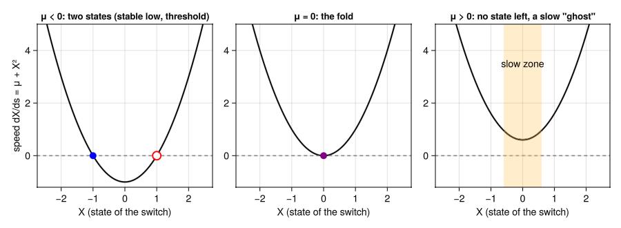
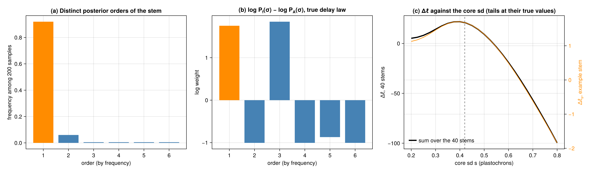

# 5. Commitment timing

## Where we are

Step 1 is done. For every stem, the propensity model gives the exact posterior of its order, and we can draw as many
orders from it as we like ([§3.7](orders.md)). Step 2 asks the question of [§1.4](problem.md): *which delay law ``f``
explains these orders?* The page answers it in four moves.

1. Write down the law of the order that a delay law predicts, ``P_f(\sigma)`` ([§5.2](timing.md)).
2. See why the exact sum over orders of [§3](orders.md) cannot use it, and why this is only a small obstacle
   ([§5.3](timing.md)).
3. Score a single order exactly, by a recursion over the heights ([§5.4](timing.md)).
4. Turn these scores into the likelihood of ``f``, by re-weighting the orders of step 1 ([§5.5](timing.md)).

The delay law itself ([§5.6](timing.md)) and its fit ([§5.7](timing.md)) come last. But first, why should a delay be
random at all?

## 5.1 Why a random delay

In each cell of the peripheral zone of the meristem, a regulatory network downstream of auxin signalling reads an
input that rises as auxin accumulates at the site. *Commitment* is the switch of this network to the organ-founder
state. A switch of this kind often happens at a fold: the uncommitted state merges with a threshold and disappears as
the input rises. Near a fold, the whole network slows down onto one slow variable, ``dX = (\mu + X^2)\,ds + dW_s``
(figure 1). Even after the uncommitted state has disappeared, the dynamics stay slow near ``X = 0``. Fast molecular
noise then turns into a slow and *variable* commitment delay.



*Figure 1. The speed of the switch variable, ``dX/ds = \mu + X^2``, for three margins. Left, before the fold: a stable
uncommitted state (blue) and a threshold (red circle). Middle: the two merge, at the fold. Right, after the fold: no
state is left, but the speed stays small near ``X = 0``. The time spent there sets the commitment delay.*

This picture motivates a random delay, but the package does not impose the delay law that a particular switch would
produce. It fits a flexible law ([§5.6](timing.md)) and lets the orders decide its shape.

## 5.2 The law of the order of a paced meristem

Recall the mechanism of [§1.4](problem.md): site ``i`` is ready at time ``i`` (in plastochrons), it commits at
``\tau_i = i + e_i`` with independent delays ``e_i \sim f``, and the order on the stem is the ranking of the
``\tau_i``. Only differences of delays matter, so ``f`` is defined up to a shift, and its core is centred at 0.

**Two sites first.** Sites 1 and 2 are swapped when site 2 commits first: ``2 + e_2 < 1 + e_1``, that is
``e_1 - e_2 > 1``. If the delays are Gaussian with sd ``s``, their difference is Gaussian with sd ``s\sqrt 2``, and

```math
P(2\,1) = \Phi\!\left(-\frac{1}{s\sqrt 2}\right).
```

With ``s = 0.42`` plastochron, this is 4.6 %: about one pair of neighbours in twenty is swapped. The same reasoning
shows why the Gaussian alone cannot be the whole story. An organ displaced by two positions needs
``e_i - e_{i+2} > 2``, which has probability ``\Phi(-2/(s\sqrt 2)) \approx 4 \times 10^{-4}``: one pair in 2600.
Real stems have many more ([§5.6](timing.md)).

**Any number of sites.** The organ at height ``p`` comes from site ``\sigma(p)``. So ``\sigma`` is the order on the
stem exactly when ``\tau_{\sigma(1)} < \tau_{\sigma(2)} < \dots < \tau_{\sigma(n)}``. Call
``t_p = \tau_{\sigma(p)}`` the commitment time of the organ at height ``p``. Its delay is ``t_p - \sigma(p)``, and the
probability of the order is the probability of this chain of inequalities:

!!! note "result — the Level-0 order law"
    ```math
    P_f(\sigma) = \int_{t_1 < t_2 < \dots < t_n} \prod_{p=1}^{n} f\big(t_p - \sigma(p)\big)\, dt_1 \cdots dt_n .
    ```

("Level 0": the sites commit independently of each other. A paced meristem where a late site also delays the next
ones would be a "Level 1".) For two sites, this integral is the ``\Phi`` above.

## 5.3 Not a product, but close to one

The integral has one factor per organ, as in the product form of [§3.1](orders.md). But the factors are tied together
by the chain ``t_1 < \dots < t_n``: where the organ of site ``j`` ends up depends on how many other sites committed
before it, so on all the other delays at once. Can a product ``\prod_p h_{p,\sigma(p)}`` still reproduce
``P_f``? There is a simple test.

**The test.** In a product form, a swap has a fixed price. Swapping the organs at heights 1 and 2 multiplies the
probability by the same factor, ``e^{\eta_{+1} + \eta_{-1}}``, whatever happens at heights 3 and 4 (their factors
cancel in the ratio):

```math
\frac{P(2\,1\,3\,4)}{P(1\,2\,3\,4)} = \frac{P(2\,1\,4\,3)}{P(1\,2\,4\,3)} .
```

So compute both ratios under Level 0. Here are the exact probabilities of the four orders, for Gaussian delays of sd
0.42 (they come from the recursion of [§5.4](timing.md); the box below has the code):

| order | 1 2 3 4 | 2 1 3 4 | 1 2 4 3 | 2 1 4 3 |
|---|---|---|---|---|
| ``P_f(\sigma)`` | 0.8635 | 0.0439 | 0.0439 | 0.00214 |

The odds of the first swap are ``0.0439 / 0.8635 = 0.0508`` when heights 3–4 are in order, but
``0.00214 / 0.0439 = 0.0487`` when they are swapped: **4 % lower**. No product form can do this.

Where does the coupling come from? From the boundary between the two pairs. If the organs at heights 2 and 3 did not
have to commit in order, the two pairs would be independent and the two odds would be equal. They must, though, and
*which* sites sit at heights 2 and 3 depends on both swaps: sites 2 and 3 in 1 2 3 4, sites 1 and 4 in 2 1 4 3. So the
probability of one swap depends a little on whether the other has happened.

The sign of this dependence is not fixed. With the WT-like law of [§6](validation.md), which has late and early tails,
the two odds are 0.0868 and 0.0890: **2.6 % higher** when heights 3–4 are swapped. A product form, with its one price
per swap, can follow neither effect.

!!! details "Reproducing the numbers"
    ```julia
    using PhyllotaxisFold
    P(σ, f) = exp(loglik_order_exact(σ, f))      # exact Level-0 probability of an order (§5.4)
    odds(f) = (P([2, 1, 3, 4], f) / P([1, 2, 3, 4], f), P([2, 1, 4, 3], f) / P([1, 2, 4, 3], f))
    gauss = DelayLaw(0.42)                       # Gaussian delays, sd 0.42 plastochron
    wt = DelayLaw(0.42; πL = 0.05, mL = 1.5, πE = 0.054, mE = 1.04) # the WT-like law of §6
    P([2, 1], gauss)                             # 0.046 (§5.2)
    odds(gauss)                                  # (0.0508, 0.0487)
    odds(wt)                                     # (0.0868, 0.0890)
    P([3, 1, 2], gauss) + P([2, 3, 1], gauss), P([3, 1, 2], wt) + P([2, 3, 1], wt) # 0.0003, 0.021 (§5.6)
    ```

Two lessons, one bad and one good.

- **The bad one.** ``P_f`` is outside the family of laws for which the sum over orders of [§3](orders.md) is exact.
  So ``p(y \mid f) = \sum_\sigma P_f(\sigma)\, p(y \mid \sigma)`` cannot be computed that way.
- **The good one.** The deviation is a few percent. A product-form law cannot *be* ``P_f``, but it can come close.
  The propensity model is such a law, fitted to the same stems. The next two sections exploit this.

## 5.4 One order at a time is easy

We cannot sum ``P_f`` over all orders, but we can compute it exactly for *one* given order, fast. The idea is the same
as in the forward pass of [§3](orders.md): go up the stem one height at a time, and carry only what the next height
needs. Here, that is the distribution of the commitment time of the organ just placed.

!!! note "result — forward recursion over the heights"
    Let ``a_p(t)`` be the density of ``t_p`` jointly with the event ``t_1 < \dots < t_p``. Then
    ```math
    a_1(t) = f\big(t - \sigma(1)\big),\qquad
    a_p(t) = f\big(t - \sigma(p)\big) \int_{-\infty}^{t} a_{p-1}(u)\, du,\qquad
    P_f(\sigma) = \int a_n(t)\, dt .
    ```

In words: the organ at height ``p`` commits at ``t`` with density ``f(t - \sigma(p))``, and the organs below it must
all have committed before ``t``; the integral of ``a_{p-1}`` up to ``t`` is the probability of that. For two sites in
order, ``P(1\,2) = \int f(t - 2)\, F(t - 1)\, dt``, with ``F`` the cumulative of ``f``: the probability that site 1
commits before site 2, as it should.

!!! details "Derivation and numerics"
    Integrate the variables of the ``n``-fold integral in the order ``t_1, t_2, \dots``. The variable ``t_{p-1}``
    appears in the factor ``f(t_{p-1} - \sigma(p-1))``, in the constraints ``t_{p-2} < t_{p-1}`` (already absorbed into
    ``a_{p-1}``) and ``t_{p-1} < t_p``. Integrating it over ``(-\infty, t_p)`` gives the cumulative of ``a_{p-1}`` at
    ``t_p``. ∎

    The functions are represented on a grid of step 0.05 plastochron (`DELAY_GRID`, from −12 to 30), and each
    ``a_p`` is renormalised as it goes (the logs of the normalisers add up to ``\log P_f(\sigma)``). The cumulative
    counts the cell that contains ``t`` for one half (midpoint rule). Counting it in full would treat two times in the
    same cell as ordered, which biases ``\log P_f(\sigma)`` upwards at first order in the step: by +0.28 for an order
    of 6 sites with three displacements. The midpoint rule leaves an error below 0.01. The tests check the two-site
    closed form ``\Phi(1/(s\sqrt2))``, that the probabilities of all 24 orders of 4 sites sum to 1, and the frequencies
    of the orders drawn from the delay law.

A stem of 45 organs is scored in a fraction of a millisecond. And step 1 gives us exactly the orders worth scoring:
the posterior samples of each stem. How do their scores become the likelihood of ``f``?

## 5.5 Re-weighting the reconstructed orders

The propensity model ``A`` and the delay law ``f`` describe the angles in the same way ([§2.5](angles.md)). They differ
only in the law of the order, ``P_A(\sigma)`` or ``P_f(\sigma)``. So write the likelihood of ``f`` as the sum over
orders, and use what step 1 already knows: under ``A``, Bayes' rule turns the angle term into the posterior of the
order.

!!! note "result — the re-weighting identity"
    For one stem,
    ```math
    \frac{p(y \mid f)}{p(y \mid A)} = \sum_\sigma p(\sigma \mid y, A)\, \frac{P_f(\sigma)}{P_A(\sigma)}
    = \mathbb E_{\sigma \sim p(\sigma \mid y, A)}\Big[ \frac{P_f(\sigma)}{P_A(\sigma)} \Big] .
    ```

!!! details "Derivation"
    ``p(y \mid f) = \sum_\sigma p(y \mid \sigma)\, P_f(\sigma)``, and under ``A``, Bayes' rule gives
    ``p(y \mid \sigma) = p(\sigma \mid y, A)\, p(y \mid A) / P_A(\sigma)``. Substitute and divide by ``p(y \mid A)``. ∎
    The identity requires ``P_A(\sigma) > 0`` wherever ``P_f(\sigma)\,p(y \mid \sigma) > 0``. Orders outside the
    band of ``A`` violate this; they are discussed under the limits below.

This is the intuition of [§1.5](problem.md), made exact. A delay law is good if it gives a high probability to the
orders that the angles support. The division by ``P_A(\sigma)`` removes the part of that support that came from
``A``'s own law of the order, so that ``A`` is not counted twice. ``P_A(\sigma)`` is computable: it is the product
form of [§4](propensity.md) divided by its permanent.

**In practice.** The expectation is an average over the posterior samples of the stem. With
``\sigma_1, \dots, \sigma_M`` the distinct sampled orders and ``w_j`` their frequencies,

```math
\Delta\ell_s(f) = \log \sum_{j} w_j\, \frac{P_f(\sigma_j)}{P_A(\sigma_j)},\qquad
\Delta\ell(f) = \sum_{\text{stems}} \Delta\ell_s(f) = \log p(y \mid f) - \log p(y \mid A) .
```

``\Delta\ell > 0`` means that the timing law explains the angles better than the free costs of the propensity model.
Two delay laws are compared by the difference of their ``\Delta\ell``, in which ``A`` cancels. Scoring a new law takes
seconds, because neither the angles nor the permanents are recomputed.



*Figure 2. The example stem. (a) Its distinct posterior orders, with their frequencies among 200 samples. (b) The
log-weight ``\log P_f(\sigma) - \log P_A(\sigma)`` of each, under the true delay law; the true order is in orange.
(c) ``\Delta\ell`` summed over the 40 stems (black) and the term of the example stem (orange, right axis), as a
function of the core sd ``s``, the tails kept at their true values. The dashed line is the true ``s``.*

Figure 2 shows the identity at work on the example stem. One order, the true one, carries 90 % of its posterior
samples, and seven others share the rest (a). The true delay law finds the true order about six times more probable
than the propensity model does (log-weight +1.8), and most of the alternatives less probable (b). So
``\Delta\ell_s > 0``: on this stem, the timing law explains the angles better than ``A``. Repeated for each value
of the core sd and summed over the stems, ``\Delta\ell`` peaks close to the true value (c).

**When can the average be trusted?** An average over samples is precise when the weights
``r_j = P_f(\sigma_j)/P_A(\sigma_j)`` are of similar size. Their spread is measured by the *effective sample size*
over the ``N`` draws, ``(\sum r)^2 / \sum r^2``: it equals ``N`` when all the weights are equal, and 1 when a single
draw carries everything. The weights are even when ``P_A`` is close to ``P_f``, and [§5.3](timing.md) showed that a
product-form law can come close to a Level-0 law. In the validation, the effective sample size is typically 175–200
out of 200 draws ([§6.4](validation.md)).

**Limits.** The angle nuisances (``\kappa``, spiral, twist) are those of the propensity model's fit. Orders outside its
band (``|d| > k``) are never sampled, so a law that puts mass on them is slightly penalised. A stem whose effective
sample size is small is scored imprecisely; more posterior samples help.

## 5.6 The delay law

**assumption** — the delay is a precise Gaussian core, plus two exponential tails for sites committed late or early:

```math
f = (1 - \pi_L - \pi_E)\, \mathcal N(0, s^2)
+ \pi_L\, \big(\mathcal N(0, s^2) \ast \mathrm{Exp}(m_L)\big)
+ \pi_E\, \big(\mathcal N(0, s^2) \ast (-\mathrm{Exp}(m_E))\big).
```

The core sd ``s`` is the precision of a typical commitment. A fraction ``\pi_L`` of the sites is late by an extra
exponential delay of mean ``m_L``, and a fraction ``\pi_E`` is early by ``m_E``. Why tails? A Gaussian core of sd 0.42
makes neighbour swaps common but displacements by two positions very rare ([§5.2](timing.md)). A tail produces exactly
the pattern a Gaussian cannot: one organ displaced by two or three positions while its neighbours stay in order. For
three sites, the two orders with a displacement by two (3 1 2 and 2 3 1) have a probability of 0.03 % under the
Gaussian core alone, and of 2.1 % under the WT-like law of [§6](validation.md), whose tails hold about 10 % of the
sites.

Three nested variants are fitted: `:core` (``s``), `:late` (``s, \pi_L, m_L``) and `:both` (all five). Comparing their
``\Delta\ell`` tells whether the orders call for tails, and on which side.

!!! details "The density"
    A Gaussian of sd ``s`` convolved with an exponential of rate ``\lambda = 1/m`` (an exponentially modified
    Gaussian) has the density
    ``\lambda \exp\!\big(\lambda(\lambda s^2/2 - x)\big)\, \Phi\big((x - \lambda s^2)/s\big)``, with ``x = z`` for the
    late tail and ``x = -z`` for the early one. The mixture is evaluated in log space on `DELAY_GRID` and
    renormalised there.

**What the orders can identify.** The five parameters are not equally visible in the orders.

- **The tail masses are.** The orders do not see the exact delay of a site, only whom it overtakes. A site committed
  more than one plastochron late commits after its upper neighbour is ready, and it is likely to be overtaken. So the
  orders measure the fractions of sites committed more than one plastochron late, early, or either:
  ``P(e > 1)``, ``P(e < -1)`` and the **off-time fraction** ``P(|e| > 1)`` (`tail_masses`). These include the small
  share of the core beyond ±1.
- **``\pi`` and ``m`` one by one are not.** A frequent short tail and a rarer long one put about the same mass beyond
  one plastochron, and predict nearly the same orders.
- **The core sd and the late/early split are identified when the tails are light**, and lost when they are heavy. When
  tens of percent of the sites sit in the tails, a narrower core plus more tail mass predicts nearly the same orders.
  ``s`` and the split are then no longer identified, even though their standard errors may look small.

The validation ([§6.3](validation.md)) measures each of these statements on simulated stems.

## 5.7 Fit, uncertainty and comparisons

- **Fit.** `fit_delay_law(samples, variant)` maximises ``\Delta\ell`` by Nelder–Mead on unconstrained parameters:
  ``\log s``; for `:both`, ``\operatorname{logit}(\pi_L + \pi_E)``, the logit of the late share
  ``\pi_L/(\pi_L + \pi_E)``, ``\log m_L`` and ``\log m_E``. The tail mass and the late share are separate
  coordinates because the first is well identified and the second may not be.
- **Robust standard errors.** The stem is the unit of replication: each stem contributes its own term
  ``\Delta\ell_s``, and stems may differ from each other more than one shared law says. `delay_law_inference`
  therefore measures the uncertainty from the spread of the per-stem slopes ``g_s`` of these terms, not from the
  curvature ``H`` of their sum alone. This is the sandwich covariance
  ``H^{-1}\big(\sum_s g_s g_s^\top\big)H^{-1}`` (derivatives by central differences). The delta method then gives the
  standard errors of ``s`` and of the tail masses.
- **Two groups** (a mutant and its co-segregant wild type). Fit each group separately. Then compare the off-time
  fractions with their standard errors (independent groups), or compare separate laws with one shared law by the
  difference of their summed ``\Delta\ell`` (a likelihood ratio). The terms of ``A`` cancel in these differences,
  because each stem's term is relative to its own group's fit of ``A``.
- **Delays in hours.** The delays are in plastochrons. The `Plastochron` module estimates the plastochron at each
  flower rank from daily counts of open flowers, to convert them.

**Code.** `DelayLaw(s; πL, mL, πE, mE)`, `rand(rng, f)`, `delay_logdensity(f)`, `tail_masses(f; a = 1)`;
`loglik_order_exact(σ, f)` (or `(σ, logg, grid, γ)`); `order_samples(order_posterior(m, fit; nsamples), η)`,
`stem_terms(samples, f)`, `relative_loglik(samples, f)` (`stem_terms(samples, logP)` scores any law of the order given
as ``\sigma \mapsto \log P(\sigma)``); `fit_delay_law`, `delay_law_inference`; `simulate_stems(f::DelayLaw; ...)`;
`flowering_rate`, `fit_flowering`, `plastochron_by_rank`, `plant_plastochron`, `relative_plastochron`.
