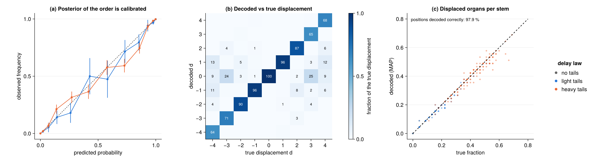

# 6. Validation on simulated stems

Each step of the method rests on assumptions and approximations, and could go wrong in its own way:

- the twist could be confused with a change of spiral;
- the posterior of the order could be overconfident;
- the re-weighting could rest on too few samples;
- the delay law could be poorly identified from orders alone;
- the plant's clock might not be as regular as the model assumes.

The way to know is to run the whole pipeline on stems whose truth is known, and compare. This page does so step by
step: the angle model and the twist ([§6.2](validation.md)), the orders ([§6.3](validation.md)), the delay law
([§6.4](validation.md)) and a remedy for its weak point ([§6.5](validation.md)), the two computations behind the delay
law ([§6.6](validation.md)), and a clock that drifts ([§6.7](validation.md)). The figures are made by
`docs/make_validation_figures.jl`.

## 6.1 The simulated stems

The stems are made to resemble the *Arabidopsis* data:

- 60 stems of 45 organs per data set;
- internodes from about 9 mm at the base to 3 mm at the top, with log-normal noise, so the twist coordinate ``x_p`` is
  in mm;
- an angular precision ``\kappa_s`` log-normal around 6.4 (``\log\mu_\kappa = 1.85``, ``\sigma_\kappa = 0.15``);
- 95 % golden spirals;
- a stem twist of ``1.0 \pm 0.7`` °/mm.

The orders come from independent commitment delays ([§5.2](timing.md)), with three delay laws (in plastochrons):

| scenario | core sd ``s`` | late tail | early tail | ``P(\lvert e\rvert > 1)`` |
|---|---|---|---|---|
| no tails | 0.42 | — | — | 1.7 % |
| light tails | 0.42 | 5 % (mean 1.5) | 5.4 % (mean 1.04) | 6.5 % |
| heavy tails | 0.39 | 19.6 % (mean 1.09) | 26.9 % (mean 1.01) | 19.7 % |

The two tailed laws are laws fitted to real stems, which is why their values are not round: the light-tailed law to a
wild type, the heavy-tailed law to a mutant with many off-time organs. The no-tails law asks whether the method
invents tails that are not there.

Each scenario is simulated three times (three *replicates*, nine data sets in all). Each data set goes through the
steps of the [worked analysis](workflow.md), exactly as real data would:

1. `fit_map_torsion!` (propensity model, ``k = 4``, twist integrated out), with the default settings: outlier angles
   allowed ([§2.4](angles.md)) and 9 twist nodes ([§2.6](angles.md)). The simulated angles have no outliers, so this
   also checks that allowing them costs nothing;
2. `decode_orders` (joint MAP);
3. `order_posterior` with 200 exact samples per stem;
4. the `:core`, `:late` and `:both` delay laws by `fit_delay_law`;
5. `delay_law_inference` (robust standard errors, *se* below).

In each replicate, the light- and heavy-tailed data sets are also fitted together, with a shared core
([§6.5](validation.md)).

## 6.2 The angle model and the twist

**What could go wrong.** The twist of a stem and a change of its spiral can both rotate the organs. If the model
confused them, it would get the twist wrong, and then the orders.

*Figure 1. The angle model, all 9 data sets (colour: delay law). (a) The twist rate of each stem, posterior mean
against truth. (b) The twist population: mean and sd, truth in black. (c) The population law of the angular precision.
(d) The fraction of stems whose orientation and divergence (golden or Lucas) are decoded correctly.*

**What we find.** The twist of each stem is recovered (correlation 0.99), and so is its population: a mean of
0.85–1.04 °/mm for a truth of 1.0, an sd of 0.62–0.80 for 0.7. So is the precision of the angles
(``\log\mu_\kappa`` 1.82–1.90 for 1.85). Every spiral is decoded with its correct orientation and divergence.

One stem in 540 gets a twist at a secondary mode of its likelihood (figure 1a, the point far from the diagonal). It is
a reminder that the twist likelihood of a stem can have several peaks. This is why the twist is integrated out rather
than fixed at its best value ([§2.6](angles.md), [§4.5](propensity.md)).

## 6.3 The orders

**What could go wrong.** The posterior of the order could be overconfident (or underconfident). Step 2 relies on its
samples, so it must be *calibrated*: an event to which it gives a probability of 70 % should happen about 70 % of the
time.

*Figure 2. The orders. (a) Calibration of the posterior: every pair (height ``p``, displacement ``d``) is grouped by
its posterior probability ``\rho_{p,d}``, and the frequency with which ``d`` is the true displacement is plotted
against that probability (± 2 se). Without tails the posterior is almost always sure (``\rho`` near 0 or 1), so there
is too little in between to plot; that law is left out of this panel. (b) The most probable displacement against the
true one: percentage of the organs of each true displacement. Unlike (a), this panel pools all nine data sets, no
tails included. The no-tails stems add mostly to ``d = 0`` and ``\pm 1``; displacements beyond ±1 come mostly
(68–85 %) from the heavy-tailed law. (c) The fraction of displaced organs per stem, decoded
against true.*

**What we find.**

- **The posterior is calibrated** (figure 2a): the points lie on the diagonal. This is what makes its samples a sound
  input for [§5](timing.md).
- **The most probable order is right for 98 % of the positions.** Displacements of ±1 and ±2 are recovered in 87–96 %
  of cases, and the rare displacements of ±3 and ±4 in 64–71 % (figure 2b). When the single best order is wrong, the
  posterior usually shares its probability between it and the true order. This is why step 2 uses the posterior
  samples, not the best order alone.

## 6.4 The delay law

**What could go wrong.** The delay law is seen only through the orders it produces, and different laws can produce
nearly the same orders ([§5.6](timing.md)). Is the overtaking profile, which the orders identify, recovered? And how
far can the parameters of the fitted law be trusted?

**The overtaking profile.** Truth (the law), then the three replicates: the profile read from the posterior orders
(`overtaking_profile`, no delay law) and that of the fitted `:both` law, with the typical standard error.

| scenario | | ``q_1`` | ``q_2`` | ``q_3`` |
|---|---|---|---|---|
| no tails | truth | 0.046 | 0.0004 | 0.0000 |
| | from the orders | 0.038, 0.049, 0.047 (± 0.004) | 0.0009, 0.0004, 0.0007 (± 0.0005) | ≤ 0.0002 |
| | fitted law | 0.038, 0.049, 0.046 | 0.0008, 0.0006, 0.0007 | 0.0000 |
| light tails | truth | 0.087 | 0.024 | 0.011 |
| | from the orders | 0.087, 0.089, 0.087 (± 0.005) | 0.025, 0.025, 0.024 (± 0.003) | 0.012, 0.011, 0.008 (± 0.002) |
| | fitted law | 0.082, 0.087, 0.085 | 0.022, 0.023, 0.022 | 0.010, 0.010, 0.007 |
| heavy tails | truth | 0.183 | 0.075 | 0.032 |
| | from the orders | 0.186, 0.191, 0.189 (± 0.006) | 0.077, 0.077, 0.088 (± 0.005) | 0.030, 0.028, 0.034 (± 0.003) |
| | fitted law | 0.184, 0.186, 0.184 | 0.072, 0.071, 0.076 | 0.027, 0.026, 0.031 |

- **The profile is recovered in every scenario.** Most of the scatter between replicates is real: each replicate's
  own orders differ from the law by chance (the first no-tails replicate has a neighbour-swap rate of 0.038 in its
  true orders, and both estimates find 0.038).
- **It does not depend on the shape of the law.** Without tails, the ridge of the `:both` fit (point 1 below) moves
  the off-time fraction but leaves the profile where it is.
- **The fitted law can miss the longest overtakings.** For heavy tails, the fitted law's ``q_3`` is below the rate in
  each replicate's own true orders by 0.006–0.008 (2 to 3 standard errors), while the profile read from the orders is
  not: the exponential tails do not quite fit the longest displacements. The two profiles differ by 0.002–0.003 there,
  which is the check of [§5.7](timing.md).

**The parameters of the fitted law.**

*Figure 3. The delay law fitted through the posterior orders ([§5.5](timing.md)). (a–d) The core sd and the three tail
masses: estimate ± 2 robust se for each replicate, truth in black. (e) The fitted densities (colour) and the true ones
(dashed). (f) Log-likelihood gains: what the two tails add to a core-only law (circles), and how much the fitted law
beats the true one (triangles, the optimism of the fit).*

Truth, then the `:both` fits of the three replicates (the readings of [§5.6](timing.md)):

| scenario | ``s`` | ``P(e > 1)`` | ``P(e < -1)`` | ``P(\lvert e\rvert > 1)`` | tails gain (``\Delta\ell``) |
|---|---|---|---|---|---|
| no tails | 0.42 → 0.32, 0.39, 0.37 | 0.009 → 0.010, 0.029, 0.033 | 0.009 → 0.008, 0.002, 0.001 | 0.017 → 0.018, 0.031, 0.034 | 1.6, 0.2, 0.4 |
| light tails | 0.42 → 0.41, 0.41, 0.38 | 0.035 → 0.043, 0.045, 0.043 | 0.030 → 0.018, 0.021, 0.026 | 0.065 → 0.061, 0.065, 0.069 | 129, 125, 96 |
| heavy tails | 0.39 → 0.01, 0.01, 0.01 | 0.086 → 0.105, 0.106, 0.113 | 0.110 → 0.110, 0.111, 0.103 | 0.197 → 0.215, 0.218, 0.216 | 70, 57, 75 |

**What we find**, from the most to the least robust:

1. **No false tails.** When the truth has none, the tails add 0.2 to 1.6 units of log-likelihood. The `:core` fit then
   recovers the law: ``s`` = 0.40, 0.43, 0.42 and an off-time fraction of 0.013, 0.019, 0.018 for 0.017. The `:both`
   fit is too flexible here ([§5.6](timing.md)). In two replicates it puts nearly every site in a short "tail" (mean
   0.2 plastochron) that only reshapes the core, and its off-time fraction drifts to 0.031–0.034, about one standard
   error (0.015) above the truth. When the tails gain little, read the `:core` fit.
2. **Real tails are found without doubt.** For both tailed laws, the tails add 57 to 129 units.
3. **The off-time fraction ``P(|e| > 1)`` is reliable only for light tails.** It is recovered within its standard
   error for the light-tailed law. For the heavy-tailed law it is about 0.02 too high in all three replicates (about
   2 se): a 10 % overestimate when a fifth of the organs are off time. Without tails it drifts (point 1).
4. **The core sd is recovered when the tails are light** (0.38–0.41 for 0.42), **but not when they are heavy.** For
   the heavy-tailed law (47 % of the sites in a tail), the fitted core collapses: ``s`` falls to about 0.01, below the
   step of the delay grid (0.05), where a narrower core no longer changes anything. Its standard error is
   misleadingly small. A narrow core plus more tail mass predicts nearly the same orders. The overestimated off-time
   fraction of point 3 comes with this collapse; a shared core ([§6.5](validation.md)) usually removes both.
5. **The split between late and early leans late.** For the light-tailed law, ``P(e > 1)`` is overestimated
   (0.043–0.045 for 0.035) and ``P(e < -1)`` underestimated (0.018–0.026 for 0.030). The reason is that some orders
   have two readings. In the order 2 3 1, the organ of site 1 sits two heights above its place. Either site 1
   committed about two plastochrons late, or sites 2 and 3 each committed about one plastochron early. Both readings
   give the same order, and the fit tends to prefer the single late site.
6. **Optimism.** The fitted law is tuned to the very stems on which it is scored, so it scores them a little better
   than the true law does: by 0.4 to 5 units. Differences of ``\Delta\ell`` below about 5 between two laws are
   therefore not meaningful on their own.

**In short:** the overtaking profile is the quantity to report and to compare between groups. The parameters of the
fitted law interpret it: the off-time fraction, the core sd and the late/early split are informative for laws with
light tails, and should be read with the caveats of points 1, 3, 4 and 5.

## 6.5 A shared core

**What could go wrong.** Comparing two groups by their profiles needs no core sd. But to *read* a group with heavy
tails in terms of the law (how precise a typical commitment is, how many organs are off time), point 4 is a real
limitation: its core cannot be estimated, and its off-time fraction is biased with it. The core can be borrowed. If the mutant
changes *which* organs are off time, and not the precision of a typical commitment, the mutant and its wild type share
one core sd. The wild type, whose tails are light, then carries it ([§5.7](timing.md)).

To test this, each replicate's light- and heavy-tailed data sets are fitted together, with one core sd and their own
tails (`fit_delay_law([light, heavy], :both)`), and the shared core is tested against separate cores
(`shared_core_test`). The true cores are close but *not* equal (0.42 and 0.39): a mild violation of the hypothesis,
as real data would have.

Truth, then the shared-core fit of each replicate (estimate ± se):

| replicate | shared ``s`` | off-time, light tails | off-time, heavy tails | difference | likelihood ratio (``p``) |
|---|---|---|---|---|---|
| truth | 0.42 and 0.39 | 0.065 | 0.197 | 0.132 | |
| 1 | 0.40 ± 0.02 | 0.062 ± 0.006 | 0.200 ± 0.010 | 0.138 ± 0.012 | 2.7 (0.10) |
| 2 | 0.41 ± 0.02 | 0.066 ± 0.006 | 0.203 ± 0.011 | 0.137 ± 0.012 | 2.3 (0.13) |
| 3 | 0.01 ± 0.001 | 0.093 ± 0.013 | 0.216 ± 0.010 | 0.123 ± 0.016 | 2.2 (0.14) |

With separate fits ([§6.4](validation.md)), the heavy-tailed off-time fraction was 0.215–0.218 and the difference
0.148–0.154.

For comparison, the difference between the two groups' profiles (heavy minus light, truth 0.096, 0.052, 0.021) read
from the orders, with no delay law: 0.100, 0.102, 0.102 for ``q_1`` (± 0.008), 0.052, 0.052, 0.064 for ``q_2``
(± 0.006) and 0.018, 0.017, 0.026 for ``q_3`` (± 0.003), with a Wald χ² of 171 to 191 on 3 degrees of freedom
(`compare_profiles`). The joint fit gives the same, even in replicate 3 (0.099, 0.053, 0.024).

**What we find.**

- **When the light-tailed group holds the core, the shared core removes the bias** (replicates 1 and 2). The shared
  ``s`` (0.40–0.41) lies between the two true cores. The heavy-tailed off-time fraction falls from 0.215–0.218 to
  0.200–0.203, for 0.197, and the difference between the groups is recovered within its standard error.
- **The likelihood ratio does not reject the shared core**, even though the true cores differ by 0.03. A difference
  this small is beyond what 60 stems can detect, and it does no visible harm to the estimates.
- **It can fail, and this can be seen** (replicate 3). There the shared core collapses as well, and the light-tailed
  group's off-time fraction is pulled up (0.093 for 0.065). This is the true maximum, not a failure of the optimiser:
  profiled over ``s``, that light-tailed data set loses only 1 unit of log-likelihood when its core shrinks from 0.4 to
  0.01, while the heavy-tailed one gains 3. Its own fit gave ``s`` = 0.38 ± 0.04, but the standard error hides a
  lopsided profile: the data bound the core from above, not from below.

**In practice.** Compare the groups by their profiles. To read them in terms of the law, fit each group alone, then
together. If the shared ``s`` stays close to the light-tailed group's own ``s``, report the shared-core estimates. If it collapses far below it, the light-tailed group does not hold the core:
report the separate fits, with the caveat of [§6.4](validation.md) point 4.

## 6.6 The exact order likelihood and the weights

**What could go wrong.** Two computations of [§5](timing.md) carry the delay law: the recursion that scores one order
([§5.4](timing.md)), and the re-weighting average over the posterior samples ([§5.5](timing.md)). The first could be
inaccurate on its grid; the second could rest on a few samples only.

*Figure 4. (a) The exact probability of each order of 7 sites ([§5.4](timing.md)), against its frequency
among a million orders drawn from the three delay laws. (b) The effective sample size of the re-weighting at the
fitted law, per stem, out of 200 posterior samples.*

**What we find.**

- **The recursion is exact in practice.** Its probabilities match the frequencies of simulated orders over five
  orders of magnitude (figure 4a).
- **The re-weighting rests on many samples.** The effective sample size ([§5.5](timing.md)) is close to 200 for most
  stems (median 172–200), and above 100 for nearly all (figure 4b). The posterior of the propensity model covers the
  orders that the delay laws favour, as [§5.3](timing.md) led us to expect.

## 6.7 A clock that drifts

**What could go wrong.** The model asks the deviations of the sites from a regular clock to be independent
([§5.2](timing.md)). Independent jitter of the readiness is absorbed into ``f``, but a clock whose *intervals* vary
is not: its errors add up like a random walk, and neighbouring delays become dependent. A drifting clock then gives more
displacements by two than an independent law with the same rate of neighbour swaps. Could the fit read them as tails?

Here the orders are simulated from a clock of intervals ``1 + \xi_i``, ``\xi_i \sim \mathcal N(0, \sigma_\xi^2)``,
followed by Gaussian commitment delays of sd 0.3. The delay law is fitted to the **true** orders (no angles), so only
the timing model is tested: three data sets of 60 stems of 45 organs per value of ``\sigma_\xi``, and one of 1200
stems to see the bias without noise. The *matched* law is the independent Gaussian with the same rate of neighbour
swaps (``s^2 = 0.3^2 + \sigma_\xi^2/2``).

| ``\sigma_\xi`` | tails gain, 60 stems | off-time, 60 stems | tails gain, 1200 stems | off-time, 1200 stems | off-time, matched law |
|---|---|---|---|---|---|
| 0 | 0.0, 6.1, 0.0 | 0.09, 0.82, 0.09 % | 0.0 | 0.08 % | 0.09 % |
| 0.1 | 0.0, 0.0, 0.0 | 0.08, 0.17, 0.11 % | 0.0 | 0.12 % | 0.12 % |
| 0.2 | 0.0, 0.0, 0.0 | 0.24, 0.22, 0.33 % | 7.5 | 0.59 % | 0.26 % |
| 0.3 | 1.7, 0.0, 2.7 | 2.8, 0.53, 1.7 % | 17.2 | 1.2 % | 0.65 % |
| 0.4 | 8.1, 10.0, 17.7 | 2.9, 3.0, 3.5 % | 161 | 3.8 % | 1.5 % |

**What we find.**

- **A clock that varies by up to 30 % per interval is absorbed.** With 60 stems, no tails are found, and the drift
  only widens the core (as the matched law predicts). Even with 1200 stems the off-time fraction stays below about
  1 %.
- **A clock that varies by 40 % is read as tails.** All three data sets of 60 stems find them (gain 8 to 18), with an
  off-time fraction of 3–3.5 % instead of 1.5 %, leaning late.
- **For real data**, a drifting clock could therefore account for a couple of points of off-time fraction, but not
  for a group in which a fifth of the organs are off time. Whether drift or true commitment tails, the orders cannot
  tell them apart.
- **One false tail in twelve data sets without drift** (the gain of 6.1 at ``\sigma_\xi = 0``). With a narrow law
  (sd 0.3) and 60 stems, a gain slightly above the threshold of about 5 of [§6.4](validation.md) can occur by chance.

The simulation is `docs/validation_clock_drift.jl`.
