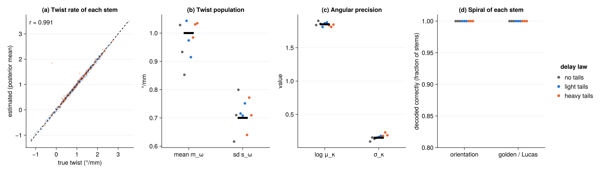
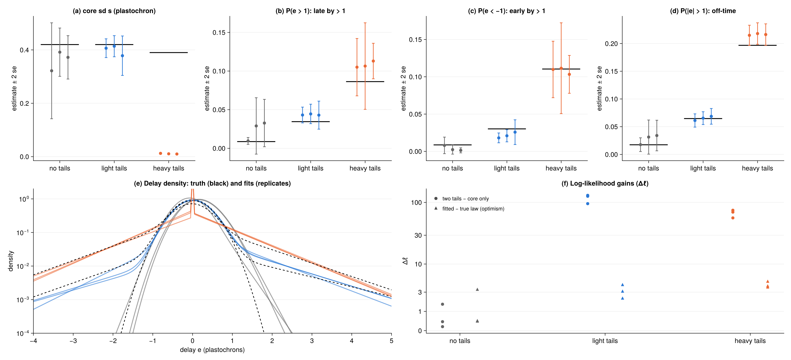
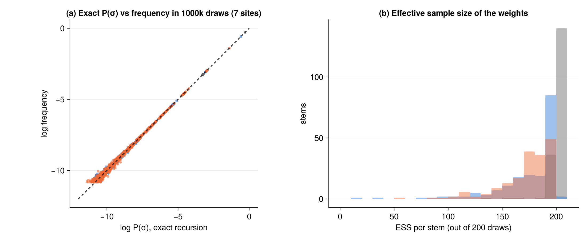

# 6. Validation on simulated stems

Each step of the method rests on assumptions and approximations, and each could go wrong in its own way:

- the twist could be confused with a change of spiral;
- the posterior of the order could be overconfident;
- the re-weighting could rest on too few samples;
- the delay law could be poorly identified from orders alone.

The only way to know is to run the whole pipeline on stems for which the truth is known, and compare. This page does
that, step by step: the angle model and the twist ([§6.1](validation.md)), the orders ([§6.2](validation.md)), the
delay law ([§6.3](validation.md)), and the two computations of [§5](timing.md) on which the delay law rests
([§6.4](validation.md)). The figures are made by `docs/make_validation_figures.jl` (simulated data only).

## The simulated stems

The stems are made to resemble the *Arabidopsis* data:

- 60 stems of 45 organs per data set;
- internodes from about 9 mm at the base to 3 mm at the top, with log-normal noise, so the twist coordinate ``x_p`` is
  in mm;
- an angular precision ``\kappa_s`` log-normal around 6.4 (``\log\mu_\kappa = 1.85``, ``\sigma_\kappa = 0.15``);
- 95 % golden spirals;
- a stem twist of ``1.0 \pm 0.7`` °/mm.

The orders come from independent commitment delays ([§5.2](timing.md)), with three delay laws (in plastochrons):

| scenario | core sd ``s`` | late tail | early tail | ``P(\lvert e\rvert > 1)`` |
|---|---|---|---|---|
| no tails | 0.42 | — | — | 1.7 % |
| WT-like | 0.42 | 5 % (mean 1.5) | 5.4 % (mean 1.0) | 6.5 % |
| mutant-like | 0.39 | 20 % (mean 1.1) | 27 % (mean 1.0) | 19.7 % |

The WT-like and mutant-like laws are close to the laws fitted to a wild type and to a mutant with more off-time
organs. The no-tails law asks whether the method invents tails that are not there.

Each scenario is simulated three times (three *replicates*, nine data sets in all). Each data set goes through the
steps of the [quick start](index.md), exactly as real data would:

1. `fit_map_torsion!` (propensity model, ``k = 4``, twist integrated out);
2. `decode_orders` (joint MAP);
3. `order_posterior` with 200 exact samples per stem;
4. the `:core`, `:late` and `:both` delay laws by `fit_delay_law`;
5. `delay_law_inference` (robust standard errors, *se* below).

## 6.1 The angle model and the twist

**What could go wrong.** The twist of a stem and a change of its spiral can both rotate the organs. If the model
confused them, it would get the twist wrong, and then the orders.

*Figure 1. The angle model, all 9 data sets (colour: delay law). (a) The twist rate of each stem, posterior mean
against truth. (b) The twist population: mean and sd, truth in black. (c) The population law of the angular precision.
(d) The fraction of stems whose orientation and divergence (golden or Lucas) are decoded correctly.*

**What we find.** The twist of each stem is recovered (correlation 0.99), and so is its population: a mean of
0.85–1.04 °/mm for a truth of 1.0, an sd of 0.62–0.80 for 0.7. So is the precision of the angles
(``\log\mu_\kappa`` 1.81–1.90 for 1.85). Every spiral is decoded with its correct orientation and divergence.

One stem in 540 gets a twist at a secondary mode of its likelihood (figure 1a, the point far from the diagonal). It is
a reminder that the twist likelihood of a stem can have several peaks. This is why the twist is integrated out rather
than fixed at its best value ([§7.2](inference.md)).

## 6.2 The orders

**What could go wrong.** The posterior of the order could be overconfident (or underconfident). Step 2 relies on its
samples, so it must be *calibrated*: an event to which it gives a probability of 70 % should happen about 70 % of the
time.

*Figure 2. The orders. (a) Calibration of the posterior: every pair (height ``p``, displacement ``d``) is grouped by
its posterior probability ``\rho_{p,d}``, and the frequency with which ``d`` is the true displacement is plotted
against that probability (± 2 se). (b) The most probable displacement against the true one: percentage of the organs
of each true displacement. (c) The fraction of displaced organs per stem, decoded against true.*

**What we find.**

- **The posterior is calibrated** (figure 2a): the points lie on the diagonal. This is what makes its samples a sound
  input for [§5](timing.md).
- **The most probable order is right for 98 % of the positions.** Displacements of ±1 and ±2 are recovered in 87–96 %
  of cases, and the rare displacements of ±3 and ±4 in 64–70 % (figure 2b). When the single best order is wrong, the
  posterior usually shares its probability between it and the true order. This is why step 2 uses the posterior
  samples, not the best order alone.

## 6.3 The delay law

**What could go wrong.** The delay law is seen only through the orders it produces, and different laws can produce
nearly the same orders ([§5.6](timing.md)). Which of its features are recovered, and which are not?

*Figure 3. The delay law fitted through the posterior orders ([§5.5](timing.md)). (a–d) The core sd and the three tail
masses: estimate ± 2 robust se for each replicate, truth in black. (e) The fitted densities (colour) and the true ones
(dashed). (f) Log-likelihood gains: what the two tails add to a core-only law (circles), and how much the fitted law
beats the true one (triangles, the optimism of the fit).*

Truth, then the fits of the three replicates:

| scenario | ``s`` | ``P(e > 1)`` | ``P(e < -1)`` | ``P(\lvert e\rvert > 1)`` | tails gain (``\Delta\ell``) |
|---|---|---|---|---|---|
| no tails | 0.42 → 0.28, 0.43, 0.42 | 0.009 → 0.022, 0.010, 0.009 | 0.009 → 0.003, 0.010, 0.009 | 0.017 → 0.025, 0.019, 0.018 | 1.6, 0.0, 0.0 |
| WT-like | 0.42 → 0.41, 0.41, 0.38 | 0.035 → 0.043, 0.045, 0.043 | 0.030 → 0.018, 0.021, 0.026 | 0.065 → 0.061, 0.065, 0.068 | 132, 126, 99 |
| mutant-like | 0.39 → 0.00, 0.01, 0.01 | 0.086 → 0.105, 0.108, 0.113 | 0.110 → 0.110, 0.110, 0.104 | 0.197 → 0.216, 0.218, 0.217 | 74, 58, 76 |

**What we find**, from the most to the least robust:

1. **No false tails.** When the truth has none, the tails add 0 to 1.6 units of log-likelihood, and the off-time
   fraction stays at the core's own (0.017).
2. **Real tails are found without doubt.** For both tailed laws, the tails add 58 to 132 units.
3. **The off-time fraction ``P(|e| > 1)`` is the best estimated quantity.** It is recovered within its standard error
   for the WT-like law. For the mutant-like law it is about 0.02 too high in all three replicates (about 2 se): a
   10 % overestimate when a fifth of the organs are off time.
4. **The core sd is recovered when the tails are light** (WT-like: 0.38–0.41 for 0.42), **but not when they are
   heavy.** For the mutant-like law (47 % of the sites in a tail), the fitted core shrinks to zero, with a standard
   error that is misleadingly small. A narrow core plus more tail mass predicts nearly the same orders.
5. **The split between late and early leans late.** For the WT-like law, ``P(e > 1)`` is overestimated (0.043–0.045
   for 0.035) and ``P(e < -1)`` underestimated (0.018–0.026 for 0.030). The reason is that some orders have two
   readings. In the order 2 3 1, the organ of site 1 sits two heights above its place. Either site 1 committed about
   two plastochrons late, or sites 2 and 3 each committed about one plastochron early. Both readings give the same
   order, and the fit tends to prefer the single late site.
6. **Optimism.** The fitted law is tuned to the very stems on which it is scored, so it scores them a little better
   than the true law does: by 0 to 5 units. Differences of ``\Delta\ell`` below about 5 between two laws are therefore
   not meaningful on their own.

**In short:** the off-time fraction is the quantity to compare between groups. The core sd and the late/early split
are informative for laws with light tails, and should be read with the caveats of points 4 and 5.

## 6.4 The exact order likelihood and the weights

**What could go wrong.** Two computations of [§5](timing.md) carry the delay law: the recursion that scores one order
([§5.4](timing.md)), and the re-weighting average over the posterior samples ([§5.5](timing.md)). The first could be
inaccurate on its grid; the second could rest on a few samples only.

*Figure 4. (a) The exact probability of each order of 7 sites ([§5.4](timing.md)), against its frequency
among a million orders drawn from the three delay laws. (b) The effective sample size of the re-weighting at the
fitted law, per stem, out of 200 posterior samples.*

**What we find.**

- **The recursion is exact in practice.** Its probabilities match the frequencies of simulated orders over five
  orders of magnitude (figure 4a).
- **The re-weighting rests on many samples.** The effective sample size ([§5.5](timing.md)) is close to 200 for most
  stems (median 175–200), and above 100 for nearly all (figure 4b). The posterior of the propensity model covers the
  orders that the delay laws favour, as [§5.3](timing.md) led us to expect.
