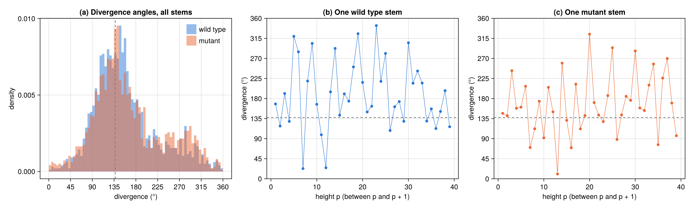
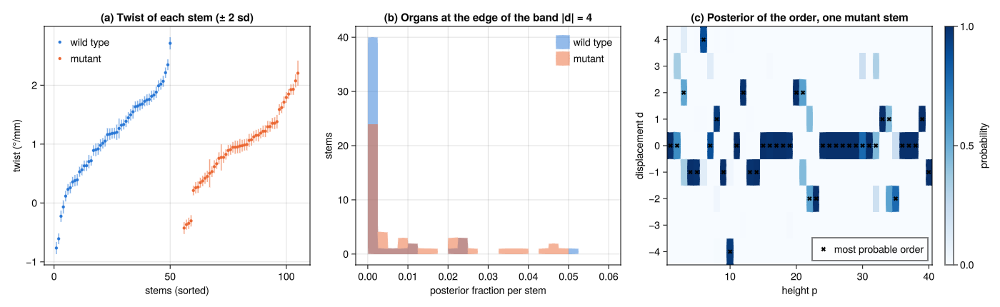
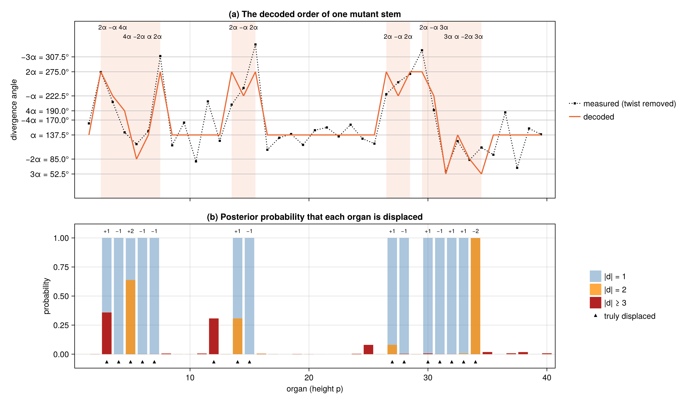
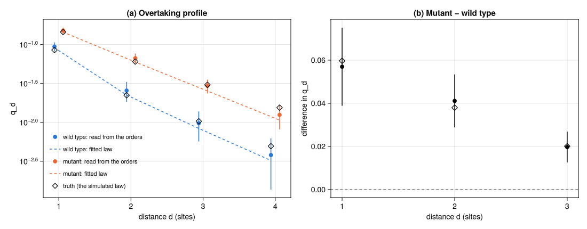
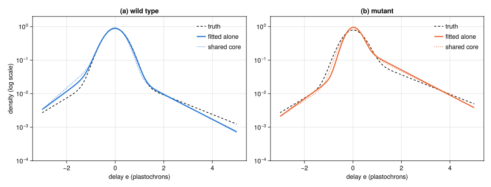
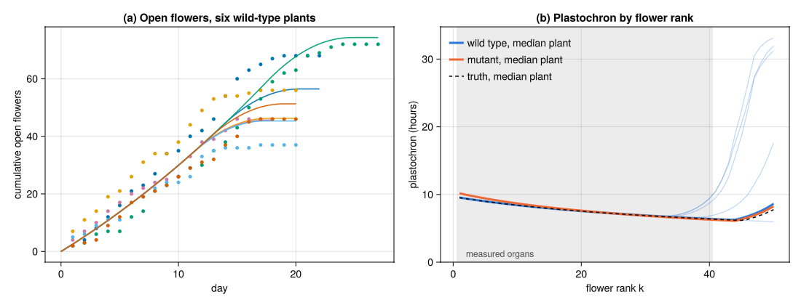

# A worked analysis

This page walks through a complete analysis, in the order it would be run on real stems: a wild type and a mutant,
each reconstructed, checked, then compared. The data are simulated, so the estimates of each step can be compared
with the truth. The code is that of `docs/make_workflow.jl`; the method behind each step is
explained in the following pages.

## The data

Two groups of 50 stems with 40 organs each. For every stem we have, from the bottom to the top:

- the absolute azimuth of each organ, in radians;
- the length of stem below each organ, in mm (internodes from about 9 mm at the base to 3 mm at the top).

```julia
angles_wt, x_wt         # Vector{Vector{Float64}}: one vector per stem
angles_mutant, x_mutant
```

Behind the scenes, both groups commit with the same precise core (sd 0.42 plastochron) and 5 % of early organs; the
mutant has 20 % of late organs instead of 5 %. The stems also twist (1.0 ± 0.7 °/mm), their angles are noisy (about
23°), and 5 % of them follow the Lucas spiral. None of this is told to the analysis.



*Figure 1. (a) The divergence angles of all stems: a peak at the golden angle, and the characteristic jumps of swaps
(near 275° and 222°, that is ``2\psi`` and ``-\psi``) more frequent in the mutant. (b, c) One stem of each group.*

The mutant looks more disordered, but by how much, and in what way? The angles alone cannot say: a jump may be noise,
a twist or a swap. That is what the next steps sort out.

## Step 1: reconstruct the orders

Each group is fitted on its own. The twist of each stem is integrated out, with a weak prior on its population
(in °/mm):

```julia
using PhyllotaxisFold

prior = TorsionPrior(mt = 0.0, st = 2.0, νt = 4.0, τt = 1.0)
m = PhyllotaxisModelAD(angles_wt; torsion = prior, torsion_x = x_wt)
r = fit_map(m)                                     # the longest step: use several threads
post = order_posterior(r; nsamples = 200)          # the posterior of the order of each stem
smp = order_samples(post, r.θ.η)                   # its samples, ready for step 2
dec = decode_orders(r; full = true)                # the single most probable order, spiral and twist (for figures)
```

and the same for the mutant. Below, `smp_wt` and `smp_mutant` are the two groups' `smp`.

**Check the fit before going on.** Displaying `r` prints the checks of the optimiser (convergence, the gradient at the
maximum, whether the Hessian is negative definite), the parameters with their Laplace intervals and the ratio of each
posterior sd to its prior sd, and it names the stems worth a look (a low log-likelihood per organ, a twist with
several modes); `fit_diagnostics(r)` returns the same checks as numbers. Then three quick looks (figure 2):

- **The fitted parameters are plausible.** Both groups find a twist of about 1 °/mm across stems (mean 1.12 and 0.95,
  sd 0.75 and 0.62; truth 1.0 ± 0.7), an angular precision ``\log\mu_\kappa \approx 1.84`` (truth 1.85) and 95–97 %
  of golden spirals (truth 95 %). The twist of each stem is sharply determined (figure 2a).
- **The band is wide enough, mostly.** The model allows displacements up to ``k = 4``. If organs pile up at that edge,
  the band is too narrow. Here the median stem puts almost nothing there (figure 2b), but a few stems put 2–5 % of
  their organs at ``|d| = 4``: the stems with a very late organ, as expected under tails. In such a case, it is worth
  refitting with a wider band (a `PhyllotaxisPrior` with five gaps instead of four) and checking that the results
  hold; [§3.2](orders.md#3.2-The-band) explains the band.
- **Look at a few stems.** Most heights are certain; where they are not, the probability is shared between a few
  orders (figure 2c). This is why step 2 works on posterior samples, not on the single most probable order.

*Comparison with the truth:* the most probable order puts 98.6 % (wild type) and 96.3 % (mutant) of the organs on their
true site, and finds 20.4 % and 34.2 % of the organs displaced, for 20.6 % and 34.8 %. The band check was justified:
0.3 % (wild type) and 0.65 % (mutant) of the organs are truly displaced by more than 4.



*Figure 2. (a) The twist of each stem, posterior mean ± 2 sd. (b) The posterior fraction of organs at the edge of the
band, ``|d| = 4``, per stem: a mass there would call for a wider band. (c) The posterior of the order of the mutant
stem with the most long displacements: each column is a height, each row a displacement ``d = \sigma(p) - p``. Black
crosses: the most probable order.*

**Draw a decoded stem.** Figure 3 draws one stem the way [refahi2011combinatorial](@citet) did: the divergence
angles, measured and decoded, with the permuted organs marked. Below it, the posterior shows how sure the
reconstruction is, organ by organ. For a stem `s`:

```julia
s = 1
(; σ, o, ψ, ω) = dec[s]                             # the most probable order, spiral and twist of the stem
y = angles_wt[s] .- deg2rad(ω) .* x_wt[s]           # its angles, the twist removed
measured = divergence_angles(y; o)                  # figure 3a, dotted
decoded = divergence_angles(o .* (σ .- 1) .* ψ; o)  # figure 3a, solid: the divergences of the decoded order
ρ = post[s].ρ                                       # ρ[p, :]: probability that the organ at height p is displaced by d = −k … k
```

The script of the figure, `docs/make_workflow.jl` (`fig_decoded_stem`), also finds the shuffled blocks and their motifs.



*Figure 3. One mutant stem, decoded. (a) Divergence angles, measured with the twist removed (dotted) and decoded
(solid). Shaded: the shuffled blocks, labelled with their motif (an isolated swap reads 2α −α 2α). (b) Posterior
probability that each organ is displaced, by ``|d|``; on top, the displacements of the most probable order; triangles,
the organs truly displaced. A partial bar marks an uncertain organ: at organs 3 and 12–14 the most probable order is
wrong, but the posterior still gives the truth about 0.3.*

## Step 2: read the overtaking profile

The first result needs no model of timing at all. For each distance ``d``, the **overtaking profile** ``q_d`` is the
probability that an organ is overtaken by the one ``d`` places up the spiral, read directly from the posterior orders:

```julia
prof_wt = overtaking_profile(smp_wt)
prof_mutant = overtaking_profile(smp_mutant)
cmp = compare_profiles(prof_wt, prof_mutant)       # mutant − wild type, with a Wald test over d = 1, 2, 3
```

| ``d`` | wild type | mutant | mutant − wild type |
|---|---|---|---|
| 1 | 0.094 ± 0.006 | 0.150 ± 0.007 | +0.056 ± 0.009 |
| 2 | 0.025 ± 0.004 | 0.066 ± 0.005 | +0.040 ± 0.006 |
| 3 | 0.0097 ± 0.0020 | 0.029 ± 0.004 | +0.019 ± 0.004 |
| 4 | 0.0038 ± 0.0012 | 0.012 ± 0.002 | |

Wald test over ``d = 1, 2, 3``: ``\chi^2 = 54.3`` on 3 degrees of freedom, ``p \approx 10^{-11}``. Standard errors
are clustered by stem, the unit of replication.

**Why stop at ``d = 3``?** ``q_4`` rests on very few events (about 7 inversions at distance 4 in the wild type), and
read from the orders it comes out too low. On the simulated data sets of [§6](validation.md) that have tails, it falls
below the rate of the stems' own true orders every time, by 1 to 4.5 standard errors, while ``q_1`` to ``q_3`` do not.
An organ overtaken four places up needs displacements near the edge of the band ``|d| \le 4``, where the band and the
prior of step 1 weigh most. Here, including it would change little (``\chi^2 = 54.6`` on 4 degrees of freedom), so
``q_4`` is shown in the table but left out of the test (`compare_profiles(a, b; d = 1:3)`, the default).



*Figure 4. (a) The overtaking profile of each group, read from the orders (dots, ± 2 se) and from the fitted delay law
of step 3 (dashed); diamonds: the truth. (b) The difference between the groups, ± 2 se; diamonds: the truth.*

**Reading it.** In the wild type, an organ is overtaken by its neighbour about once in ten, and by the organ two
places up once in forty. The mutant is more disordered at every distance, but not uniformly: neighbour swaps rise by
60 %, overtakings at distance 2 and 3 nearly triple. Long-range overtakings growing faster than short ones is the
signature of organs committing much later (or earlier) than their turn, rather than of a uniformly less precise
clock.

*Comparison with the truth:* every estimate is within about one standard error of the profile of the stems' own true
orders (wild type 0.091, 0.024, 0.009, 0.004; mutant 0.139, 0.057, 0.028, 0.014), and so is the difference (truth
+0.060, +0.038, +0.020).

This comparison is the most robust result of the package: it assumes nothing about the shape of the delay law.

## Step 3: interpret it with a delay law

The profile says *how often* organs are overtaken. A delay law says *why*: how precise a typical commitment is, and
how many organs commit out of their turn. Fit three nested laws, from the simplest:

```julia
core = fit_delay_law(smp, GaussianExpTails(:core)) # a Gaussian core only
late = fit_delay_law(smp, GaussianExpTails(:late)) # plus late organs
both = fit_delay_law(smp, GaussianExpTails(:both)) # plus late and early organs
inf = delay_law_inference(smp, both)               # estimates and standard errors, clustered by stem
```

These are three variants of the package's default law, a Gaussian core with exponential tails
([§5.6](timing.md#5.6-The-delay-law)), each named by the tails it fits (`:early` also exists). It is one hypothesis among others: any
law of the delay can be defined in a few lines and fitted in the same way, and its `rel_ll` compared with the values
below ([Custom delay laws](custom_laws.md) shows how, with two examples fitted to these same stems).

Each fit returns `rel_ll`, the log-likelihood of the law relative to the propensity model of step 1. The gains tell
whether the orders call for tails:

| law | wild type | mutant |
|---|---|---|
| `:core` | −49.0 | −70.3 |
| `:late` | −8.7 | +46.5 |
| `:both` | +15.6 | +56.3 |

Both groups clearly need tails: adding late organs gains 40 (wild type) and 117 (mutant) units of log-likelihood,
early organs another 24 and 10. Gains below about 5 would not be meaningful on their own ([§6.4](validation.md#6.4-The-delay-law)).
Before reading the parameters, check that the fitted law reproduces the profile of step 2: in figure 4a, the dashed
lines go through the dots, so the law's shape is not distorting the data.

The estimates of the `:both` law (± robust se), with the truth:

| | wild type | truth | mutant | truth |
|---|---|---|---|---|
| core sd ``\sigma_c`` (plastochron) | 0.41 ± 0.03 | 0.42 | 0.30 ± 0.09 | 0.42 |
| late, ``P(e > 1)`` | 0.032 ± 0.006 | 0.035 | 0.141 ± 0.018 | 0.113 |
| early, ``P(e < -1)`` | 0.038 ± 0.008 | 0.028 | 0.019 ± 0.009 | 0.027 |
| off time, ``P(\lvert e\rvert > 1)`` | 0.071 ± 0.008 | 0.062 | 0.160 ± 0.014 | 0.140 |

**Reading it.** A typical commitment is precise, with an sd of about 0.4 plastochron, and in the wild type about 7 %
of the organs commit more than one plastochron off their turn. The mutant has about 16 %, mostly late.

Two caveats, both expected ([§5.6](timing.md#5.6-The-delay-law)). The late/early split is the least identified part of the law (the
wild type's early fraction is a little high). And the mutant's core sd is low and uncertain: with many organs in the
tails, a narrower core plus a little more tail mass predicts nearly the same orders. Its off-time fraction drifts up
with it. The next step addresses this.

## Step 4: a shared core

If the mutant changes *which* organs commit off time, but not the precision of a typical commitment, the two groups
share one core sd, and the wild type, whose tails are light, can carry it. This is a biological hypothesis, to be
tested:

```julia
sct = shared_core_test([smp_wt, smp_mutant], GaussianExpTails(:both))  # one core sd against one per group
inf2 = delay_law_inference([smp_wt, smp_mutant], sct.shared)           # estimates under the shared core
inf2.Δoff                                                              # mutant − wild type off-time fraction
```

The likelihood ratio is 1.1 (``p = 0.30``): nothing against a shared core. The shared sd, 0.38 ± 0.05, stays close to
the wild type's own 0.41, so the wild type does hold the core (if it collapsed far below, the separate fits should be
reported instead; [§6.5](validation.md#6.5-A-shared-core)). Under the shared core:

| | wild type | mutant | difference | truth |
|---|---|---|---|---|
| off time, ``P(\lvert e\rvert > 1)`` | 0.076 ± 0.013 | 0.150 ± 0.011 | +0.074 ± 0.013 | +0.078 |

The mutant's off-time fraction comes down from 0.160 to 0.150 (truth 0.140), and the difference between the groups
matches the truth.



*Figure 5. The fitted delay laws (log scale): each group fitted alone (solid), the two fitted with a shared core
(dotted), and the truth (dashed).*

## Step 5: delays in hours

The delays so far are in plastochrons, the time between two initiations. To express them in hours, count the open
flowers of each plant every day. Flowers open at the pace at which they were initiated (an **assumption**: their
maturation takes the same time throughout flowering), so the counts give the plastochron at each flower rank.

```julia
# counts: one vector per plant, the cumulative number of open flowers at the end of each day (NaN: a day not recorded)
fl = fit_flowering(counts_wt)
T = mean_plastochron(fl, [1:40 for _ in 1:50])   # mean plastochron of the measured organs (ranks 1–40), in hours
in_hours(inf2.estimate[1].σc, inf2.se[1].σc, T)  # the shared core sd, in hours
```

`fit_flowering` fits a flowering rate that rises, then declines from a change point specific to each plant, until the
meristem arrests (the model is in the docstring of `Plastochron`). Figure 6 shows the counts and the plastochron it
implies.



*Figure 6. (a) Daily counts of open flowers for six wild-type plants (dots), and the fitted curves, each with the
plant's own change point. (b) The plastochron by flower rank: the median plant of each group (thick), six wild-type
plants (thin), and the truth (dashed). Grey: the ranks of the measured organs.*

Over the measured ranks, the plastochron of the median plant shortens from about 9.5 to 6.5 hours. Its mean is
7.67 ± 0.14 h in the wild type and 7.78 ± 0.14 h in the mutant (truth 7.65 h). `in_hours` multiplies, and combines the
two uncertainties, treated as independent since they come from different data:

| core sd ``\sigma_c`` | in plastochrons | in hours | truth (hours) |
|---|---|---|---|
| wild type, fitted alone | 0.41 ± 0.03 | 3.1 ± 0.3 | 3.2 |
| shared core | 0.38 ± 0.05 | 2.9 ± 0.4 | 3.2 |

Here the plastochron is the smaller source of uncertainty: the delay law dominates.

Two cautions. A mean plastochron sets the scale of a delay well when the plastochron changes little over the one or
two plastochrons a delay spans, which holds here (about 1 % per rank). And it is the plastochron of the *median*
plant: individual plants can differ, especially near their arrest (thin curves). `plant_plastochron` gives each
plant's own, and `relative_plastochron` shows how much the plastochron varies along the measured stems.

## What to report

For this experiment, the summary would read:

> The overtaking profile of the mutant is higher than that of the wild type at every distance (``\Delta q_1 =
> 0.056 \pm 0.009``, ``\Delta q_2 = 0.040 \pm 0.006``, ``\Delta q_3 = 0.019 \pm 0.004``; ``\chi^2_3 = 54.3``), with the
> long-range overtakings increased most. Interpreted with a delay law sharing its core between the groups (core sd
> 0.38 ± 0.05 plastochron, that is 2.9 ± 0.4 h; shared core not rejected, ``p = 0.30``), the mutant has 7.4 ± 1.3
> points more organs committing over one plastochron off their turn, mostly late.

And the checks behind it: the fitted parameters, the band edge, the effective sample size of the re-weighting
(median 193 out of 200 posterior samples per stem in the wild type, 170 in the mutant; [§5.5](timing.md#5.5-Re-weighting-the-reconstructed-orders)), and the
agreement between the fitted law and the profile read from the orders. One wild-type stem has an effective sample
size of only 17: it is also the stem with the most organs at the edge of the band, so its term is the least precise.
With one stem in fifty this does not matter; with many, draw more posterior samples or widen the band.

## Going further

- **How far to trust each number.** [Validation on simulated stems](validation.md) repeats this analysis on replicated
  data sets, including a mutant with much heavier tails.
- **Other delay laws.** [Custom delay laws](custom_laws.md) fits two other laws to these stems.
- **Why it works.** The next pages explain each step, from [the problem](problem.md) to
  [commitment timing](timing.md).
